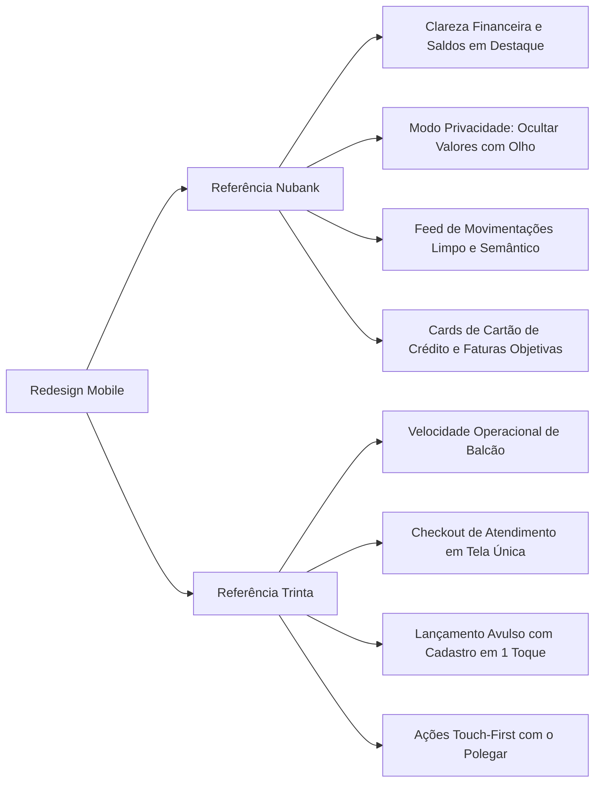
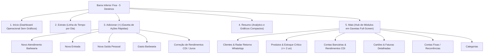
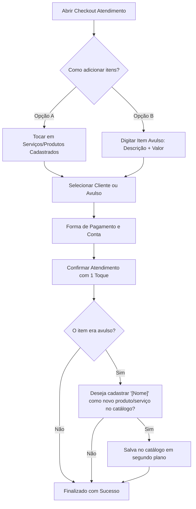

# Engenharia de Requisitos: Redesign Mobile do Sistema Financeiro e Barbearia

## 1. Visão Geral e Propósito do Produto

### 1.1. Missão da Versão Mobile
A versão mobile foi desenhada para ser a **ferramenta de uso diário, ágil e operacional**, enquanto a versão web de computador permanece como o ambiente executivo, analítico e de configurações profundas.
O usuário deve conseguir realizar as tarefas do dia a dia (lançar uma despesa na rua, fechar um corte de cabelo no balcão da barbearia, conferir o saldo bancário e consultar faturas) com o **mínimo de toques possíveis**, sem sobrecarga cognitiva ou telas lentas.

### 1.2. Pilares de Design (Nubank + Trinta)

---

## 2. Arquitetura da Navegação Mobile

A versão mobile oculta o cabeçalho superior de desktop (`Navbar` com logo, e-mail e logout) em telas móveis (`hidden md:block`), liberando 64px de área útil vertical.
A navegação e saída da conta ocorrem através de:
- **Barra de Navegação Inferior Fixa (Bottom Navigation)** com 5 destinos;
- **Botão de Logout Dedicado** na aba **Mais**, com limpeza completa de sessão e redirecionamento.

### 2.1. Cabeçalho Persistente (Header Mobile)
Presente no topo das telas mobile com comportamento contextual:
- **Aba Início (Home)**:
  - Alternador `[ 💈 Barbearia ] [ 👤 Pessoal ]` para adaptar instantaneamente indicadores e métricas.
  - **Modo Privacidade**: Ícone de olho (`Eye` / `EyeOff`) posicionado exclusivamente nesta tela para ocultar valores (`••••••`) ao usar o app em público.
  - Seletor estilizado touch de mês/ano.
- **Aba Extrato**:
  - Seletor touch de mês/ano em largura total limpa e sem botão de privacidade.
- **Aba Resumo**:
  - Seletor único no topo (`Semanal` | `Mensal` | `Anual`) em largura total, integrado à navegação temporal sem o botão de privacidade.

---

## 3. Especificação das 5 Telas Principais

### 3.1. Tela 1: Início (Dashboard Operacional Rápido)
- **100% Livre de Gráficos Pesados**: Carregamento instantâneo no 4G/5G.
- **No Modo Barbearia**:
  1. Card de **Faturamento do Mês** com Ticket Médio por atendimento.
  2. Card de **Clientes Atendidos** (total de atendimentos, clientes únicos e taxa de frequência).
  3. Card de **Lucro Líquido Real** (faturamento menos custos operacionais pagos, margem % e pendências).
  4. Botões de ação rápida de balcão: `[ Novo Atendimento ]` e `[ + Gasto Barbearia ]`.
  5. Card de **Divisão de Faturamento: Serviços vs. Produtos** com barra bipartida.
  6. Ranking dos **Top Clientes do Mês** (1º ao 5º).
  7. Alerta de **Retorno (+30 dias)** com botão de 1 clique para WhatsApp.
- **No Modo Pessoal**:
  1. Card de **Conta e Saldo Disponível**: Saldo consolidado e rendimento do mês (`+R$ XX este mês`), com atalhos de pílula (Extrato, Cartões, Bancos).
  2. Alerta de **Contas a Vencer**: Aparece somente se houver contas nos próximos dias, com botão direto "Pagar".
  3. Card de **Cartão de Crédito**: Fatura atual em roxo, barra de consumo do limite e limite disponível.
  4. Card de **Entradas vs Saídas**: Receitas recebidas vs Despesas pagas no período.
  5. **Últimas Movimentações**: Feed dos últimos 5 lançamentos com categoria, data e valor.

---

### 3.2. Tela 2: Extrato (Timeline Cronológica)
- **Agrupamento por Dia**: Cada grupo de data possui cabeçalho com o dia e o dia da semana (ex.: `22 de Outubro • Quinta-feira`).
- **Filtros Rápidos em Pílulas**: `[ Todos ]`, `[ Entradas ]`, `[ Saídas ]`, `[ Pessoal ]`, `[ Barbearia ]`, `[ Pendentes ]`.
- **Busca Rápida**: Campo de pesquisa textual por descrição ou notas.
- **Interação por Toque**: Ao tocar em qualquer transação, abre uma **Gaveta Inferior de Detalhes** com:
  - Descrição, valor formatado, categoria, conta/cartão de origem e status.
  - Ações imediatas: `[ Marcar como Pago / Pendente ]`, `[ Editar ]` e `[ Excluir ]`.

---

### 3.3. Ação 3: Adicionar (+) — Gaveta de Ações Rápidas
Ao tocar no botão central da barra inferior, abre uma gaveta fluida com 4 ações grandes:
1. **Novo Atendimento (Barbearia)** $\rightarrow$ Abre o Checkout Rápido da Barbearia.
2. **Nova Entrada (Receita)** $\rightarrow$ Abre o Cadastro Rápido de Movimentação em modo receita.
3. **Nova Saída (Despesa Pessoal)** $\rightarrow$ Abre o Cadastro Rápido em modo despesa pessoal.
4. **Gasto da Barbearia** $\rightarrow$ Abre o Cadastro Rápido pré-configurado no escopo da barbearia.

---

### 3.4. Tela 4: Resumo (Analytics e Gráficos Compactos)
Dedicada exclusivamente para quando o usuário deseja analisar o panorama gráfico:
- **Evolução Mensal**: Gráfico de barras ou linha fluido com receitas e despesas.
- **Distribuição por Categorias**: Donut compacto touch-friendly mostrando os maiores centros de custo.
- **Desempenho da Barbearia**: Gráfico de faturamento histórico e relação entre mão de obra vs produtos de prateleira.

---

### 3.5. Tela 5: Mais (Hub de Módulos em Gavetas Full-Screen)
Não altera a rota do navegador; cada módulo abre em uma **Gaveta de Tela Cheia com cabeçalho limpo e botão Fechar/Voltar**:
1. **Clientes & CRM**:
   - Radar de retorno com identificação de clientes "Na Janela" e "Atrasados".
   - Botão direto para WhatsApp com mensagem personalizada predefinida.
   - Lista touch de clientes com busca e histórico individual de atendimentos.
2. **Produtos & Estoque**:
   - **Alerta de Estoque Baixo no Topo**: Destaca itens com $\le 2$ unidades com botão de ajuste rápido.
   - Catálogo de serviços e produtos com preço de venda e custo.
3. **Contas Bancárias**:
   - Saldos por instituição (Nubank, Inter, Caixa, Carteira).
   - Rendimentos acumulados e projeção CDI.
   - Botão de ajuste de saldo base.
4. **Cartões de Crédito**:
   - Cartões visuais realistas (faturas abertas e fechadas, limites e compras parceladas).
5. **Recorrências & Categorias**:
   - Contas fixas mensais e gestão de categorias com cores e ícones.

---

## 4. Requisitos Especiais de Alto Impacto (UX Trinta & Balcão)

### 4.1. Checkout de Atendimento em Tela Única com Item Avulso Inteligente

#### Regras de Negócio do Checkout:
1. **Campo de Descrição Condicional**:
   - Se **nenhum** produto/serviço cadastrado for selecionado, o campo de descrição se torna **obrigatório**, junto com o valor numérico.
   - Se itens cadastrados forem selecionados, o campo de descrição se torna **opcional** (usado para anotações do corte).
2. **Pós-Venda com Cadastro em 1 Toque**:
   - Quando um item avulso é digitado (ex.: "Platinado Especial - R$ 120,00"), após a confirmação da venda uma caixa discreta pergunta:
     > *"Deseja cadastrar 'Platinado Especial' como um novo serviço para os próximos atendimentos?"*
   - Com 1 toque, o barbeiro adiciona o item ao catálogo sem precisar parar o atendimento no balcão.

### 4.2. Cadastro Rápido de Movimentação com "Salvar e Adicionar Outra"
- Ao abrir o formulário, o cursor foca imediatamente no valor com teclado numérico.
- Padrões inteligentes: data de hoje preenchida, sugestão da última conta e categoria usadas.
- **Dois Botões de Ação**:
  - `[ Salvar ]`: Registra e fecha a gaveta com toast de sucesso.
  - `[ Salvar e Adicionar Outra ]`: Registra no banco, limpa o valor e mantém a gaveta aberta, permitindo lançar múltiplos recibos rapidamente.

---

## 5. Plano de Implementação em Fases

| Fase | Foco | Entregáveis |
| :---: | :--- | :--- |
| **Fase 1** | **Barra Inferior & Header Persistente** | Nova `MobileBottomNav` (5 abas), header com seletor de contexto persistente e modo privacidade (`Eye`/`EyeOff`). |
| **Fase 2** | **Ação Central (+) & Cadastro Rápido** | Bottom sheet de ações rápidas com formulário inteligente de receitas/despesas e botão "Salvar e Adicionar Outra". |
| **Fase 3** | **PDV Mobile Inteligente** | Checkout em tela única com suporte a itens avulsos e prompt pós-venda para cadastrar no catálogo. |
| **Fase 4** | **Extrato Mobile & Resumo** | Timeline de transações agrupada por dia com gaveta de detalhes, mais aba Resumo com gráficos compactos. |
| **Fase 5** | **Área Mais (Drawers Full-Screen)** | Gavetas de Clientes (Radar WhatsApp), Produtos (Estoque crítico $\le 2$), Contas e Cartões. |
| **Fase 6** | **Polimento e Testes** | Validação com Vitest, verificação touch com uma mão, compatibilidade PWA e build de produção. |

---

## 6. Otimizações Extremas de Performance Mobile (Gargalos 1 a 10)

Para garantir velocidade instantânea e fluidez nativa no celular, foram implementadas as seguintes correções arquiteturais:

1. **Eliminação de Fetch Duplicado Inicial**: `page.tsx` agora busca `getTransactions` em paralelo no SSR e repassa `initialTransactions`. `DashboardView` não refaz requisições na montagem.
2. **Desbloqueio do Caminho Crítico**: A sincronização do mês seguinte (`syncMonthlyRecurrences`) roda em background de forma assíncrona, eliminando atrasos no TTFB do mês atual.
3. **Atualização Otimista & Refresh Inteligente**: O estado de contas a pagar e a receber é atualizado no cliente instantaneamente, e o cache por mês é mantido sincronizado.
4. **Cálculos e Visões Prioritárias**: Separação de escopo e montagem sob demanda dos componentes de Barbearia vs Geral.
5. **Cache em Memória por Mês & Prefetch**: Navegação entre meses visitados em **0ms** via `cacheRef`. Pré-busca automática em background do mês anterior durante ociosidade da CPU.
6. **Code-Splitting e Dynamic Imports**: Gavetas e modais pesados (`QuickActionDrawer`, `MobileNewSaleDrawer`, `MobileYieldCorrectionModal`, `MobileSummaryView`, `MobileStatementView`, `MobileMoreView`) são carregados com `dynamic({ ssr: false })` apenas quando disparados.
7. **Detecção Mobile no Servidor (Zero CLS)**: `useIsMobile(768, initialIsMobile)` com detecção de User-Agent no servidor, eliminando o flash de renderização de desktop e o re-render de hidratação.
8. **Abertura Instantânea do Botão (+) (0ms)**: Módulo `client-cache.ts` com dados pré-carregados (contas, cartões, categorias, produtos e clientes) em memória, sem telas de carregamento nos modais.
9. **Middleware Leve**: O `middleware.ts` verifica a presença de cookies de autenticação antes de invocar a API de rede do Supabase, liberando assets públicos e rotas não autenticadas imediatamente.
10. **Pré-busca de Navegação do Hub Mobile**: Links do menu "Mais" e rotas do `BottomNav` utilizam `prefetch={true}`, eliminando atrasos de navegação entre módulos.
11. **Resiliência de Estado no Retorno & Botão Voltar**: O estado de "Abrindo..." é limpo automaticamente ao navegar de volta para o dashboard ou alternar páginas (`popstate`, `pageshow`, timeout de segurança). O botão de retorno nos módulos secundários exibe apenas `[ < Voltar ]` sem poluição textual.
