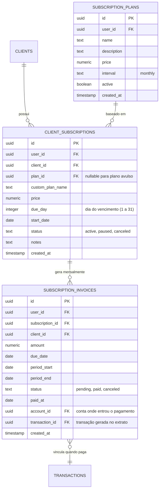
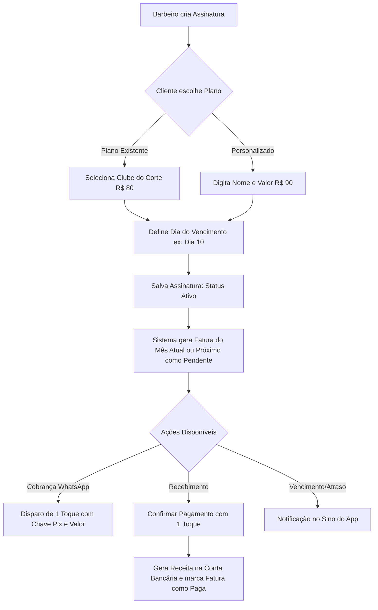

# Engenharia de Requisitos: Assinaturas e Mensalidades Recorrentes (Clube da Barbearia)

## 1. Visão Geral e Objetivos

O objetivo deste módulo é permitir que a barbearia crie e gerencie **planos de assinatura recorrente** (ex: *Clube do Corte R$ 80/mês*, *VIP Barba & Cabelo R$ 130/mês*) ou mensalidades avulsas vinculadas a clientes.

A funcionalidade automatiza:
1. **Cadastro e Gestão de Planos & Assinaturas:** Planos pré-configurados com suporte a valor personalizado por cliente e dia de vencimento fixo (ex: todo dia 05, 10, etc.).
2. **Ciclo Financeiro com Cobrança Pendente:** A cada ciclo/mês, o sistema gera a fatura da mensalidade como **Pendente** no dia do vencimento. O barbeiro dá baixa com **1 clique**, escolhendo a conta de destino, convertendo em receita confirmada.
3. **Lembrete de Cobrança WhatsApp (1 Toque):** Botão direto para enviar mensagem formatada via WhatsApp com o nome do cliente, plano, valor, data de vencimento e chave Pix cadastrada da barbearia.
4. **Integração com Notificações do App:** Alerta visual no sino de notificações quando houver mensalidades a vencer hoje ou em atraso.
5. **Acesso Fácil:** Integrado diretamente na tela de **Clientes (`/clientes`)** através de uma aba "Assinaturas" e também como opção recorrente no **Modal de Nova Venda**.

---

## 2. Modelo de Dados

### 2.1 Tabelas no Supabase

1. **`subscription_plans`**:
   - `id` (UUID, PK)
   - `user_id` (UUID, FK auth.users)
   - `name` (TEXT, ex: "Clube do Corte Semanal")
   - `description` (TEXT)
   - `price` (NUMERIC(10,2))
   - `interval` (TEXT, default `'monthly'`)
   - `active` (BOOLEAN, default `true`)
   - `created_at` (TIMESTAMPTZ)

2. **`client_subscriptions`**:
   - `id` (UUID, PK)
   - `user_id` (UUID, FK auth.users)
   - `client_id` (UUID, FK `clients(id)`)
   - `plan_id` (UUID, FK `subscription_plans(id)`, opcional/nullable)
   - `custom_plan_name` (TEXT)
   - `price` (NUMERIC(10,2))
   - `due_day` (INTEGER, 1-31)
   - `start_date` (DATE)
   - `status` (TEXT: `'active'`, `'paused'`, `'canceled'`)
   - `notes` (TEXT)
   - `created_at` (TIMESTAMPTZ)

3. **`subscription_invoices`** (As faturas/mensalidades de cada mês):
   - `id` (UUID, PK)
   - `user_id` (UUID, FK auth.users)
   - `subscription_id` (UUID, FK `client_subscriptions(id)`)
   - `client_id` (UUID, FK `clients(id)`)
   - `amount` (NUMERIC(10,2))
   - `due_date` (DATE)
   - `period_start` (DATE)
   - `period_end` (DATE)
   - `status` (TEXT: `'pending'`, `'paid'`, `'canceled'`)
   - `paid_at` (DATE)
   - `account_id` (UUID, FK `accounts(id)`, quando pago)
   - `transaction_id` (UUID, FK `transactions(id)`, transação de receita gerada no extrato quando pago)
   - `created_at` (TIMESTAMPTZ)

---

## 3. Fluxo Operacional e Casos de Uso

### Caso de Uso 1: Cadastrar Nova Assinatura
- O barbeiro pode cadastrar uma assinatura de duas formas:
  1. Na aba **Assinaturas** em `/clientes`, clicando em `+ Nova Assinatura`.
  2. No **Modal de Nova Venda**, marcando a opção `"Tornar Venda Recorrente / Mensalidade"`, selecionando o cliente e o plano.
- Define o dia de vencimento (1 a 31).
- O sistema gera automaticamente a fatura inicial.

### Caso de Uso 2: Acompanhamento de Assinaturas (CRM de Clientes)
- Na aba **Assinaturas** em `/clientes`, são exibidos cards/linhas dos clientes com assinatura:
  - Nome do Cliente e Telefone.
  - Plano e Valor mensal.
  - Dia do vencimento.
  - **Status da Mensalidade Atual**:
    - 🟢 **Em dia / Paga**: Mensalidade do mês quitada.
    - 🟡 **Pendente / A vencer**: Vence nos próximos dias ou hoje.
    - 🔴 **Em atraso**: Venceu e ainda não foi paga.
  - Ações rápidas:
    - **Confirmar Recebimento** (abre diálogo rápido para escolher conta de depósito e data).
    - **Lembrar no WhatsApp** (abre conversa com texto e Pix formatados).
    - **Pausar / Cancelar Assinatura**.

### Caso de Uso 3: Cobrança via WhatsApp
- Template inteligente integrado ao `business_message_settings`:
  > *"Olá, {nome}! Tudo bem? Passando para lembrar da sua mensalidade da barbearia ({plano}) no valor de R$ {valor}, com vencimento em {vencimento}. Para pagar via Pix, utilize nossa chave: {pix}. Qualquer dúvida estamos à disposição! 💈✂️"*
- Se o barbeiro configurou a chave Pix nas configurações de mensagem, a chave é preenchida automaticamente.

### Caso de Uso 4: Geração Automática das Faturas dos Ciclos
- Ao carregar a tela de assinaturas ou via rotina diária:
  - O sistema verifica todas as assinaturas ativas (`status = 'active'`).
  - Se a assinatura não possui fatura para o mês corrente, cria a fatura com `status = 'pending'`.
- Gera notificação no sistema quando houver faturas com vencimento para o dia atual ou faturas em atraso.

---

## 4. Telas e Componentes

1. **Aba "Assinaturas" em `/clientes`:**
   - Resumo no topo:
     - Total de Assinantes Ativos.
     - Receita Recorrente Mensal (MRR).
     - Mensalidades Pendentes / Em Atraso no mês.
   - Botão para gerenciar "Planos de Assinatura" (criar/editar planos).
   - Tabela / Cards mobile com status de pagamento de cada assinante, atalho para WhatsApp e confirmação de baixa.
2. **Modal `SubscriptionModal.tsx`:**
   - Seleção de Cliente (com busca rápida).
   - Seleção de Plano ou Valor customizado.
   - Dia de vencimento.
   - Data de início.
3. **Modal `SubscriptionPlanModal.tsx`:**
   - Nome do plano, descrição e valor mensal padrão.
4. **Integração no `SaleModal.tsx`:**
   - Opção para converter a venda em assinatura recorrente vinculada ao cliente selecionado.

---

## 5. Próximos Passos (Após Aprovação)

1. Criar migration SQL: `subscription_plans`, `client_subscriptions`, `subscription_invoices` com políticas RLS.
2. Criar Server Actions em `src/lib/actions/subscriptions.ts`.
3. Adicionar template de mensagem WhatsApp para mensalidade em `src/lib/whatsapp.ts`.
4. Implementar UI da aba de Assinaturas em `src/app/(dashboard)/clientes/page.tsx` (responsiva Web + Mobile).
5. Adicionar verificação de cobranças recorrentes nas notificações automáticas do sistema.
6. Executar suíte de testes unitários (`npm test`) e lint (`npm run lint`).
7. Commit em português (pt-BR).
