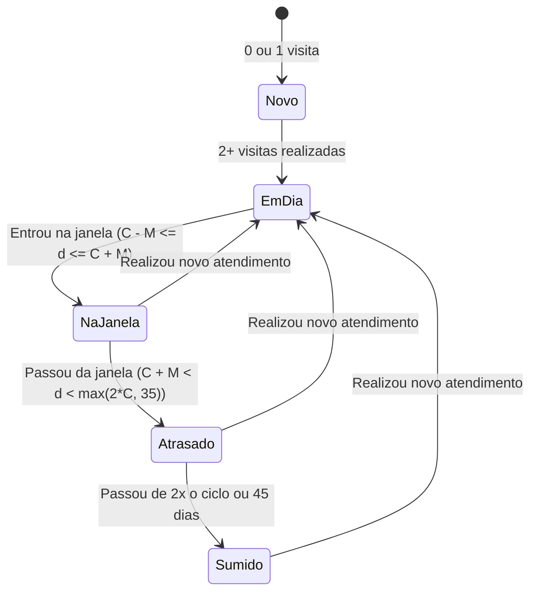

# Documento de Engenharia de Requisitos (SRS)
## Módulo de Inteligência de Clientes & Previsão de Retorno

---

## 1. Visão Geral & Premissas do Produto

O objetivo desta evolução na guia de **Clientes** ([`/clientes`](file:///home/alexandrerangel/Projetos/financeiro-app/src/app/clientes/page.tsx)) é transformar uma lista estática de contatos em um **motor inteligente de retenção e previsibilidade de caixa** para a barbearia, sem adicionar burocracia ao cadastro.

### 1.1 Premissas Fundamentais
* **Zero Cadastro Manual de Ciclo:** O barbeiro não precisa preencher "de quantos em quantos dias o cliente corta". O sistema aprende sozinho a partir das datas reais na tabela `sales`.
* **Reconhecimento de Padrão Semanal:** Todo cliente tem hábitos (ex: corta sempre na sexta à tarde ou no sábado de manhã). O sistema analisa o histórico e destaca os **dias da semana mais prováveis** de cada cliente.
* **Status Relativo ao Próprio Cliente:** Um cliente que corta toda semana (ciclo de 7 dias) e fica 16 dias sem vir já está **Sumido**; já um cliente que corta a cada 30 dias está **Em Dia** aos 16 dias. As etiquetas respeitam o ritmo individual de cada pessoa.
* **Nenhuma Mudança Obrigatória no Schema do Banco:** Todos os cálculos preditivos usam os registros já existentes em `clients`, `sales` e `sale_items`, mantendo compatibilidade imediata com os dados em produção.

---

## 2. Regras de Negócio & Algoritmos Preditivos

### 2.1 Cálculo do Ciclo de Retorno Individual
Para cada cliente, ordenamos seus atendimentos (`sales`) por data (`sale_date`) de forma crescente, consolidando atendimentos do mesmo dia como uma única visita:

1. **Clientes com $\ge 2$ visitas em dias distintos:**
   * Calculamos os intervalos em dias entre visitas consecutivas: $\Delta_i = \text{data}_{i} - \text{data}_{i-1}$.
   * Descartamos outliers extremos ($\Delta_i > 120$ dias) caso existam intervalos regulares menores, ou usamos a **média ponderada** dando maior peso aos últimos 4 intervalos para refletir o hábito atual do cliente.
   * O ciclo estimado em dias é $C = \text{round}(\bar{\Delta})$, limitado ao intervalo mínimo de $5$ dias e máximo de $90$ dias.
2. **Clientes com apenas $1$ visita:**
   * Sem ciclo calculado (*"1º atendimento (aguardando 2ª visita)"*). Não entram no Radar de Retorno nem nos alertas de clientes inativos até acumularem histórico de frequência real ($\ge 2$ atendimentos).
3. **Clientes com $0$ visitas:**
   * Sem ciclo calculado (*"Sem atendimentos"*).

### 2.2 Janela Prevista de Atendimento
A partir da data da última visita ($D_{\text{última}}$) e do ciclo do cliente ($C$):
* **Data Central Prevista:** $D_{\text{prev}} = D_{\text{última}} + C\text{ dias}$.
* **Margem da Janela ($M$):** $\max(2, \min(5, \text{round}(C \times 0.15)))$ dias (ex: para um ciclo de 20 dias, a margem é de $\pm 3$ dias).
* **Intervalo da Janela:** de $(D_{\text{prev}} - M)$ até $(D_{\text{prev}} + M)$.
  * *Exemplo visual:* `"A cada ~20 dias • Janela: 22/10 a 28/10"`.

### 2.3 Dias da Semana Mais Prováveis
* Contabilizamos o dia da semana (`Dom` a `Sáb`, no fuso `America/Sao_Paulo`) de todas as visitas do cliente.
* Extraímos os **até 2 dias da semana mais frequentes** (desde que representem pelo menos 25% das visitas).
* *Exemplo visual:* `"Costuma vir: Sex / Sáb"` ou `"Costuma vir: Ter"`.

### 2.4 Máquina de Estados: Etiquetas / Status do Cliente
Seja $d$ o número de dias corridos desde a última visita ($d = \text{Hoje} - D_{\text{última}}$):

| Status | Critério | Cor / Estilo | Ação Sugerida |
| :--- | :--- | :--- | :--- |
| **Na Janela** | $C - M \le d \le C + M$ ($\ge 2$ visitas) | Esmeralda / Verde Pulsante | Esperado nos próximos dias |
| **Atrasado** | $C + M < d < \max(2C, 35)$ ($\ge 2$ visitas) | Âmbar / Amarelo | Lembrete amigável no WhatsApp |
| **Sumido** | $d \ge \max(2C, 45)$ ($\ge 2$ visitas) | Rosa / Vermelho | Mensagem de reativação |
| **Em Dia** | $d < C - M$ ($\ge 2$ visitas) | Azul | Dentro do ciclo normal |
| **Novo** | $0$ ou $1$ visita | Zinco / Neutro | Fidelizar no próximo retorno |
| **VIP** *(Badge extra)* | $\ge 5$ visitas ou Top 20% faturamento | Roxo / Dourado | Cliente de alto valor |

---

## 3. Requisitos Funcionais (RF)

### 3.1 Radar de Retorno no Topo da Página
* **RF-C01 (Painel "Na Janela & Atrasados"):** Acima da tabela principal, exibir um painel compacto e acionável listando os clientes que estão **Na Janela** (previstos para voltar agora) e os **Atrasados**, destacando:
  * Nome do cliente e etiqueta de status.
  * Dias da semana em que costuma vir (ex: *"Sex / Sáb"*).
  * Janela de datas prevista (ex: *"22/10 – 26/10"* ou *"Passou 4 dias do ciclo de 15d"*).
  * Botão de 1 clique para WhatsApp com mensagem contextual pronta e botão de **Novo Atendimento**.

### 3.2 Filtros Rápidos e Ordenação Avançada
* **RF-C02 (Pílulas de Filtro por Status):**
  * `Todos`, `Na Janela`, `Atrasados`, `Sumidos`, `Em Dia`, `VIPs`, `Novos`.
  * Cada pílula exibe o contador de clientes naquele estado (ex: `Na Janela (4)`).
* **RF-C03 (Seletor de Ordenação):**
  * **Prioridade de Retorno** *(Padrão inteligente: Na Janela $\rightarrow$ Atrasados $\rightarrow$ Em Dia $\rightarrow$ Sumidos)*.
  * **Maior Valor Gasto (VIP)**.
  * **Mais Atendimentos**.
  * **Última Visita (Mais recente / Mais antiga)**.
  * **Ordem Alfabética (A–Z)**.

### 3.3 Tabela Enriquecida de Clientes
* **RF-C04 (Colunas de Inteligência):**
  * **Cliente:** Avatar, Nome, Badge `VIP` (se aplicável), Status (`Na Janela`, `Atrasado`, `Sumido`, `Em Dia`, `Novo`) e Observação.
  * **Ciclo & Provável Retorno:** Exibe o intervalo médio (ex: `A cada ~18 dias`), a janela prevista (`24/10 a 28/10`) e os dias da semana mais prováveis (`Sex • Sáb`).
  * **Atendimentos & Ticket:** Quantidade de visitas, total gasto e média por visita.
  * **Última Visita:** Data formatada + contador relativo (`há 16 dias`).
  * **Ações Rápidas:** Abrir Histórico/Ficha, WhatsApp contextual, Novo Atendimento, Editar, Excluir.

### 3.4 Modal / Gaveta de Histórico Completo do Cliente
* **RF-C05 (Ficha Detalhada ao Clicar no Cliente):**
  * **Cabeçalho:** Nome, telefone, etiquetas (`VIP`, status atual), botão **Novo Atendimento** (redireciona para `/vendas?clientId=...` já pré-selecionando o cliente) e botão **WhatsApp**.
  * **Cards de Inteligência Pessoal:**
    1. *Ciclo Médio & Janela:* ex. `~18 dias (Próx: 24/10 - 28/10)`.
    2. *Dias Preferidos:* ex. `Sexta e Sábado`.
    3. *Serviços Mais Pedidos:* Top 3 itens consumidos pelo cliente (ex: `Corte (8x), Barba (5x)`).
    4. *Resumo Financeiro:* Total investido na barbearia e ticket médio.
  * **Linha do Tempo de Atendimentos:** Lista cronológica de todas as vendas daquele cliente, mostrando data/hora, itens detalhados (`1x Corte, 1x Sobrancelha`), forma de pagamento (`Pix`, `Dinheiro`, etc.) e valor total.

---

## 4. Arquitetura Técnica & Testes

1. **Módulo Puro de Inteligência (`src/lib/client-analytics.ts`):**
   * Funções puras e determinísticas para cálculo de ciclo médio, janela prevista, dias da semana prováveis, classificação de status e serviços favoritos.
   * 100% coberto por testes unitários no **Vitest** (`src/lib/client-analytics.test.ts`).
2. **Server Action `getClients` enriquecida (`src/lib/actions/clients.ts`):**
   * Busca `clients` com join em `sales(id, total_amount, sale_date, payment_method, notes, items:sale_items(product_name, quantity, unit_price, total_price))` e processa as métricas analíticas no servidor usando o fuso `America/Sao_Paulo`.
3. **Pré-seleção de Cliente em `/vendas`:**
   * Suporte ao parâmetro `?clientId=` na tela de vendas para abrir o modal de Novo Atendimento já com o cliente vinculado.
