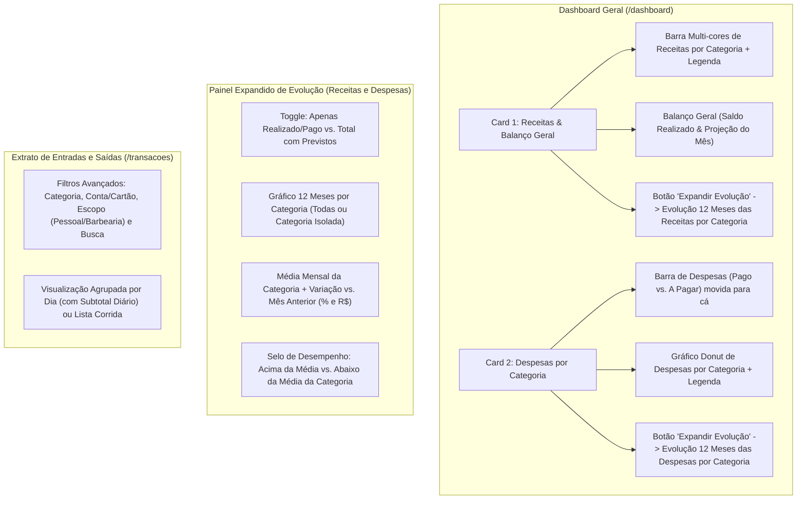

# 📊 Engenharia de Requisitos — Receitas, Despesas & Evolução por Categorias

Documento atualizado exatamente com as suas escolhas do questionário.

---

## 1. Visão Geral das Mudanças

---

## 2. Requisitos Funcionais Detalhados

### RF01 — Reformulação dos 2 Cards no Dashboard Geral ([`MonthlyBarChart.tsx`](file:///home/alexandrerangel/Projetos/financeiro-app/src/components/dashboard/MonthlyBarChart.tsx) e [`CategoryDonutChart.tsx`](file:///home/alexandrerangel/Projetos/financeiro-app/src/components/dashboard/CategoryDonutChart.tsx))

1. **Card 1 (Esquerda) — "Receitas & Balanço Geral":**
   - Mantém a barra multi-cores de **Composição das Receitas por Categoria** (`% recebido`, valor por categoria e valor a receber).
   - Mantém o rodapé de **Balanço Geral** (**Saldo Atual Realizado** e **Projeção Final do Mês**).
   - **Remove** a barra de Despesas daqui (que passa para o Card 2).
   - Adiciona em cada categoria de receita o indicador rápido se está **Acima ou Abaixo da Média** mensal daquela categoria.
   - Adiciona o botão **"Expandir Evolução"** para abrir a visão histórica de 12 meses das Receitas por Categoria.

2. **Card 2 (Direita) — "Despesas por Categoria":**
   - **Recebe a Barra de Despesas (`Pago` vs. `A Pagar`)** logo acima do gráfico Donut, unificando toda a análise gráfica de saídas em um único lugar.
   - Mantém o **Gráfico Donut** e a lista de categorias de despesa com valor e `%`.
   - Adiciona em cada categoria de despesa o indicador rápido se está **Acima ou Abaixo da Média** mensal daquela categoria.
   - Adiciona o botão **"Expandir Evolução"** para abrir a visão histórica de 12 meses das Despesas por Categoria.

---

### RF02 — Expansão da Evolução Anual por Categoria (Receitas e Despesas)

Ao clicar em **"Expandir Evolução"** em qualquer um dos dois cards (**Receitas** ou **Despesas**):
- **Alternador de Contabilização:**
  - `Apenas Realizado / Pago` vs. `Total (com Pendentes / Previstos)`.
- **Gráfico de Evolução 12 Meses (`Jan` a `Dez`):**
  - Exibe as curvas de evolução das categorias ao longo do ano.
  - Permite clicar nos chips das categorias para **isolar uma categoria específica** (ex: ver apenas a curva de *Barbearia*, *Investimentos*, *Alimentação* ou *Insumos*) ou **comparar todas**.
- **Tabela / Cards de Diagnóstico de Média e Tendência por Categoria:**
  - Para cada categoria (tanto de Receita quanto de Despesa), calcula e exibe:
    1. **Valor no Mês Atual (`R$`)** e participação (`%`).
    2. **Média Mensal da Categoria no Ano (`R$/mês`)** (calculada sobre os meses com movimentação ou até o mês atual).
    3. **Status vs. Média da Categoria:**
       - Nas **Receitas**: estar **Acima da Média** é destacado em verde (`▲ +18% acima da média`); **Abaixo da Média** em âmbar (`▼ -12% abaixo da média`).
       - Nas **Despesas**: estar **Acima da Média** alerta em rosa/âmbar (`▲ +25% acima da média`); **Abaixo da Média** destaca economia em verde (`▼ -14% abaixo da média`).
    4. **Variação vs. Mês Anterior:** diferença em `%` e em `R$` comparada ao mês imediatamente anterior.
    5. **Acumulado no Ano (`R$`)**.

---

### RF03 — Extrato Expandido com Filtros Avançados e Agrupamento Diário ([`TransactionsView.tsx`](file:///home/alexandrerangel/Projetos/financeiro-app/src/components/transactions/TransactionsView.tsx))

Na guia **Transações (`/transacoes`)**:
- **Barra de Busca e Filtros Combinados:**
  - **Busca textual** por descrição ou observação.
  - **Seletor de Categoria** (filtra entradas ou saídas de uma categoria específica).
  - **Seletor de Conta Bancária / Cartão de Crédito**.
  - **Filtros rápidos de Tipo/Escopo:** `Todos`, `✂️ Barbearia`, `Pessoal`, `Receitas`, `Despesas`, `Cartão`, `Pendentes`.
- **Alternador de Visualização da Lista:**
  - **Agrupado por Dia (Padrão):** agrupa os lançamentos por data (`Hoje`, `Ontem`, `18 de Outubro...`) exibindo no cabeçalho de cada dia o **Subtotal do Dia** (`+R$ Entradas`, `-R$ Saídas` e saldo líquido do dia).
  - **Lista Corrida:** visualização linear compacta.
- **Resumo Dinâmico do Filtro:** quando um filtro (ex: uma categoria específica) estiver ativo, exibe a participação e o total daquele filtro no topo.
