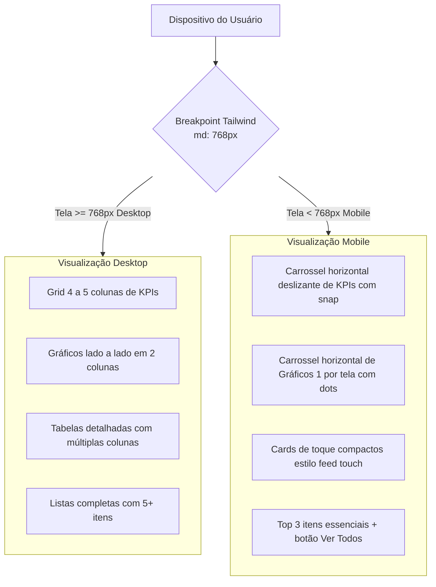

# Engenharia de Requisitos: Visualização Adaptativa Web vs Mobile

## 1. Visão Geral e Contexto
O aplicativo financeiro expandiu com dashboards ricos em indicadores (pessoal e barbearia), CRM de retenção com WhatsApp, gráficos de evolução por período (mensal, anual, semanal), divisão de produtos vs serviços, faturas de cartões e extratos bancários.
No computador (desktop/web), essa densidade de informação proporciona uma visão panorâmica e executiva. Porém, em dispositivos móveis (smartphones), a quantidade excessiva de gráficos verticais e tabelas densas gera sobrecarga visual e fadiga de scroll.

Este documento define a especificação completa de separação das visualizações **Web (Desktop)** e **Mobile (Touch-first)** para todo o aplicativo.

---

## 2. Decisões de Escopo e Design (Aprovadas)

### 2.1. Escopo Abrangente
A diferenciação se aplica a todas as áreas-chave do sistema:
1. **Dashboard da Barbearia** (Faturamento, Gastos, Lucro Real, Clientes, Divisão de Receita, Retenção, Top Clientes).
2. **Dashboard Pessoal** (Saldo Total, Entradas, Saídas, Projeção do Mês, Rendimentos, Gráficos de Evolução e Categorias).
3. **Extrato de Transações** (Filtros compactos, lista agrupada por data em formato de cards touch).
4. **CRM de Clientes** (Cards rápidos de clientes, atalho para WhatsApp, métricas resumidas).
5. **Contas e Cartões** (Carrossel de faturas e saldos bancários).

---

## 3. Especificações Técnicas por Módulo

### 3.1. Dashboards (Geral e Barbearia)

#### A. Cards de KPIs de Topo
- **Desktop (`md:grid`)**: Grid de 4 a 5 colunas estático (`grid-cols-2 md:grid-cols-4 lg:grid-cols-5`).
- **Mobile (`md:hidden`)**: 
  - Carrossel horizontal deslizável com `flex overflow-x-auto snap-x snap-mandatory scrollbar-none gap-3 pb-2`.
  - Cards com largura fixa proporcional (`w-[82vw] sm:w-[320px] shrink-0 snap-center`).
  - Indicadores de paginação por pontos discretos (dots) ou barra de progresso suave indicando que há mais cards para o lado.

#### B. Seção de Gráficos Analíticos
- **Desktop (`md:grid`)**: 2 colunas (`grid-cols-1 lg:grid-cols-2`) exibindo evolução de receitas/despesas, donut de categorias, ticket médio ou serviços vs produtos.
- **Mobile (`md:hidden`)**:
  - Carrossel horizontal deslizante com navegação por abas/dots no topo:
    - Slide 1: Gráfico de Evolução (SmoothLine / Linhas fluidas).
    - Slide 2: Gráfico de Distribuição (Categorias / Donut ou Serviços vs Produtos).
  - Cada gráfico ocupa 100% da largura útil da tela do smartphone, sem espremer legendas nem cortar rótulos do eixo X.

#### C. Listas e Rankings (Top Clientes, Retenção, Lançamentos Recentes)
- **Desktop**: Tabelas completas com cabeçalho (`th`), 4 colunas (`Cliente`, `Visitas`, `Total Gasto`, `Última Visita`).
- **Mobile**:
  - Cards estilo feed/lista touch-friendly.
  - Exibição focada nos **Top 3** itens principais.
  - Informações empilhadas em linha dupla (Nome + Tag de frequência na linha 1; Total em R$ e Data na linha 2).
  - Botão de rodapé "Ver todos no CRM" / "Ver extrato completo".

---

### 3.2. Painel de Retenção (Atenção: Clientes para Retorno)
- **Desktop**: Grid de 5 colunas compactas com botões de WhatsApp horizontais.
- **Mobile**: Carrossel horizontal touch ou mini-cards verticais com botão de 1 toque de WhatsApp proeminente e fácil de clicar com o polegar.

---

### 3.3. Extrato de Transações
- **Desktop**: Tabela densa de extrato com busca, múltiplos filtros de categoria/status/conta e paginação.
- **Mobile**:
  - Barra de pesquisa rápida com gaveta (bottom sheet / dropdown) de filtros avançados para não ocupar meia tela com selects.
  - Itens de transação em formato de linhas touch compactas com ícone da categoria, descrição, valor com cor semântica (verde/vermelho) e status de confirmação.

---

## 4. Plano de Implementação por Fases

| Fase | Foco | Ações Principais |
| :---: | :--- | :--- |
| **Fase 1** | **Dashboards (Barbearia & Geral)** | Implementar carrossel horizontal de KPIs com snap + carrossel horizontal de gráficos 1 por tela + cards touch para Top Clientes e Retenção. |
| **Fase 2** | **Contas e Cartões** | Carrossel touch de cartões de crédito e faturas; cartões de saldo bancário compactos. |
| **Fase 3** | **Extrato de Transações** | Agrupamento touch de transações e filtros em gaveta/modal compacto. |
| **Fase 4** | **CRM de Clientes & PDV** | Ajuste fino do PDV e lista de clientes para toque com uma mão no balcão. |
| **Fase 5** | **Testes e Validação** | Testes no Vitest, verificação de responsividade (viewport de 360px a 1440px), build de produção. |

---

## 5. Critérios de Aceitação
1. Em telas menores que 768px (iPhone, Android), a página não deve exigir scroll horizontal descontrolado de toda a página (apenas carrosséis internos controlados com snap).
2. Não deve haver queda de performance nem re-renderizações desnecessárias: a adaptação deve usar classes utilitárias CSS nativas do Tailwind (`hidden md:block`, `md:hidden`, `snap-x`, etc.).
3. A experiência desktop permanece 100% rica, ampla e inalterada para quem acessa pelo computador.
