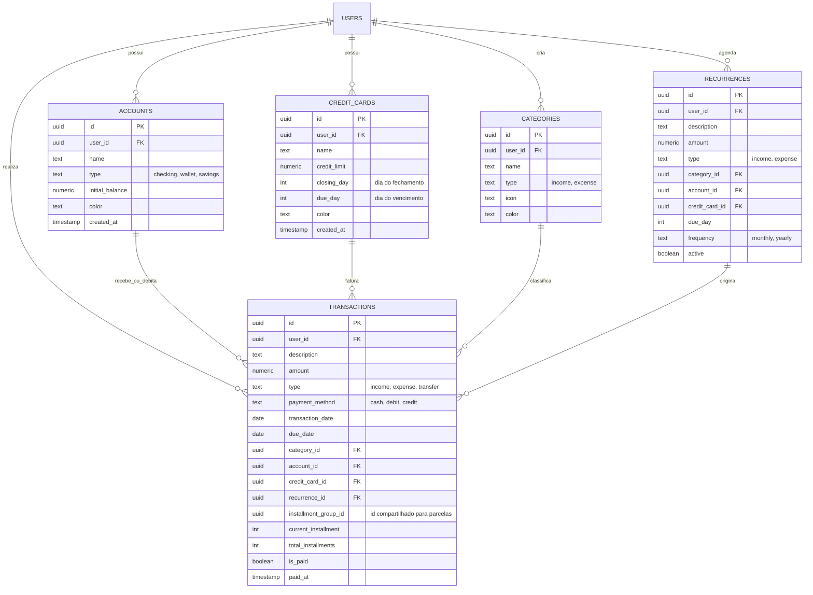
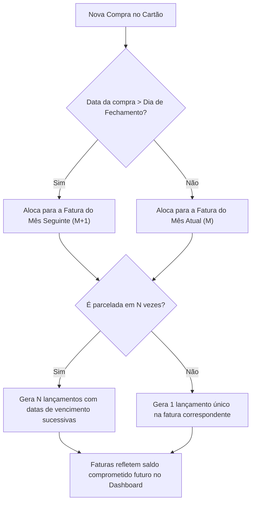

# Documento de Engenharia de Requisitos (SRS)
## Aplicativo de Gestão Financeira Pessoal

---

## 1. Visão Geral do Produto
O aplicativo é uma solução de **finanças pessoais individuais**, focada em oferecer rapidez no lançamento de despesas diárias, clareza visual dos gastos por categorias, acompanhamento inteligente de faturas de cartões de crédito (com parcelamentos automáticos) e previsibilidade através de despesas recorrentes e fixas.

### 1.1 Objetivos de Negócio e de Usuário
* **Rapidez de Entrada:** Permitir o registro de uma despesa em menos de 10 segundos no smartphone.
* **Previsibilidade:** Saber exatamente quanto já está comprometido nos próximos meses em compras parceladas e contas fixas.
* **Visibilidade Consolidada:** Visão unificada de saldo disponível, total de faturas a vencer e economia no mês.
* **Segurança e Privacidade:** Dados isolados por usuário via Row Level Security (RLS) no PostgreSQL/Supabase.

---

## 2. Requisitos Funcionais (RF)

### Módulo A: Contas e Saldo
* **RF-01 (Cadastro de Contas):** O usuário pode cadastrar contas (ex: Carteira/Dinheiro, Conta Corrente Nubank, Conta Itaú) com nome, saldo inicial e cor/ícone.
* **RF-02 (Cálculo de Saldo Dinâmico):** O saldo da conta deve ser calculado com base no saldo inicial somado às receitas consolidadas e subtraído das despesas pagas associadas àquela conta.
* **RF-03 (Transferência entre Contas):** Permitir transferir valores entre contas cadastradas sem duplicar o lançamento de despesa no balanço geral.

### Módulo B: Cartões de Crédito e Faturas
* **RF-04 (Cadastro de Cartões):** O usuário pode cadastrar cartões com nome, limite total, dia de fechamento e dia de vencimento.
* **RF-05 (Cálculo de Ciclo de Fatura):**
  * Toda compra no cartão é atribuída à fatura aberta correspondente.
  * Se a compra for feita *após* a data de fechamento, é alocada automaticamente para a fatura do mês seguinte (melhor dia de compra).
* **RF-06 (Compras Parceladas Automáticas):**
  * Ao lançar uma compra parcelada (ex: R$ 600 em 6x de R$ 100), o sistema gera automaticamente os 6 lançamentos vinculados às faturas dos meses subsequentes.
  * Cada parcela deve exibir o indicador visual `(X/Y)` (ex: Parcela 2/6).
* **RF-07 (Pagamento/Fechamento de Fatura):** O usuário pode visualizar a fatura por mês e marcá-la como "Paga", selecionando de qual conta sairá o débito do pagamento.

### Módulo C: Transações e Categorias
* **RF-08 (Tipos de Transação):** Suporte para Receita, Despesa (Débito/Dinheiro) e Despesa de Cartão de Crédito.
* **RF-09 (Categorização):** Transações possuem categorias pré-cadastradas e customizáveis (ex: Alimentação, Moradia, Transporte, Lazer, Saúde, Salário), com cores e ícones.
* **RF-10 (Status de Pagamento):** Transações possuem status `Pago` (ou `Recebido`) e `Pendente`.
* **RF-11 (Filtro Temporal):** Navegação intuitiva mês a mês (ex: `Outubro 2026`) com opção de filtrar por tipo, categoria ou conta.

### Módulo D: Despesas Fixas e Recorrências
* **RF-12 (Cadastro de Recorrência):** Configuração de receitas/despesas fixas (ex: Salário dia 05, Aluguel dia 10, Netflix dia 20).
* **RF-13 (Projeção Mensal):** O sistema projeta essas transações no início de cada mês com status `Pendente`, aguardando apenas confirmação ou ajuste de valor pelo usuário.

### Módulo E: Dashboard e Relatórios
* **RF-14 (Cards de Resumo do Mês):**
  * Saldo Total em Contas.
  * Total de Receitas (recebidas e previstas).
  * Total de Despesas (pagas e pendentes).
  * Balanço Líquido do Mês (Receitas - Despesas).
  * Faturas de Cartão de Crédito abertas e seus vencimentos.
* **RF-15 (Gráficos Interativos):**
  * Gráfico de Rosca/Pizza: Distribuição de gastos por categoria no mês selecionado.
  * Gráfico de Barras/Linhas: Comparativo Receitas vs. Despesas do mês.

---

## 3. Requisitos Não Funcionais (RNF)

* **RNF-01 (Design Mobile-First & PWA):** Interface otimizada prioritariamente para telas móveis (375px+), com botões de toque confortáveis, barra inferior de navegação e suporte a PWA (atalho na tela inicial).
* **RNF-02 (Segurança & RLS):** Todas as tabelas no Supabase devem ter `Row Level Security` (RLS) habilitado, garantindo que nenhum usuário possa ler ou modificar dados de terceiros (`auth.uid() = user_id`).
* **RNF-03 (Performance & SSR):** Utilizar Server Components do Next.js para renderização inicial rápida e consultas cacheadas onde aplicável.
* **RNF-04 (Usabilidade Dark Mode):** Paleta moderna em modo escuro nativo (Zinc/Slate) com alto contraste para visualização financeira clara.

---

## 4. Modelo Conceitual de Dados (ERD)

---

## 5. Fluxos Críticos de Negócio

### 5.1 Ciclo de Compras e Faturas de Cartão de Crédito

### 5.2 Ciclo de Despesas Recorrentes (Contas Fixas)
1. O usuário cadastra uma recorrência (ex: Aluguel R$ 1.500 no dia 10).
2. Na virada do mês (ou ao abrir a visão daquele mês), o sistema verifica as recorrências ativas e garante que os registros do mês estejam gerados com status `Pendente`.
3. O usuário recebe a confirmação visual na lista de afazeres financeiros e pode marcar como `Pago` com um clique.

---

## 6. Planejamento de Implementação (Fases)

### Fase 1: Fundação do Banco de Dados & RLS
* Script de migração SQL no Supabase: criação das tabelas `accounts`, `credit_cards`, `categories`, `transactions` e `recurrences`.
* Criação de triggers para atualizar `updated_at` e políticas RLS de isolamento por usuário.
* Seed inicial automático de categorias padrão (Alimentação, Moradia, Salário, etc.) quando um novo usuário se cadastra.

### Fase 2: Layout Base Mobile-First & CRUD de Contas e Cartões
* Shell da aplicação com Header responsivo, Seletor de Mês e Bottom Navigation Bar (Home, Transações, Cartões, Contas).
* Telas de cadastro/edição de Contas bancárias e Cartões de Crédito.

### Fase 3: Motor de Lançamentos & Parcelamento
* Modal / Formulário rápido de Nova Transação (Receita, Despesa e Compra no Cartão).
* Lógica de cálculo de parcelas automáticas e atribuição de datas de fatura.
* Listagem de transações com filtros por mês, status (`Pago` / `Pendente`) e botão de ação rápida para pagar/receber.

### Fase 4: Dashboard com Gráficos e Recorrências
* Gráficos em Recharts / Lucide para visualização de despesas por categoria e evolução mensal.
* Geração e gestão das despesas e receitas fixas recorrentes.
