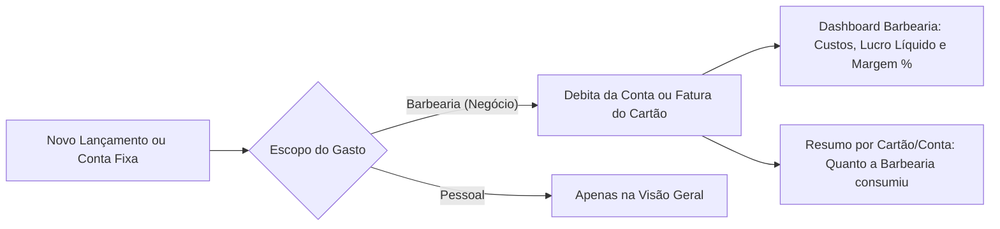

# Engenharia de Requisitos — Controle de Gastos & Lucro Real da Barbearia

## 1. Visão Geral e Objetivo
Permitir a separação clara entre **Gastos Pessoais** e **Gastos da Barbearia (Negócio)** diretamente nos lançamentos, contas fixas e categorias, sem precisar duplicar contas bancárias ou cartões de crédito. Com isso, o **Dashboard Barbearia** passa a calcular o **Lucro Líquido Real** ($\text{Faturamento} - \text{Custos da Barbearia}$), a **Margem de Lucro (%)** e o consumo da barbearia em cada conta/cartão.

---

## 2. Fluxo de Funcionamento

---

## 3. Requisitos Funcionais (RF)

### RF01 — Classificação "Pessoal" vs "Barbearia (Negócio)" (`scope`)
- **Em Lançamentos (`transactions`) e Contas Fixas (`recurrences`):**
  - Adicionar seletor rápido no topo do modal de Nova Transação e Nova Conta Fixa: **`Pessoal`** | **`Barbearia (Negócio)`**.
  - Quando uma conta fixa da Barbearia gerar lançamentos mensais automáticos, eles já nascem marcados como `scope = 'business'`.
- **Em Categorias (`categories`):**
  - Permitir identificar categorias voltadas ao negócio e criar automaticamente a categoria padrão de despesa **"Insumos & Barbearia"** (lâminas, gola higiênica, luvas, álcool, toalhas, pomadas, etc.).
  - Ao selecionar uma categoria da barbearia no modal de lançamento, o sistema marca automaticamente a opção **Barbearia (Negócio)**.

### RF02 — Atalho "+ Gasto da Barbearia" e Filtro em Transações
- **No Dashboard Barbearia:**
  - Botão rápido **"+ Gasto da Barbearia"** ao lado de "+ Nova Transação", que já abre o modal pré-configurado como **Despesa + Barbearia (Negócio) + Categoria Insumos & Barbearia**.
- **Na página de Transações (`/transacoes`) e Faturas do Cartão (`/cartoes`):**
  - Exibir selo visual `Barbearia` (ícone de tesoura) nos gastos do negócio.
  - Adicionar filtro **"Barbearia"** na tela de Transações para listar apenas os custos do negócio no mês.
  - Mostrar nos Cartões/Contas quanto do valor utilizado no mês pertence a gastos da **Barbearia** vs **Pessoal**.

### RF03 — Lucro Líquido Real e Margem de Lucro no Dashboard Barbearia
- Atualizar os cards principais do **Dashboard Barbearia** ([`BusinessDashboardView.tsx`](file:///home/alexandrerangel/Projetos/financeiro-app/src/components/dashboard/BusinessDashboardView.tsx)) para exibir:
  1. **Faturamento Bruto** (total de atendimentos/vendas no período).
  2. **Gastos da Barbearia** (despesas pagas da barbearia no período + indicação de despesas pendentes/fatura).
  3. **Lucro Líquido Real** ($\text{Faturamento Bruto} - \text{Gastos da Barbearia}$) e **Margem de Lucro (%)** ($\frac{\text{Lucro Líquido}}{\text{Faturamento Bruto}} \times 100$).
  4. **Atendimentos & Ticket Médio**.
- **Gráfico Evolução da Barbearia (Anual, Mensal e Semanal):**
  - Exibir comparativo visual entre **Faturamento (Receita)**, **Gastos da Barbearia** e **Lucro Líquido** em cada mês, semana ou dia da semana.
- **Lista dos Últimos Gastos da Barbearia:**
  - Card no Dashboard Barbearia mostrando os últimos gastos com insumos/estrutura da barbearia e qual conta ou cartão foi utilizado.

---

## 4. Evolução do Banco de Dados (Migração SQL)

> [!IMPORTANT]
> A migração será 100% retrocompatível (não apaga nenhum dado existente):
> - Adiciona coluna `scope TEXT NOT NULL DEFAULT 'personal' CHECK (scope IN ('personal', 'business'))` em `public.transactions`, `public.recurrences` e `public.categories`.
> - Marca automaticamente a categoria `Barbearia` existente e todas as transações geradas por atendimentos (`sales`) como `scope = 'business'`.
> - Cria a categoria padrão de despesa **`Insumos & Barbearia`** (`type = 'expense'`, `scope = 'business'`, ícone `scissors`) para todos os usuários.
