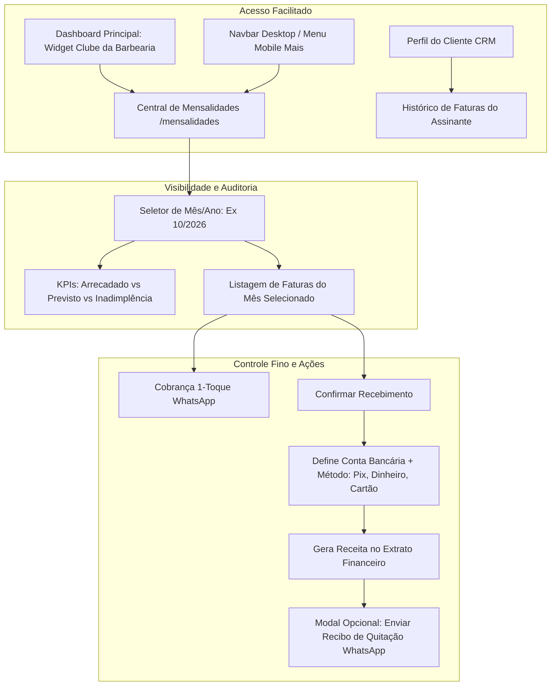

# Engenharia de Requisitos: Gestão Avançada, Acesso e Visibilidade de Mensalidades (Clube da Barbearia)

## 1. Visão Geral e Justificativa

Após a introdução do Clube de Assinaturas, identificou-se a necessidade de:
1. **Maior Acesso e Ergonomia:** Facilitar o acesso imediato tanto na versão Desktop quanto Mobile, incluindo atalho direto na barra de navegação e um **Widget Executivo no Dashboard principal**.
2. **Mais Visibilidade e Inteligência de Negócio:** Permitir a navegação histórica através de um **seletor de Mês/Ano**, acompanhando a taxa de adimplência, receita mensal arrecadada do clube vs prevista e taxa de inadimplência.
3. **Controle Financeiro Mais Fino:** Dar suporte à escolha explícita do **Método de Pagamento** (Pix, Dinheiro, Débito, Crédito) na baixa da mensalidade, auditar o **histórico completo de faturas** passadas e futuras de cada assinante, e permitir reajuste/cancelamento individual de faturas.
4. **Recibo de Quitação via WhatsApp:** Emissão de comprovante amigável com 1 toque ao receber o pagamento.

---

## 2. Arquitetura e Fluxo Operacional

---

## 3. Detalhamento dos Módulos

### 3.1 Maior Acesso (Navbar, Mobile e Dashboard)
1. **Atalho Dedicado na Navbar e Mobile:**
   - Rota direta `/mensalidades` redirecionando com foco total em `/clientes?tab=subscriptions`, além de link dedicado na Navbar com ícone da coroa (`Crown`) e no menu "Mais" do Mobile com destaque.
2. **Widget no Dashboard Principal (`DashboardView.tsx` e `MobileDashboardView.tsx`):**
   - Card *"Clube da Barbearia"*:
     - **MRR Atual** (Receita Recorrente Mensal contratada).
     - **Arrecadado no Mês** vs **Meta/Previsão Total**.
     - **Inadimplência / Atraso**: % e valor em aberto.
     - Botão *"Gerenciar Assinaturas"*.

### 3.2 Mais Visibilidade (Auditoria Mensal e Métricas)
1. **Navegador Temporal (Seletor Mês/Ano):**
   - Navegação por mês: `← Mês Anterior` / `Próximo Mês →` ou seletor `MM/AAAA`.
   - Permite visualizar com exatidão o status de qualquer mês (ex: auditar se o cliente X pagou a mensalidade de Agosto, Setembro ou Outubro).
2. **Painel de Métricas do Ciclo:**
   - **Recebido:** R$ arrecadado de mensalidades no mês selecionado.
   - **A Receber (No prazo):** R$ que vence nos próximos dias do mês.
   - **Em Atraso (Inadimplência):** R$ vencido que ainda não foi pago no mês.
   - **Taxa de Eficiência:** % de recebimento do clube no mês (ex: 85% quitado).

### 3.3 Controle Fino da Mensalidade
1. **Baixa com Método de Pagamento:**
   - No modal de confirmação de pagamento (`PayInvoiceModal`), o barbeiro escolhe:
     - **Conta de Depósito:** (Caixa Físico, Nubank, Itaú, etc.).
     - **Método de Pagamento:** Pix, Dinheiro em Espécie, Cartão de Débito, Cartão de Crédito.
     - **Data de Quitação:** (default hoje, permitindo retroagir caso tenha recebido ontem).
   - A transação financeira em `transactions` passa a registrar com exatidão o `payment_method` correto.
2. **Histórico Completo de Faturas por Assinante:**
   - Na lista de assinantes, botão `"Ver Histórico de Faturas"`.
   - Abre modal listando todos os meses da assinatura:
     - Mês/Ano, Vencimento, Valor, Status (Pago, Pendente, Atrasado), Data do Pagamento, Conta de Destino.
     - Ações por fatura: Disparar cobrança, dar baixa ou cancelar fatura.

### 3.4 Recibo de Quitação via WhatsApp
- Template oficial no `whatsapp-templates.ts`:
  > *"Fala {primeiro_nome}, tudo bem, irmão? 💈 Confirmamos o recebimento da sua mensalidade da barbearia ({plano}) no valor de {valor} via {metodo_pagamento}! Muito obrigado pela confiança e parceria de sempre! Visual sempre em dia! Tmj! ✂️🔥"*
- Ao concluir a baixa em `PayInvoiceModal`, uma opção/diálogo rápido permite disparar o recibo direto para o WhatsApp do cliente com 1 toque.

---

## 4. Atualizações de Banco e Backend

1. **Adicionar `payment_method` em `subscription_invoices`:**
   - `ALTER TABLE public.subscription_invoices ADD COLUMN IF NOT EXISTS payment_method VARCHAR(20) DEFAULT 'pix';`
2. **Server Actions (`src/lib/actions/subscriptions.ts`):**
   - Atualizar `paySubscriptionInvoice` para aceitar `paymentMethod: PaymentMethod`.
   - Criar `getSubscriptionInvoicesBySubscriptionId(subscriptionId: string)`.
   - Criar `getClubMonthlyOverview(monthStr: string)` para cálculo consolidado de arrecadação, inadimplência e taxa de conversão.
3. **Novo Template WhatsApp:**
   - Adicionar `subscriptionReceipt` em `DEFAULT_TEMPLATES` e suporte a `{metodo_pagamento}` no renderizador.

---

## 5. Próximos Passos (Após Aprovação)

1. Adicionar migração SQL para o campo `payment_method` em `subscription_invoices`.
2. Atualizar templates de WhatsApp em `src/lib/whatsapp-templates.ts` com recibo de quitação.
3. Expandir as Server Actions em `src/lib/actions/subscriptions.ts` com histórico e métricas mensais.
4. Criar Widget do Clube no Dashboard (Web e Mobile).
5. Adicionar rota dedicada `/mensalidades`.
6. Implementar `PayInvoiceModal` com seleção de método e disparo de recibo.
7. Implementar `SubscriptionHistoryModal` para auditar faturas passadas de qualquer assinante.
8. Executar testes (`npm test`), build (`npm run build`) e commit em português (`pt-BR`).
