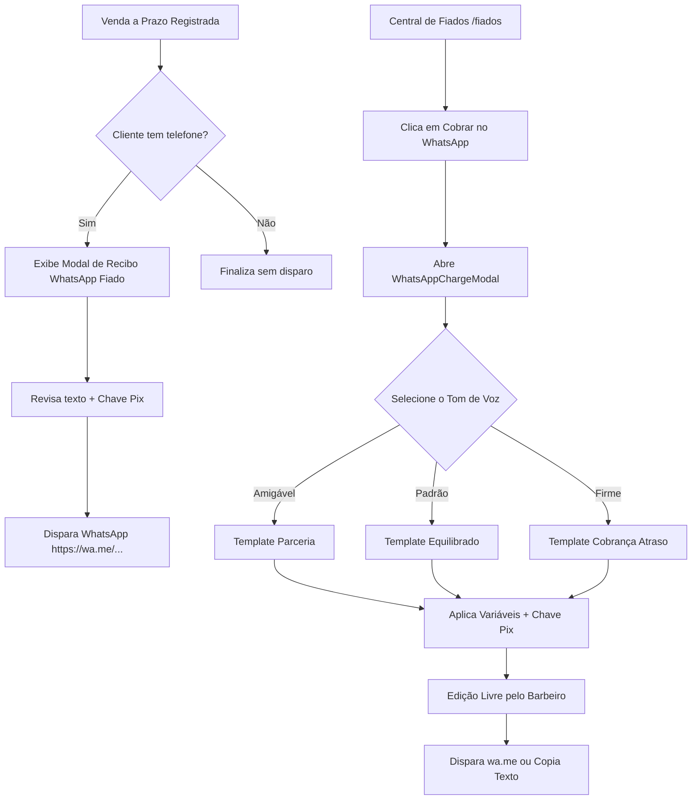

# Engenharia de Requisitos: Mensagens Avançadas de WhatsApp (Barbearia & Fiados)

## 1. Visão Geral e Objetivos

O objetivo deste módulo é profissionalizar e agilizar a comunicação da barbearia com os clientes via WhatsApp, aumentando a taxa de recuperação de vendas a prazo (fiados) e formalizando o atendimento no momento em que o serviço é realizado.

### Principais Dores Solucionadas:
1. **Cobrança Constrangedora ou Inflexível:** O barbeiro nem sempre sabe qual o tom de voz ideal para cada cliente (amigos de longa data vs clientes ocasionais vs devedores reincidentes).
2. **Fricção no Pagamento:** O cliente recebe a cobrança mas precisa responder pedindo a chave Pix; ao receber a chave Pix já na mensagem, ele copia e paga imediatamente.
3. **Falta de Formalização do Fiado:** Ao sair da barbearia sem pagar à vista, o cliente muitas vezes esquece o valor exato ou o prazo acordado. O envio imediato de um recibo/comprovante de atendimento no fiado cria transparência e alinhamento mútuo desde o primeiro momento.

---

## 2. Requisitos Funcionais

### RF-01: Perfis e Tons de Mensagens de Cobrança
No modal de cobrança ([`WhatsAppChargeModal`](file:///home/alexandrerangel/Projetos/financeiro-app/src/components/fiados/WhatsAppChargeModal.tsx)), o usuário terá botões rápidos/pílulas para alternar instantaneamente entre 3 estilos de texto:

1. **Amigável / Descontraído (Parceria):**
   - Ideal para amigos, clientes frequentes e lembretes prévios.
   - Linguagem leve, descontraída ("fala irmão", "passando só pra te lembrar").
2. **Padrão / Profissional:**
   - Equilibrado e cordial, destacando o valor e solicitando o comprovante ou confirmação de acerto.
3. **Firme / Atenção (Atrasos Críticos):**
   - Indicado para clientes com atraso prolongado (> 15/30 dias).
   - Linguagem mais formal, informando dias de atraso e solicitando a regularização da pendência com urgência.

> [!NOTE]
> Todos os templates geram o texto no `<textarea>`, permitindo ao barbeiro editar qualquer trecho livremente antes de enviar.

---

### RF-02: Inclusão Automática da Chave Pix da Barbearia
- O usuário poderá cadastrar e salvar sua **Chave Pix Principal da Barbearia** (Tipo: Telefone, CPF/CNPJ, E-mail ou Chave Aleatória) e o Nome do Titular/Favorecido.
- Em todos os modelos de cobrança e recibos, haverá um switch/checkbox **"Incluir Chave Pix no texto"** (ativado por padrão).
- Quando ativado, anexa automaticamente no final da mensagem um bloco limpo para cópia fácil:
  ```text
  🔑 Chave Pix para pagamento:
  11999998888 (Telefone - BarberFin)
  ```

---

### RF-03: Recibo de Atendimento no Fiado (Pós-Venda Imediato)
Ao registrar uma comanda com método de pagamento **A Prazo (Fiado)** no [`NewSaleModal`](file:///home/alexandrerangel/Projetos/financeiro-app/src/components/sales/NewSaleModal.tsx) ou [`MobileNewSaleDrawer`](file:///home/alexandrerangel/Projetos/financeiro-app/src/components/layout/MobileNewSaleDrawer.tsx):
- Se o cliente possuir telefone cadastrado (ou se o barbeiro informou), o sistema exibirá uma notificação/modal perguntando:
  **"Deseja enviar o comprovante do atendimento a prazo pelo WhatsApp?"**
- Mensagem modelo pré-configurada:
  ```text
  Fala [Nome], valeu demais pela presença hoje aqui na barbearia! 💈✂️
  
  Registramos seu atendimento:
  - 1x Corte Degradê (R$ 50,00)
  - 1x Pomada Matte (R$ 30,00)
  Total: R$ 80,00
  Combinado para: 10/11/2026

  Tmj e até a próxima!

  _Mensagem enviada via BarberFin_
  ```

---

### RF-04: Tela de Configurações de Mensagens & Pix
Uma seção dedicada de configurações (ex: em `/configuracoes` ou aba dentro de perfil/barbearia) permitindo:
1. **Dados do Pix da Barbearia:**
   - Tipo de chave (CPF, CNPJ, Telefone, E-mail, Chave Aleatória).
   - Chave Pix.
   - Nome do Favorecido / Banco.
2. **Editor de Templates Padrão:**
   - Editor dos 4 modelos: *Amigável*, *Padrão*, *Firme*, *Recibo Fiado*.
   - Botão para "Restaurar modelos originais de fábrica".
3. **Tags Dinâmicas (Variáveis de Substituição):**
   - `{nome}`: Nome completo do cliente.
   - `{primeiro_nome}`: Primeiro nome do cliente.
   - `{valor}`: Valor total em aberto (ex: R$ 80,00).
   - `{vencimento}`: Data acordada de vencimento.
   - `{dias_atraso}`: Quantidade de dias em atraso (quando aplicável).
   - `{itens}`: Lista resumida dos serviços e produtos consumidos.
   - `{chave_pix}`: Bloco da chave Pix formatada.
   - `{nome_barbearia}`: Nome da barbearia / usuário.

---

### RF-05: Assinatura do Sistema
- Todas as mensagens disparadas pelo aplicativo contêm a assinatura padronizada:
  `_Mensagem enviada via BarberFin_`
- Preservação da identidade visual consistente em todos os canais.

---

## 3. Arquitetura de Dados & Persistência

### Tabela de Configurações de Mensagens (`business_message_settings`)
Armazenada por usuário (`user_id` com RLS):
- `user_id` (UUID, PK, FK `auth.users`)
- `pix_key_type` (VARCHAR: `phone`, `cpf`, `cnpj`, `email`, `random`)
- `pix_key` (VARCHAR)
- `pix_holder_name` (VARCHAR)
- `template_friendly` (TEXT)
- `template_default` (TEXT)
- `template_firm` (TEXT)
- `template_sale_credit_receipt` (TEXT)
- `include_pix_default` (BOOLEAN DEFAULT TRUE)
- `created_at`, `updated_at` (TIMESTAMPTZ)

Caso o usuário ainda não tenha salvo configurações customizadas, o sistema utiliza **fallbacks em memória inteligentes**, garantindo que tudo funcione imediatamente sem necessidade de configuração prévia obrigatória.

---

## 4. Diagrama de Fluxo



---

## 5. Próximos Passos de Execução
1. **Migration Supabase:** Criar tabela `business_message_settings` com RLS e políticas por `user_id`.
2. **Server Actions:** Funções `getMessageSettings()` e `saveMessageSettings()`.
3. **Helper de Montagem de Mensagens:** Motor puro de substituição de variáveis (`templateEngine`).
4. **Atualização do `WhatsAppChargeModal`:** Inclusão dos seletores de tom (Amigável, Padrão, Firme) e toggle de Chave Pix.
5. **Integração no Fluxo de Nova Venda a Prazo:** Adicionar o gatilho de envio de recibo ao concluir venda fiada no `NewSaleModal` e `MobileNewSaleDrawer`.
6. **Interface de Configurações:** Aba ou modal de edição de templates e Chave Pix.
