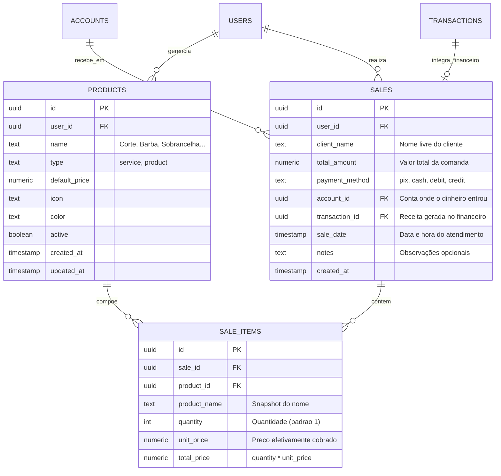
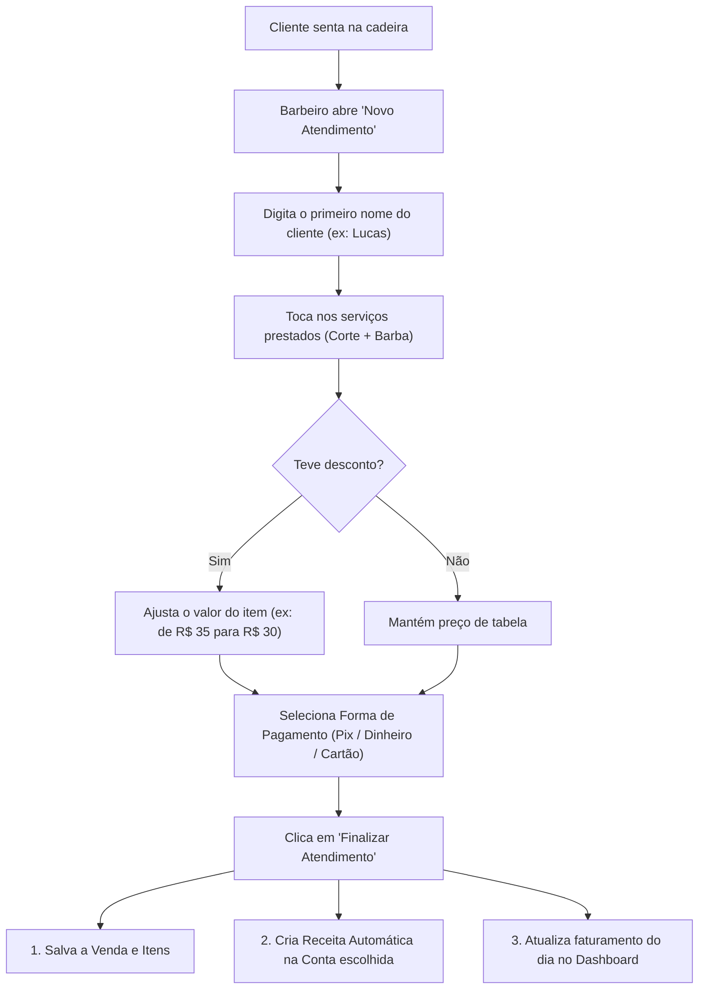

# Documento de Engenharia de Requisitos (SRS)
## Módulo de Produtos, Serviços & Vendas (Barbearia / Autônomo)

---

## 1. Visão Geral & Contexto do Negócio
O usuário é **barbeiro autônomo** e necessita de um fluxo ultra-rápido para gerenciar seu catálogo de serviços e produtos (Corte, Barba, Sobrancelha, Bigode, Pomadas, etc.) e registrar atendimentos/vendas no dia a dia.

### 1.1 Premissas Fundamentais
* **Zero Burocracia com Clientes:** Não deve existir cadastro prévio de clientes (sem formulários de telefone, CPF ou e-mail). O barbeiro apenas digita o **nome do cliente** no momento do atendimento.
* **Múltiplos Itens por Atendimento:** Um atendimento pode conter 1 ou mais serviços/produtos combinados (ex: *1x Corte + 1x Sobrancelha*).
* **Flexibilidade de Preço:** Cada serviço possui um preço padrão de tabela, mas o barbeiro pode ajustar o valor no momento da venda (para aplicar descontos de cortesia ou promoções).
* **Integração Financeira Direta:** Toda venda confirmada gera automaticamente uma **Receita (`income`)** no app, computada na conta de recebimento (ex: Pix no Nubank, Dinheiro na Carteira) e refletida instantaneamente no Dashboard.
* **Resumo Operacional Diário:** Métricas claras de **total faturado hoje** e **quantidade de clientes atendidos no dia**.

---

## 2. Requisitos Funcionais (RF)

### 2.1 Catálogo de Produtos e Serviços
* **RF-P01 (Cadastro de Itens):** O usuário pode cadastrar itens definindo:
  * Nome (ex: *Corte Masculino, Barba Terapia, Sobrancelha na Navalha, Bigode, Pomada Modeladora*).
  * Tipo: `service` (Serviço) ou `product` (Produto físico).
  * Preço Padrão (R$).
  * Cor / Ícone representativo.
  * Status: Ativo / Inativo.
* **RF-P02 (Edição e Exclusão):** Possibilidade de alterar preços, renomear ou desativar itens do catálogo sem quebrar o histórico de vendas passadas.
* **RF-P03 (Seed Automático):** Na primeira utilização do módulo, o app já pré-configura os 4 serviços fundamentais:
  1. *Corte* (R$ 35,00)
  2. *Barba* (R$ 25,00)
  3. *Sobrancelha* (R$ 15,00)
  4. *Bigode* (R$ 10,00)

### 2.2 Registro de Venda / Comanda Rápida
* **RF-P04 (Nome do Cliente):** Campo de texto simples e direto para preencher o nome de quem foi atendido (ex: *"João Silva"* ou *"Marcos"*).
* **RF-P05 (Seleção Ágil de Itens):**
  * Grade de botões/cards dos serviços para inclusão com 1 toque no carrinho do atendimento.
  * Contador de quantidade por item (ex: + / -).
  * Campo editável para o valor cobrado por item caso haja desconto.
* **RF-P06 (Forma de Pagamento e Destino):**
  * Escolha da forma de pagamento: `Pix`, `Dinheiro`, `Débito` ou `Crédito`.
  * Escolha da conta bancária de recebimento (ex: *Nubank, Carteira física, Itaú*).
* **RF-P07 (Finalização Rápida):** Botão único de conclusão (*"Finalizar Atendimento - R$ 55,00"*), registrando a comanda em menos de 10 segundos no celular.

### 2.3 Integração com o Motor Financeiro
* **RF-P08 (Geração Automática de Receita):**
  * Toda venda gera uma transação na tabela `transactions` vinculada à conta escolhida.
  * Descrição automática: `Atendimento: [Cliente] ([Qtd] serviços)`.
  * Status automático: `is_paid = true` (recebido na hora).
* **RF-P09 (Estorno / Exclusão de Venda):** Se uma venda for excluída no histórico, a transação financeira correspondente é removida automaticamente da conta.

### 2.4 Painel de Atendimentos & Resumos
* **RF-P10 (Resumo do Dia):** Cards no topo com:
  * **Faturamento Hoje (R$)**
  * **Clientes Atendidos Hoje (Qtd)**
  * **Ticket Médio por Cliente (R$)**
* **RF-P11 (Histórico de Atendimentos):** Lista cronológica das comandas do dia ou mês, exibindo cliente, serviços realizados, horário, valor total e forma de pagamento.

---

## 3. Requisitos Não Funcionais (RNF)

* **RNF-P01 (Usabilidade & Ergonomia Mobile):** Interface com foco no uso com uma mão só no celular, com botões de toque largos e feedback visual imediato.
* **RNF-P02 (Segurança & RLS):** Todas as tabelas (`products`, `sales`, `sale_items`) com políticas de Row Level Security vinculadas ao `auth.uid() = user_id`.
* **RNF-P03 (Performance):** Inserção transacional atômica (venda + itens da venda + receita financeira executados em operação consistente).

---

## 4. Modelo de Dados Relacional (ERD)

---

## 5. Fluxo de Atendimento do Barbeiro

---

## 6. Plano de Execução (Fases)

### Fase A: Estrutura do Banco de Dados & RLS
* Script SQL de migração: criação das tabelas `products`, `sales` e `sale_items`.
* Criação de políticas RLS, índices e gatilhos de `updated_at`.
* Seed automático dos 4 serviços básicos para novos usuários.
* Definição dos tipos TypeScript em `src/types/database.ts`.

### Fase B: Catálogo de Produtos e Serviços ([`/produtos`](file:///home/alexandrerangel/Projetos/financeiro-app/src/app/produtos))
* Listagem de serviços/produtos com preço e status ativo/inativo.
* Modal para Criar, Editar preço/nome e Excluir/Pausar itens.

### Fase C: Comanda Rápida & Registro de Venda ([`/vendas/nova`](file:///home/alexandrerangel/Projetos/financeiro-app/src/app/vendas))
* Tela/Modal de atendimento rápido para smartphone.
* Campo de nome do cliente, seleção de itens em grade de botões, ajuste de preço e forma de pagamento.
* Server Action transacional gerando venda + receita automática na conta.

### Fase D: Painel de Atendimentos & Resumo do Dia ([`/vendas`](file:///home/alexandrerangel/Projetos/financeiro-app/src/app/vendas))
* Cards de Faturamento Hoje, Clientes Hoje e Ticket Médio.
* Histórico cronológico das comandas com detalhes dos serviços e botão de estorno.
* Atalho no Dashboard e na barra de navegação para "Atendimentos".
