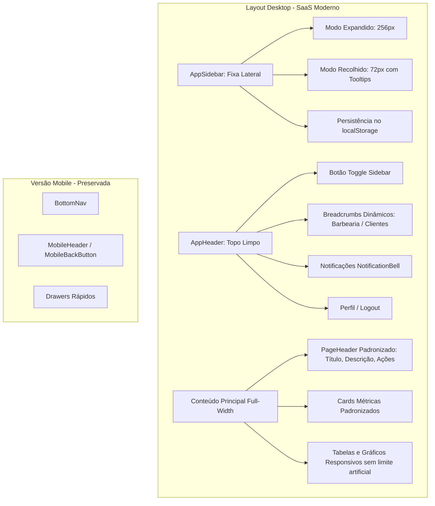
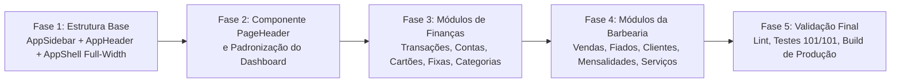

# Engenharia de Requisitos: Refatoração Visual Desktop — Canário

## 1. Visão Geral e Objetivos

O objetivo deste projeto é refatorar a interface da **versão web desktop** do BarberFin, transformando a navegação e a hierarquia visual em um padrão **SaaS financeiro profissional, moderno e coeso**.

### Premissas e Restrições Mandatórias:
- **Preservação Total das Regras de Negócio e Funcionalidades:** Não reconstruir módulos, não alterar cálculos financeiros, consultas ao banco de dados, regras de autenticação ou fluxos de lançamentos.
- **Preservação Estrita do Mobile:** A versão mobile (ajustada recentemente com gavetas, `BottomNav`, cabeçalhos dedicados e toque rápido) **deve permanecer 100% intacta**, sem interferência da sidebar ou headers do desktop.
- **Nenhum Módulo Perdido ou Renomeado sem Consentimento:** Todas as 11 rotas ativas da aplicação continuam presentes e acessíveis.

---

## 2. Diagnóstico da Estrutura Atual

### 2.1 Limitações Identificadas na Versão Desktop Atual:
1. **Navegação Horizontal Saturada:** O [`Navbar.tsx`](file:///home/alexandrerangel/Projetos/financeiro-app/src/components/layout/Navbar.tsx) atual tenta colocar 11 links lado a lado no topo (`Dashboard`, `Atendimentos`, `Fiados`, `Clientes`, `Mensalidades`, `Serviços`, `Transações`, `Cartões`, `Contas`, `Fixas`, `Categorias`). Em telas de 1280px ou 1366px, o menu fica comprimido, disputando espaço com o logo, sino de notificações e email do usuário.
2. **Gargalo de Espaço Horizontal (`max-w-6xl`):** O layout em [`AppShell.tsx`](file:///home/alexandrerangel/Projetos/financeiro-app/src/components/layout/AppShell.tsx) restringe todo o conteúdo desktop a `max-w-6xl` (1152px), desperdiçando o espaço útil de telas 1080p, 1440p e ultrawide para visualização de extratos, tabelas de atendimentos e gráficos comparativos.
3. **Falta de Hierarquia por Domínio:** Os módulos financeiros gerais (cartões, contas bancárias, despesas fixas) estão misturados linearmente com as operações do negócio de barbearia (atendimentos, fiados, mensalidades, clientes).
4. **Cabeçalhos Despadronizados:** Cada página define seu próprio cabeçalho com classes e espaçamentos ligeiramente divergentes.

---

## 3. Arquitetura da Solução Proposta

### 3.1 Sidebar Lateral Esquerda (`AppSidebar.tsx`)
- **Fixa e Independente de Rolagem:** O menu lateral não rola com o conteúdo da página (`h-screen sticky top-0`).
- **Modos de Exibição:**
  - **Expandida (256px / `w-64`):** Logotipo com identificador do sistema, títulos de agrupamento em caixa alta sutil (`text-[11px] font-semibold tracking-wider text-zinc-500`), ícones, rótulos e badges de notificação.
  - **Recolhida (72px / `w-[72px]`):** Logotipo em ícone compacto, itens apenas com ícones centralizados e **Tooltips instantâneos** posicionados lateralmente (`role="tooltip"` com animação de fade).
- **Controle de Alternância:** Botão de alternância (collapse/expand) na base da sidebar ou no header, com atalho de teclado opcional (`[Ctrl + B]`).
- **Persistência de Estado:** Salva em `localStorage` (`barberfin:sidebar_collapsed`), garantindo que o usuário encontre a sidebar no mesmo estado ao navegar entre páginas ou recarregar.

### 3.2 Estrutura e Agrupamento dos Módulos:

| Grupo | Módulo | Rota | Ícone |
| :--- | :--- | :--- | :--- |
| **VISÃO GERAL** | Dashboard | `/dashboard` | `LayoutDashboard` |
| **FINANÇAS** | Transações & Extrato | `/transacoes` | `ArrowLeftRight` |
| | Contas Bancárias | `/contas` | `Wallet` |
| | Cartões de Crédito | `/cartoes` | `CreditCard` |
| | Recorrências Fixas | `/recorrencias` | `Repeat` |
| | Categorias | `/categorias` | `Tags` |
| **BARBEARIA** | Atendimentos & Vendas | `/vendas` | `Scissors` |
| | Fiados & A Receber | `/fiados` | `Receipt` |
| | Carteira de Clientes | `/clientes` | `Users` |
| | Clube & Mensalidades | `/mensalidades` | `Crown` |
| | Serviços & Estoque | `/produtos` | `Package` |

### 3.3 Cabeçalho Superior Global (`AppHeader.tsx`)
O header deixa de conter os 11 links de navegação e passa a focar em contexto e utilidades:
1. **Lado Esquerdo:**
   - Botão de colapso/expansão da sidebar (`PanelLeftClose` / `PanelLeftOpen`).
   - Separador vertical sutil (`h-4 w-px bg-zinc-800`).
   - **Breadcrumbs Inteligentes:** Mapeia a rota ativa (ex: `Barbearia › Clientes`, `Finanças › Transações`).
2. **Lado Direito:**
   - Alternador de escopo (quando na tela de dashboard).
   - Sino de Notificações (`NotificationBell`).
   - Perfil do usuário (avatar com inicial, email truncado) e botão de Sair.

### 3.4 Área de Conteúdo Full-Width
- No desktop: O `main` remove o teto de `max-w-6xl` e adota um layout fluido com preenchimento lateral confortável:
  `w-full px-6 py-6 lg:px-8 space-y-6`.
- Em telas amplas, grids e tabelas ocupam o espaço de forma nobre, aumentando a quantidade de colunas legíveis e a visibilidade dos gráficos sem quebras bruscas.

---

## 4. Padronização de Componentes Compartilhados

1. **`PageHeader.tsx`:**
   - Componente reutilizável para o topo de cada página:
     - `title`: Título principal (`text-2xl font-bold tracking-tight text-zinc-100`).
     - `description`: Subtítulo contextual (`text-sm text-zinc-400`).
     - `actions`: Slot flexível para botões contextuais (`+ Nova Venda`, `+ Nova Transação`, filtros, etc.).
2. **`MetricCard.tsx`:**
   - Padronização de cards de métricas (título, valor grande, subtítulo, ícone e cor de destaque).
3. **`AppShell.tsx`:**
   - Unificação do layout:
     - Renderiza `AppSidebar` e `AppHeader` em telas desktop (`md:flex`).
     - Renderiza o cabeçalho e `BottomNav` nas telas mobile (`md:hidden`).

---

## 5. Plano de Execução em Fases

- **Fase 1 — Fundação de Navegação:**
  - Criar `src/components/layout/AppSidebar.tsx` com suporte a colapso e persistência em `localStorage`.
  - Criar `src/components/layout/AppHeader.tsx` com breadcrumbs dinâmicos e utilitários.
  - Atualizar `src/components/layout/AppShell.tsx` integrando o novo layout desktop sem alterar a visualização mobile.
- **Fase 2 — Componentes Compartilhados & Dashboard:**
  - Criar `src/components/layout/PageHeader.tsx`.
  - Adaptar o Dashboard Desktop para respirar no layout full-width com alinhamento refinado.
- **Fase 3 & 4 — Aplicação Consistente nos Módulos:**
  - Integrar o `PageHeader` padronizado nas telas de Finanças e Barbearia.
- **Fase 5 — Validação Contínua:**
  - Executar `npx tsc --noEmit` (tipagem TypeScript estrita).
  - Executar `npm run lint` (ESLint 0 erros).
  - Executar `npm test` (garantir os 101 testes passando).
  - Executar `npm run build` (geração de páginas estáticas e dinâmicas).
  - Commit em Português (`pt-BR`).

---

## 6. Critérios de Aceite

1. A navegação desktop possui uma sidebar lateral recolhível (256px ↔ 72px) fixa, com tooltips no modo compacto e grupos de navegação bem definidos.
2. O topo desktop contém um header unificado e limpo com breadcrumbs, notificações e controle de sidebar.
3. As páginas desktop usam largura full-width fluida com espaçamento consistente, sem estourar rolagem horizontal.
4. A experiência da versão mobile permanece exatamente como está, sem regressões.
5. Nenhuma rota ou funcionalidade existente foi perdida, quebrada ou renomeada.
6. A aplicação compila em produção (`npm run build`) com sucesso e todos os testes unitários são aprovados.
