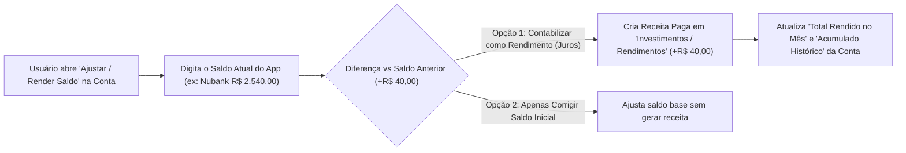

# Engenharia de Requisitos — Rendimento de Contas & Juros (Nubank / CDI)

## 1. Visão Geral
Contas digitais remuneradas (como **Nubank**, Mercado Pago, PicPay e Caixinhas/CDBs) rendem juros diariamente como percentual do CDI. Em vez de exigir que o usuário digite centavos todos os dias, este módulo combina **Conciliação Inteligente por Saldo** (você digita o saldo que aparece hoje no app do banco e o sistema lança a diferença positiva como **Rendimento**) + **Projeção Automática por Taxa (% do CDI ou % a.m.)**.

---

## 2. Fluxo de Contabilização de Juros

---

## 3. Requisitos Funcionais (RF)

### RF01 — Conciliação Inteligente de Saldo vs Rendimento (`EditAccountBalanceModal`)
Ao clicar no saldo de uma conta (no Dashboard ou em `/contas`), o modal terá dois modos integrados:
1. **Contabilizar Rendimento (Juros):**
   - Você pode informar o **Novo Saldo no Banco** (ex: `R$ 1.542,80` quando o saldo no sistema era `R$ 1.530,00`) **OU** digitar diretamente o **Valor que Rendeu** (ex: `+ R$ 12,80`).
   - O sistema mostra na hora: `Rendimento calculado: + R$ 12,80`.
   - Ao confirmar, o sistema cria automaticamente uma transação de **Receita (`income`)** já paga, vinculada à conta e à categoria **Investimentos / Rendimentos**, com descrição `Rendimento: [Nome da Conta]`.
2. **Apenas Ajuste / Correção de Saldo:**
   - Caso a diferença não seja juros (e sim um esquecimento ou ajuste manual), mantém a opção de apenas corrigir o saldo base sem gerar receita de rendimento.

### RF02 — Configuração de Taxa de Rendimento na Conta (% do CDI ou % ao mês)
No cadastro/edição da conta (`AccountModal`), adicionar configuração opcional de **Rendimento Automático / Estimativa**:
- Ativar se a conta rende juros (ex: **Nubank — 100% do CDI**).
- Permitir escolher o indexador:
  - **% do CDI** (ex: `100% do CDI`, `105% do CDI`, `110% do CDI` — usando a taxa CDI atual como referência líquida estimada de ~0,85% a.m. para 100% CDI já descontando IR médio, ou permitindo ajuste).
  - **Taxa Fixa Mensal (% a.m.)** (ex: `0,85% ao mês`, `1,00% ao mês`, ou Poupança `~0,60% ao mês`).

### RF03 — Indicadores de Juros e Projeção nos Cards de Contas (`/contas` e Dashboard)
Em cada conta remunerada e no topo da página `/contas`:
- **Rendimento no Mês Atual (`+ R$ X,XX`)**: Soma de todos os rendimentos contabilizados naquela conta no mês selecionado.
- **Rendimento Acumulado Histórico (`+ R$ Y,YY`)**: Tudo que aquela conta já rendeu desde o início.
- **Projeção Estimada (30 dias e 12 meses)**: Com base no `Saldo Atual` da conta e na taxa configurada (ex: `100% CDI`), exibe quanto o saldo atual deve render nos próximos **30 dias (`+ R$ ... / mês`)** e em **1 ano (`+ R$ ... / ano`)**.

---

## 4. Evolução do Banco de Dados (Compatível e Sem Perda de Dados)
- Adicionar colunas opcionais na tabela `public.accounts`:
  - `yield_rate NUMERIC(6, 2) DEFAULT 0` (ex: `100` para 100% do CDI ou `0.85` para 0,85% a.m.)
  - `yield_type TEXT DEFAULT 'none' CHECK (yield_type IN ('none', 'cdi_percent', 'monthly_percent'))`
- Assim como fizemos nos módulos anteriores, o código terá **fallback automático** caso a migração SQL ainda não tenha sido executada no Supabase.
