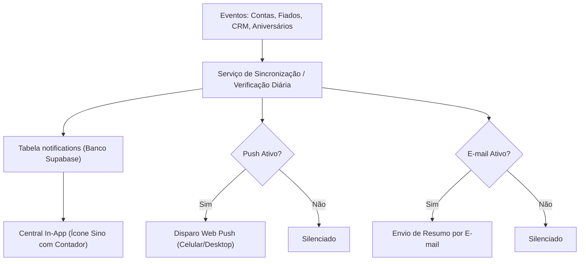

# Documento de Engenharia de Requisitos: Módulo de Notificações Unificado

## 1. Visão Geral do Módulo
O objetivo deste módulo é manter o usuário sempre atualizado sobre as operações vitais do seu negócio e da sua vida financeira, alertando sobre vencimentos de despesas, faturas, recebimento de fiados em atraso, resgate de clientes e aniversariantes do dia.

---

## 2. Canais de Notificação e Regras de Entrega

| Canal | Status | Descrição |
| :--- | :--- | :--- |
| **Central In-App (Sino no Topo)** | **Sempre Ativo (Padrão)** | Ícone de sino na barra de navegação superior (desktop e mobile) com indicador/badge de quantidade não lida. Ao clicar, abre gaveta/dropdown com as notificações, agrupadas e com ações diretas de 1 clique. |
| **Web Push (Navegador & Celular)** | **Opcional (Toggle nas Configurações)** | Notificações push nativas via Service Worker / PWA para alertar o usuário mesmo quando a aba do app estiver fechada. |
| **Envio de E-mail** | **Opcional (Toggle nas Configurações)** | E-mail diário consolidado ou alertas imediatos disparados para o e-mail do usuário logado (ex: Resumo Matinal com contas do dia e aniversariantes). |

> [!NOTE]
> Conforme solicitado, a Central In-App é o canal base e obrigatório. Os envios por Web Push e por E-mail possuem preferências individuais ativáveis e desativáveis pelo usuário.

---

## 3. Gatilhos e Eventos Monitorados

### 3.1. Financeiro (Contas & Cartões)
1. **Contas a Pagar Vencendo Hoje:** Alerta matinal para despesas cadastradas com vencimento na data de hoje.
2. **Contas em Atraso:** Alertas para despesas não pagas cujo vencimento já expirou.
3. **Fatura de Cartão de Crédito:** Alerta no dia do fechamento da fatura e no dia do vencimento.

### 3.2. Operação & Barbearia (Fiados & CRM)
1. **Fiados / Contas a Receber Vencidas:** Alerta de clientes com pagamentos de venda a prazo atrasados, com botão para cobrar via WhatsApp com 1 clique.
2. **Radar de Retorno de Corte:** Clientes que atingiram a janela ideal de retorno (ex: 21 a 35 dias sem cortar).
3. **Aniversariantes do Dia:** Lembrete dos clientes que fazem aniversário na data atual, com botão para parabenizar via WhatsApp.

---

## 4. Arquitetura de Dados & Persistência

### 4.1. Tabela `notifications` (Supabase)
```sql
CREATE TABLE IF NOT EXISTS public.notifications (
  id UUID PRIMARY KEY DEFAULT gen_random_uuid(),
  user_id UUID NOT NULL REFERENCES auth.users(id) ON DELETE CASCADE,
  category TEXT NOT NULL CHECK (category IN ('bill_due', 'bill_overdue', 'credit_overdue', 'client_return', 'birthday', 'card_invoice')),
  title TEXT NOT NULL,
  message TEXT NOT NULL,
  action_url TEXT,
  action_label TEXT,
  metadata JSONB DEFAULT '{}'::jsonb,
  is_read BOOLEAN DEFAULT false,
  read_at TIMESTAMPTZ,
  created_at TIMESTAMPTZ DEFAULT now()
);
```

### 4.2. Tabela `user_notification_preferences` (Supabase)
```sql
CREATE TABLE IF NOT EXISTS public.user_notification_preferences (
  user_id UUID PRIMARY KEY REFERENCES auth.users(id) ON DELETE CASCADE,
  email_notifications_enabled BOOLEAN DEFAULT false,
  push_notifications_enabled BOOLEAN DEFAULT false,
  notify_bills BOOLEAN DEFAULT true,
  notify_credits BOOLEAN DEFAULT true,
  notify_client_returns BOOLEAN DEFAULT true,
  notify_birthdays BOOLEAN DEFAULT true,
  email_digest_time TIME DEFAULT '08:00',
  push_subscription JSONB,
  updated_at TIMESTAMPTZ DEFAULT now()
);
```

---

## 5. Experiência do Usuário (UI/UX)



### 5.1. Componente do Sino na Navbar (`NotificationBell.tsx`)
- Localizado no topo, próximo ao perfil do usuário.
- Badge vermelho/esmeralda com contador de notificações não lidas.
- Ao clicar: abre popover/drawer moderno com abas **"Todas"** e **"Não Lidas"**, botão de **"Marcar todas como lidas"** e atalho para **"Configurações de Notificação"**.
- Cada item da lista possui:
  - Ícone temático da categoria (dinheiro, tesoura, bolo de aniversário, cartão de crédito).
  - Título e descrição sucinta.
  - Horário/tempo relativo ("Há 15 min", "Hoje às 08:00").
  - Botão de ação direta (ex: *"Cobrar no WhatsApp"*, *"Marcar como Paga"*, *"Ver Fiado"*).

### 5.2. Tela / Aba de Configurações de Notificações
- Localizada nas configurações e acessível diretamente pela aba Mais do mobile e dropdown desktop.
- Permite ativar/desativar:
  - Notificações Web Push (com botão de autorização do navegador).
  - Notificações por E-mail (com indicação do e-mail logado).
  - Filtros por categoria (desativar só retorno de clientes, ou só contas, etc.).

---

## 6. Plano de Implementação em Fases

1. **Fase 1: Banco de Dados & RLS:**
   - Criação da migração com `notifications` e `user_notification_preferences`.
   - Políticas RLS garantindo isolamento total por `user_id`.
2. **Fase 2: Motor de Geração e Gerenciamento de Notificações:**
   - Server Actions para listar, contar não lidas, marcar como lida e marcar todas como lidas.
   - Rotina de verificação/geração inteligente que evita notificações duplicadas para o mesmo evento no mesmo dia.
3. **Fase 3: Interface da Central In-App (`NotificationBell.tsx`):**
   - Integração na Navbar desktop e mobile.
   - Gaveta/Dropdown com lista de notificações, filtros e ações rápidas de 1 clique.
4. **Fase 4: Preferências do Usuário & Canais Externos (Push & E-mail):**
   - Modal/Página de preferências de notificação.
   - Integração com Web Push API (Service Worker).
   - Envio de e-mail via Resend/SMTP/Supabase Auth Mailer para o e-mail logado do usuário.
