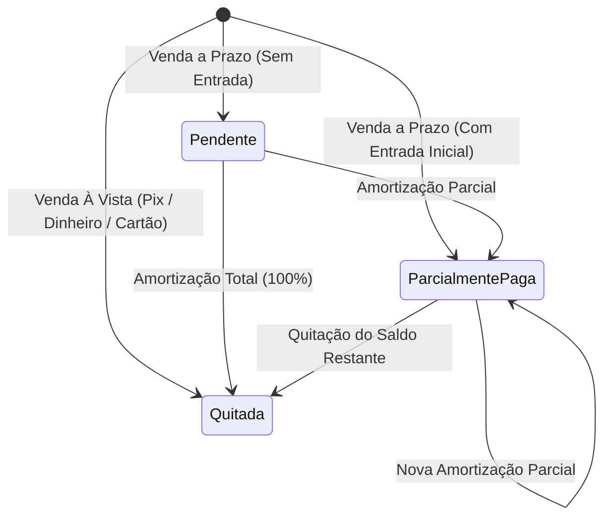
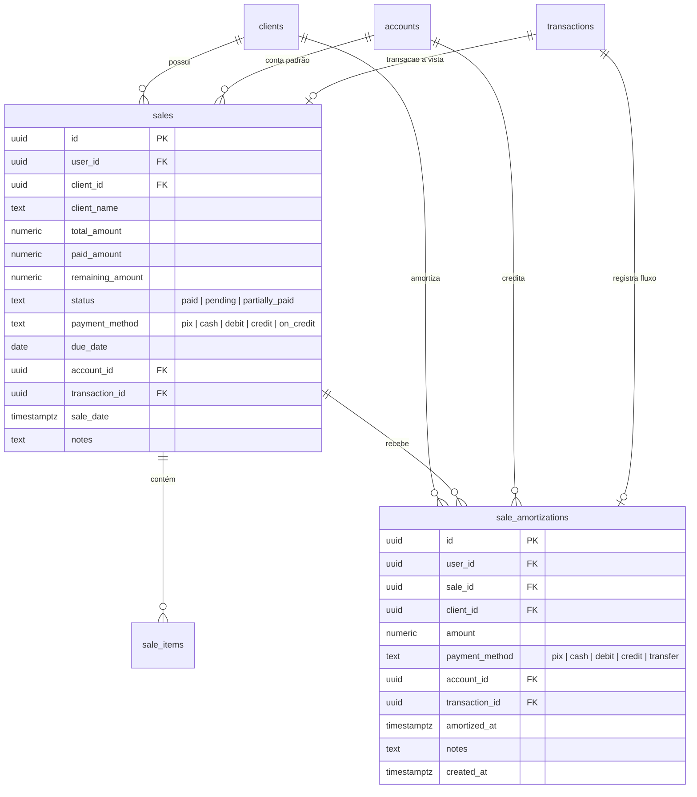

# Documento de Engenharia de Requisitos (SRS)
## Módulo de Vendas a Prazo (Fiado / Crediário) & Amortizações de Débitos

---

## 1. Visão Geral & Contexto de Negócio

No modelo operacional de barbearias e profissionais autônomos, é comum e culturalmente consolidado o atendimento de clientes fiéis com **pagamento posterior** (*"marca aí no meu nome"*, *"te pago no dia do meu pagamento"*, *"te pago semana que vem"*), bem como vendas parceladas de produtos com maior valor agregado (pomadas, tônicos, kits de cuidado) ou pagamentos divididos (*"vou te pagar metade no Pix agora e o resto na semana que vem"*).

### 1.1 Premissas Alinhadas com o Usuário
1. **Faturamento do Dia 100% Realizado (Caixa Líquido):** O indicador "Total Faturado Hoje" contabiliza apenas o que foi **efetivamente recebido** (vendas à vista normais, valor de entradas imediatas e amortizações pagas hoje). O valor pendente a prazo **não infla o faturamento do dia**, mas fica visível em um indicador dedicado: **"Vendido a Prazo Hoje" / "A Receber de Clientes"**.
2. **Entrada Imediata Opcional:** No momento da venda a prazo, é possível registrar um pagamento de entrada na hora (ex: Total R$ 100, R$ 40 pagos na hora via Pix/Dinheiro e R$ 60 ficam a prazo).
3. **Data de Vencimento Opcional:** Por padrão, a venda a prazo **não obriga preenchimento de vencimento** (muitos clientes pagam quando puderem ou no próximo corte). Porém, há a opção de adicionar data de vencimento com chips de atalho rápido (+7d, +15d, +30d) ou escolha de data livre.
4. **Flexibilidade Total na Amortização:**
   * **Por Comanda Específica:** O barbeiro pode abrir uma comanda e abater direto nela.
   * **Pelo Saldo Consolidado do Cliente:** Na tela de Clientes, o barbeiro pode abater qualquer valor direto do saldo devedor geral do cliente (ex: cliente deve R$ 150 em 3 comandas e paga R$ 50; o sistema aplica a amortização abatendo as mais antigas ou distribuindo).

---

## 2. Conceitos & Regras de Negócio Fundamentais

### 2.1 A Tríade de Status da Venda a Prazo
Toda venda terá um ciclo de vida financeiro claro:
* **`paid` (Quitada):** Valor integralmente pago. (Vendas normais à vista ou vendas a prazo que foram 100% liquidadas).
* **`pending` (Pendente):** Venda realizada a prazo sem nenhuma entrada registrada (`paid_amount = 0`, `remaining_amount = total_amount`).
* **`partially_paid` (Parcialmente Paga):** Venda que recebeu uma entrada ou amortizações parciais, mas ainda possui saldo residual (`0 < paid_amount < total_amount`).



### 2.2 Venda a Prazo com Entrada Imediata
O profissional pode registrar uma venda mista:
* *Exemplo:* Corte + Pomada = **R$ 110,00**.
* O cliente paga **R$ 50,00 no Pix** na hora (entrada imediata).
* Os **R$ 60,00 restantes** ficam **a prazo** para o dia 10 do mês seguinte.
* **Comportamento no Sistema:**
  1. Cria a venda com `total_amount = 110.00`, `paid_amount = 50.00`, `remaining_amount = 60.00`, `status = 'partially_paid'`, `payment_method = 'on_credit'`.
  2. Registra automaticamente a primeira **amortização** de R$ 50,00 via Pix na conta selecionada.
  3. Gera a receita financeira de R$ 50,00 no extrato com `is_paid = true`.
  4. Mantém o saldo a receber de R$ 60,00 vinculado ao cliente com vencimento para a data combinada.

### 2.3 Mecânica de Amortização
Uma **amortização** é o abatimento de parte ou da totalidade de um débito em aberto:
1. **Regra de Teto:** O valor da amortização não pode ser superior ao saldo devedor restante (`amount <= remaining_amount`).
2. **Destino Financeiro:** Toda amortização exige a especificação de:
   * **Valor amortizado** (R$).
   * **Forma de pagamento real** (`pix`, `cash`, `debit`, `credit`, `transfer`).
   * **Conta de recebimento** (ex: *Nubank*, *Carteira Dinheiro*, *Itaú*).
   * **Data do pagamento** (padrão: hoje/agora).
3. **Impacto Contábil:** Toda amortização gera uma transação de receita financeira (`income`, `is_paid = true`) na data em que ocorreu, creditando imediatamente a conta bancária escolhida.
4. **Atualização Automática:** Atualiza `paid_amount = paid_amount + valor` e `remaining_amount = remaining_amount - valor`. Se `remaining_amount == 0`, o status passa automaticamente para `paid`.

### 2.4 Obrigatoriedade de Cliente Cadastrado
* Diferente da venda à vista (onde é permitido apenas digitar um nome avulso sem cadastro formal), na venda a prazo **é mandatório associar um cliente cadastrado (`client_id != null`)**.
* Caso o barbeiro digite um nome que ainda não possui cadastro, a interface oferece a criação rápida em 1 clique ("Cadastrar cliente para liberar venda a prazo") solicitando telefone opcional para contato/lembretes.

### 2.5 Estorno e Integridade Referencial
* **Exclusão de Amortização:** Se o barbeiro lançou uma amortização errada, ao excluí-la:
  * A transação de receita financeira correspondente é estornada/excluída.
  * O `remaining_amount` da comanda volta a aumentar e o status é recalculado para `partially_paid` ou `pending`.
* **Exclusão de Venda a Prazo:**
  * Se a venda for cancelada, todas as amortizações atreladas são canceladas, as receitas financeiras já lançadas são removidas do extrato e os itens da venda são deletados de forma consistente (atômica).

---

## 3. Requisitos Funcionais (RF)

### 3.1 Registro de Atendimentos & Vendas
* **RF-AP01 (Opção de Pagamento "A Prazo"):** Adicionar o método de pagamento `'on_credit'` (*"A Prazo / Fiado"*) nos canais de venda (`MobileNewSaleDrawer` e `NewSaleModal`).
* **RF-AP02 (Data de Vencimento Opcional):** Por default, **não exigir data de vencimento** na venda a prazo. Disponibilizar um controle expansível/opcional para definir vencimento, com atalhos rápidos (*+7 dias*, *+15 dias*, *+30 dias*) e permitindo edição livre no calendário.
* **RF-AP03 (Entrada Imediata Opcional):** Permitir informar um valor de entrada paga no momento do atendimento, com sua respectiva forma de pagamento (Pix/Dinheiro) e conta de depósito.
* **RF-AP04 (Bloqueio de Cliente Anônimo):** Impedir a finalização de venda a prazo sem a vinculação de um `client_id` existente na tabela `clients`.

### 3.2 Gestão de Amortizações & Recebimentos
* **RF-AP05 (Modal de Amortização Rápida):** Interface acessível por 1 toque na listagem de comandas ou no perfil do cliente, contendo:
  * Exibição do valor total da venda, valor já pago e saldo devedor atual.
  * Campo de valor a amortizar (com botão de preenchimento rápido *"Quitar Total (R$ X,XX)"*).
  * Forma de pagamento (`pix`, `dinheiro`, `débito`, `crédito`).
  * Conta bancária de entrada.
  * Data do recebimento e observação opcional.
* **RF-AP06 (Amortização Flexível - Por Comanda ou Saldo Consolidado):**
  * **Por Comanda:** O usuário pode escolher abater em uma comanda específica.
  * **Saldo Consolidado do Cliente:** O usuário pode amortizar direto no perfil/card do cliente (ex: abater R$ 50 do saldo total de R$ 130), liquidando as pendências mais antigas (*FIFO*) ou rateando proporcionalmente.
* **RF-AP07 (Histórico de Amortizações):** Visualização de todos os pagamentos parciais realizados em uma comanda (data, hora, valor, forma e conta).
* **RF-AP08 (Comprovante / Recibo de Quitação):** Botão para gerar mensagem formatada de recibo para envio no WhatsApp do cliente (*"Olá [Nome], confirmamos o recebimento de R$ [Valor] referente à sua comanda. Saldo restante: R$ [Saldo]"*).

### 3.3 CRM & Visão de Clientes
* **RF-AP09 (Indicador de Débito no Card do Cliente):** Exibir badge destacada em vermelho/laranja na listagem de clientes para quem possui débitos pendentes (*"Débito: R$ 120,00"*).
* **RF-AP10 (Filtro "Clientes com Débito / A Receber"):** Pílula de filtro na tela `/clientes` para listar exclusivamente clientes inadimplentes ou com pagamentos pendentes.
* **RF-AP11 (Total Geral a Receber):** Resumo no topo da tela de clientes informando o valor total represado em fiados e a quantidade de devedores.

### 3.4 Telas de Vendas & Financeiro
* **RF-AP12 (Filtros na Tela de Vendas):** Pílulas para filtrar comandas por status: `Todas`, `Quitadas`, `A Prazo (Pendentes)`, `Vencidas`.
* **RF-AP13 (Destaque de Comandas Vencidas):** Vendas cuja data combinada (`due_date`) estiver definida e for anterior a hoje e o status for diferente de `paid` devem receber marcação visual de atraso.
* **RF-AP14 (Faturamento Diário do Negócio - Visão Caixa):**
  * O card principal **"Faturamento Hoje"** contabiliza estritamente os **valores efetivamente recebidos no dia** (vendas à vista normais + entradas imediatas de vendas a prazo de hoje + amortizações recebidas hoje).
  * Exibir card ou linha dedicada: **"Vendido a Prazo Hoje (R$)"** e **"Total a Receber Acumulado (R$)"**.

---

## 4. Modelo de Dados Relacional (Schema & Migrations)



### 4.1 Modificações na Tabela `sales`
```sql
-- 1. Ampliar o check de payment_method para incluir 'on_credit'
ALTER TABLE public.sales DROP CONSTRAINT IF EXISTS sales_payment_method_check;
ALTER TABLE public.sales ADD CONSTRAINT sales_payment_method_check 
    CHECK (payment_method IN ('pix', 'cash', 'debit', 'credit', 'on_credit'));

-- 2. Novos campos de controle de débito e prazos
ALTER TABLE public.sales 
    ADD COLUMN IF NOT EXISTS status TEXT NOT NULL DEFAULT 'paid' 
        CHECK (status IN ('paid', 'pending', 'partially_paid')),
    ADD COLUMN IF NOT EXISTS due_date DATE,
    ADD COLUMN IF NOT EXISTS paid_amount NUMERIC(12, 2) NOT NULL DEFAULT 0.00 
        CHECK (paid_amount >= 0),
    ADD COLUMN IF NOT EXISTS remaining_amount NUMERIC(12, 2) NOT NULL DEFAULT 0.00 
        CHECK (remaining_amount >= 0);

-- 3. Backfill das vendas existentes no banco
UPDATE public.sales
SET 
    status = 'paid',
    paid_amount = total_amount,
    remaining_amount = 0.00
WHERE remaining_amount = 0.00 AND status = 'paid';
```

### 4.2 Nova Tabela `sale_amortizations`
```sql
CREATE TABLE IF NOT EXISTS public.sale_amortizations (
    id UUID PRIMARY KEY DEFAULT gen_random_uuid(),
    user_id UUID NOT NULL REFERENCES auth.users(id) ON DELETE CASCADE,
    sale_id UUID NOT NULL REFERENCES public.sales(id) ON DELETE CASCADE,
    client_id UUID REFERENCES public.clients(id) ON DELETE SET NULL,
    amount NUMERIC(12, 2) NOT NULL CHECK (amount > 0),
    payment_method TEXT NOT NULL CHECK (payment_method IN ('pix', 'cash', 'debit', 'credit', 'transfer')),
    account_id UUID NOT NULL REFERENCES public.accounts(id) ON DELETE RESTRICT,
    transaction_id UUID REFERENCES public.transactions(id) ON DELETE SET NULL,
    amortized_at TIMESTAMPTZ NOT NULL DEFAULT NOW(),
    notes TEXT,
    created_at TIMESTAMPTZ NOT NULL DEFAULT NOW()
);

-- Índices de Performance e Isolamento RLS
CREATE INDEX IF NOT EXISTS idx_amortizations_user_id ON public.sale_amortizations(user_id);
CREATE INDEX IF NOT EXISTS idx_amortizations_sale_id ON public.sale_amortizations(sale_id);
CREATE INDEX IF NOT EXISTS idx_amortizations_client_id ON public.sale_amortizations(client_id);
CREATE INDEX IF NOT EXISTS idx_amortizations_date ON public.sale_amortizations(user_id, amortized_at DESC);

ALTER TABLE public.sale_amortizations ENABLE ROW LEVEL SECURITY;

CREATE POLICY "Users can manage their own sale amortizations"
    ON public.sale_amortizations
    FOR ALL
    USING (auth.uid() = user_id)
    WITH CHECK (auth.uid() = user_id);
```

### 4.3 Procedimento Armazenado Atômico: `amortize_sale_atomic`
Para garantir consistência absoluta e evitar concorrência ou valores descasados:
1. Valida se `amount <= remaining_amount`.
2. Cria o lançamento na tabela `transactions` (`type = 'income'`, `is_paid = true`, vinculado à `account_id` da amortização).
3. Cria a linha em `sale_amortizations` vinculando ao `transaction_id`.
4. Atualiza a tabela `sales`:
   * `paid_amount = paid_amount + amount`
   * `remaining_amount = remaining_amount - amount`
   * `status = CASE WHEN remaining_amount - amount = 0 THEN 'paid' ELSE 'partially_paid' END`

---

## 5. Experiência do Usuário (UI / UX Mobile & Desktop)

### 5.1 No Registro de Venda (`MobileNewSaleDrawer` e `NewSaleModal`)
* No seletor de "Forma de Pagto", adicionar **"A Prazo (Fiado)"**.
* Quando "A Prazo" for marcado:
  1. O campo "Conta de Entrada" torna-se opcional ou some (exceto se houver valor de entrada).
  2. Surge a seção **"Condição de Pagamento"**:
     * **Data de Vencimento / Promessa:** Seletor com chips de atalho (`7 dias`, `15 dias`, `30 dias`).
     * **Valor de Entrada (Opcional):** Input monetário. Se preenchido com valor $> 0$, habilita seleção de forma (Pix/Dinheiro) e conta de destino da entrada.
  3. Se nenhum cliente cadastrado estiver selecionado, um aviso amigável é exibido com botão para salvar o cliente instantaneamente.

### 5.2 Na Listagem de Vendas (`/vendas`)
* Card da comanda exibe status com etiqueta colorida:
  * **Verde:** `Quitado`
  * **Âmbar:** `A Prazo • Vence em 15/11 (Faltam R$ 60,00)`
  * **Vermelho pulsante:** `Atrasado • Venceu em 20/10 (Faltam R$ 40,00)`
* Botão de ação direta no card: **`Amortizar`** (com ícone de moedas/recebimento rápido).
* Modal de Amortização em formato bottom sheet no mobile:
  * Exibe saldo devedor em destaque grande.
  * Botão *"Pagar Tudo (R$ 60,00)"* ou digitar valor customizado.
  * Botão de confirmação: *"Confirmar Recebimento de R$ 60,00"*.

### 5.3 Na Listagem de Clientes (`/clientes`)
* Filtro de topo: **"Com Saldo Devedor ([Qtd])"**.
* No card de cada cliente devedor:
  * Badge destacada com o saldo total pendente (ex: `R$ 130,00 a receber`).
  * Botão direto no menu de ações: **"Receber Débito"**.
  * No histórico de atendimentos do cliente (`ClientHistoryModal`), visualização clara de quais comandas já foram amortizadas e quanto resta.

---

## 6. Casos de Borda & Regras de Exceção

1. **Amortização Maior que a Dívida:** O sistema valida client-side e no banco com `CHECK` e exceção PL/pgSQL impedindo amortizar R$ 50 se a dívida restante for R$ 40.
2. **Edição de Preço na Comanda:** Se uma comanda a prazo tiver seu valor total ajustado posteriormente, o `remaining_amount` é recalculado respeitando os valores já amortizados (`remaining = new_total - paid_amount`).
3. **Exclusão de Cliente com Débitos:** Bloquear ou exigir confirmação explícita ao tentar excluir um cliente que possui vendas a prazo pendentes.
4. **Venda a Prazo 100% Amortizada no Ato:** Caso o usuário marque "A Prazo" mas informe entrada igual a 100% do total, o sistema alerta e sugere registrar diretamente como pagamento à vista.
5. **Relatórios Fiscais e DRE:** A tela de faturamento mensal continuará registrando o valor bruto faturado dos serviços pela data da comanda (competência), enquanto o fluxo de entradas de caixa respeitará as datas das amortizações.
