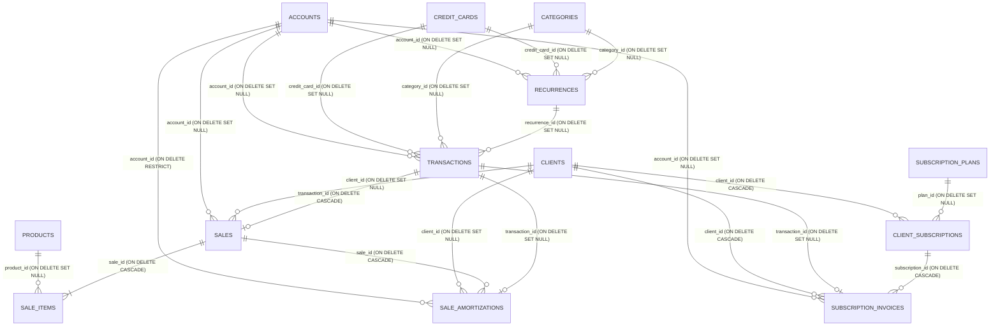
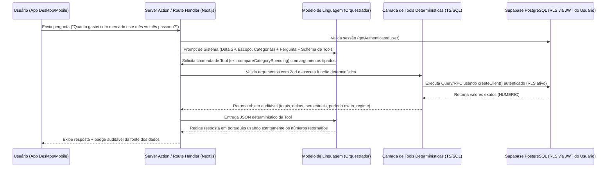

# Auditoria e Diagnóstico da Inteligência Financeira — Sistema Canário (`financeiro-app`)

> [!IMPORTANT]
> **Escopo e Metodologia:** Este documento registra o diagnóstico técnico completo da inteligência financeira, cálculos contábeis, arquitetura de dados, confiabilidade analítica, segurança multi-tenant e preparação para Inteligência Artificial do sistema **Canário (`financeiro-app`)**. Todas as conclusões foram verificadas diretamente no código-fonte, nas 23 migrações SQL, nas 13 Server Actions, nos utilitários analíticos e nos 21 arquivos de testes automatizados.

---

## Sumário

1. [Visão Geral da Arquitetura e dos Módulos](#1-visão-geral-da-arquitetura-e-dos-módulos)
2. [Inventário dos Dados e Relacionamentos Relevantes](#2-inventário-dos-dados-e-relacionamentos-relevantes)
3. [Indicadores e Cálculos Existentes](#3-indicadores-e-cálculos-existentes)
4. [Capacidades Atuais de Consulta e Análise](#4-capacidades-atuais-de-consulta-e-análise)
5. [Problemas, Inconsistências e Limitações Identificadas](#5-problemas-inconsistências-e-limitações-identificadas)
6. [Perguntas que Já Podem Ser Respondidas](#6-perguntas-que-já-podem-ser-respondidas)
7. [Perguntas Tecnicamente Viáveis Ainda Não Implementadas](#7-perguntas-tecnicamente-viáveis-ainda-não-implementadas)
8. [Perguntas que Dependem de Novos Dados ou Definições](#8-perguntas-que-dependem-de-novos-dados-ou-definições)
9. [Arquitetura Atual e Possibilidades de Integração com IA](#9-arquitetura-atual-e-possibilidades-de-integração-com-ia)
10. [Riscos de Segurança, Confiabilidade e Desempenho](#10-riscos-de-segurança-confiabilidade-e-desempenho)
11. [Lacunas de Testes e Proposta de Avaliação](#11-lacunas-de-testes-e-proposta-de-avaliação)
12. [Lista de Arquivos, Funções, Consultas e Componentes Relevantes](#12-lista-de-arquivos-funções-consultas-e-componentes-relevantes)
13. [Questões que Precisam de Decisão Humana Antes de Implementação](#13-questões-que-precisam-de-decisão-humana-antes-de-implementação)

---

## 1. Visão Geral da Arquitetura e dos Módulos

### 1.1 Stack Tecnológica e Camadas de Execução (Fatos Confirmados)
- **Framework Web & Fullstack:** `Next.js 16.4.2` (App Router) com `React 19.3.0` e `TypeScript 5` ([`package.json`](file:///home/alexandrerangel/Projetos/financeiro-app/package.json)).
- **Banco de Dados e Autenticação:** `Supabase` (`@supabase/supabase-js 2.103.3`, `@supabase/ssr 0.10.2`) sobre PostgreSQL com *Row Level Security* (RLS), triggers de provisionamento e 5 *Stored Procedures* (RPCs) em `PL/pgSQL`.
- **Camada de Backend e Acesso a Dados:** Exclusivamente baseada em **Next.js Server Actions** (`'use server'`) localizadas em [`src/lib/actions/`](file:///home/alexandrerangel/Projetos/financeiro-app/src/lib/actions/). Não existem rotas REST/GraphQL de domínio em `src/app/api/` — as únicas rotas HTTP (`route.ts`) são [`/auth/callback`](file:///home/alexandrerangel/Projetos/financeiro-app/src/app/auth/callback/route.ts) (OAuth callback) e [`/auth/dev-auto-login`](file:///home/alexandrerangel/Projetos/financeiro-app/src/app/auth/dev-auto-login/route.ts) (exclusiva de desenvolvimento local).
- **Geração de Relatórios e Documentos (Client-Side):** Exportação de relatórios gerenciais e extratos em PDF, Excel (`.xlsx`) e CSV via `jspdf` (`4.2.1`), `jspdf-autotable` (`5.0.7`) e `xlsx` (`0.18.5`) em [`src/lib/export-utils.ts`](file:///home/alexandrerangel/Projetos/financeiro-app/src/lib/export-utils.ts), além de emissão de Notas de Serviço/Venda A4 em PDF via [`src/lib/sale-receipt-utils.ts`](file:///home/alexandrerangel/Projetos/financeiro-app/src/lib/sale-receipt-utils.ts).
- **Presença Atual de Inteligência Artificial:** **Nenhuma (0%).** Confirmado via inspeção de dependências e busca global no código: não há SDKs de LLMs (OpenAI, Google Gemini, Anthropic, Vercel AI SDK), endpoints de chat, *prompts*, *embeddings* ou extensão `pgvector`. Toda a inteligência atual do sistema é **algorítmica e determinística**, distribuída entre RPCs SQL, Server Actions e utilitários TypeScript no frontend.

### 1.2 Arquitetura Funcional Híbrida (Pessoal + Negócio)
O sistema atende simultaneamente **finanças pessoais** e **gestão financeira de pequenos negócios/autônomos** (controlada por `business_profiles.has_business` e pelo campo `scope: 'personal' | 'business'` em categorias, transações e recorrências):

| Módulo | Rota | Página (Server Component) | Server Actions | Componentes de UI Principais | Escopo |
| :--- | :--- | :--- | :--- | :--- | :--- |
| **Resumo / Dashboard** | `/dashboard` | [`dashboard/page.tsx`](file:///home/alexandrerangel/Projetos/financeiro-app/src/app/(app)/dashboard/page.tsx) | [`dashboard.ts`](file:///home/alexandrerangel/Projetos/financeiro-app/src/lib/actions/dashboard.ts), [`notifications.ts`](file:///home/alexandrerangel/Projetos/financeiro-app/src/lib/actions/notifications.ts) | [`GeneralDashboardDesktop.tsx`](file:///home/alexandrerangel/Projetos/financeiro-app/src/components/dashboard/desktop/GeneralDashboardDesktop.tsx), [`BusinessDashboardDesktop.tsx`](file:///home/alexandrerangel/Projetos/financeiro-app/src/components/dashboard/desktop/BusinessDashboardDesktop.tsx), [`GeneralDashboardMobile.tsx`](file:///home/alexandrerangel/Projetos/financeiro-app/src/components/dashboard/mobile/GeneralDashboardMobile.tsx), [`BusinessDashboardMobile.tsx`](file:///home/alexandrerangel/Projetos/financeiro-app/src/components/dashboard/mobile/BusinessDashboardMobile.tsx), [`MobileSummaryView.tsx`](file:///home/alexandrerangel/Projetos/financeiro-app/src/components/dashboard/mobile/MobileSummaryView.tsx) | Híbrido (`personal` + `business`) |
| **Extrato / Transações** | `/transacoes` | [`transacoes/page.tsx`](file:///home/alexandrerangel/Projetos/financeiro-app/src/app/(app)/transacoes/page.tsx) | [`transactions.ts`](file:///home/alexandrerangel/Projetos/financeiro-app/src/lib/actions/transactions.ts) | [`TransactionsView.tsx`](file:///home/alexandrerangel/Projetos/financeiro-app/src/components/transactions/TransactionsView.tsx), [`MobileStatementView.tsx`](file:///home/alexandrerangel/Projetos/financeiro-app/src/components/dashboard/mobile/MobileStatementView.tsx) | Híbrido (`personal` + `business`) |
| **Contas Bancárias** | `/contas` | [`contas/page.tsx`](file:///home/alexandrerangel/Projetos/financeiro-app/src/app/(app)/contas/page.tsx) | [`accounts.ts`](file:///home/alexandrerangel/Projetos/financeiro-app/src/lib/actions/accounts.ts) | [`AccountsList.tsx`](file:///home/alexandrerangel/Projetos/financeiro-app/src/components/accounts/AccountsList.tsx), [`MobileYieldCorrectionModal.tsx`](file:///home/alexandrerangel/Projetos/financeiro-app/src/components/layout/MobileYieldCorrectionModal.tsx) | Compartilhado |
| **Cartões de Crédito** | `/cartoes` | [`cartoes/page.tsx`](file:///home/alexandrerangel/Projetos/financeiro-app/src/app/(app)/cartoes/page.tsx) | [`credit-cards.ts`](file:///home/alexandrerangel/Projetos/financeiro-app/src/lib/actions/credit-cards.ts) | [`CreditCardsView.tsx`](file:///home/alexandrerangel/Projetos/financeiro-app/src/components/credit-cards/CreditCardsView.tsx), [`PayInvoiceModal.tsx`](file:///home/alexandrerangel/Projetos/financeiro-app/src/components/credit-cards/PayInvoiceModal.tsx) | Compartilhado |
| **Recorrências (Fixos)** | `/recorrencias` | [`recorrencias/page.tsx`](file:///home/alexandrerangel/Projetos/financeiro-app/src/app/(app)/recorrencias/page.tsx) | [`recurrences.ts`](file:///home/alexandrerangel/Projetos/financeiro-app/src/lib/actions/recurrences.ts) | [`RecurrencesList.tsx`](file:///home/alexandrerangel/Projetos/financeiro-app/src/components/recurrences/RecurrencesList.tsx) | Híbrido (`personal` + `business`) |
| **Categorias** | `/categorias` | [`categorias/page.tsx`](file:///home/alexandrerangel/Projetos/financeiro-app/src/app/(app)/categorias/page.tsx) | [`categories.ts`](file:///home/alexandrerangel/Projetos/financeiro-app/src/lib/actions/categories.ts) | [`CategoriesList.tsx`](file:///home/alexandrerangel/Projetos/financeiro-app/src/components/categories/CategoriesList.tsx) | Híbrido (`personal` + `business`) |
| **Vendas / Atendimentos** | `/vendas` | [`vendas/page.tsx`](file:///home/alexandrerangel/Projetos/financeiro-app/src/app/(app)/vendas/page.tsx) | [`sales.ts`](file:///home/alexandrerangel/Projetos/financeiro-app/src/lib/actions/sales.ts) | [`SalesView.tsx`](file:///home/alexandrerangel/Projetos/financeiro-app/src/components/sales/SalesView.tsx), [`NewSaleModal.tsx`](file:///home/alexandrerangel/Projetos/financeiro-app/src/components/sales/NewSaleModal.tsx), [`SaleDetailsModal.tsx`](file:///home/alexandrerangel/Projetos/financeiro-app/src/components/sales/SaleDetailsModal.tsx) | Negócio |
| **Fiados / Em Aberto** | `/fiados` | [`fiados/page.tsx`](file:///home/alexandrerangel/Projetos/financeiro-app/src/app/(app)/fiados/page.tsx) | [`sales.ts`](file:///home/alexandrerangel/Projetos/financeiro-app/src/lib/actions/sales.ts) | [`FiadosView.tsx`](file:///home/alexandrerangel/Projetos/financeiro-app/src/components/fiados/FiadosView.tsx) | Negócio |
| **Clientes (CRM)** | `/clientes` | [`clientes/page.tsx`](file:///home/alexandrerangel/Projetos/financeiro-app/src/app/(app)/clientes/page.tsx) | [`clients.ts`](file:///home/alexandrerangel/Projetos/financeiro-app/src/lib/actions/clients.ts) | [`ClientsList.tsx`](file:///home/alexandrerangel/Projetos/financeiro-app/src/components/clients/ClientsList.tsx) | Negócio |
| **Clube / Assinaturas** | `/mensalidades` | [`mensalidades/page.tsx`](file:///home/alexandrerangel/Projetos/financeiro-app/src/app/(app)/mensalidades/page.tsx) | [`subscriptions.ts`](file:///home/alexandrerangel/Projetos/financeiro-app/src/lib/actions/subscriptions.ts) | [`ClientsList.tsx`](file:///home/alexandrerangel/Projetos/financeiro-app/src/components/clients/ClientsList.tsx) (`mode="subscriptions"`), [`SubscriptionsSection.tsx`](file:///home/alexandrerangel/Projetos/financeiro-app/src/components/subscriptions/SubscriptionsSection.tsx) | Negócio |
| **Catálogo (Serviços/Produtos)** | `/produtos` | [`produtos/page.tsx`](file:///home/alexandrerangel/Projetos/financeiro-app/src/app/(app)/produtos/page.tsx) | [`products.ts`](file:///home/alexandrerangel/Projetos/financeiro-app/src/lib/actions/products.ts) | [`ProductsList.tsx`](file:///home/alexandrerangel/Projetos/financeiro-app/src/components/products/ProductsList.tsx) | Negócio |

---

## 2. Inventário dos Dados e Relacionamentos Relevantes

### 2.1 Diagrama Entidade-Relacionamento (Confirmado nas 23 Migrações SQL)



### 2.2 Especificação das 17 Tabelas do Schema `public`

Todas as colunas monetárias no PostgreSQL utilizam tipos decimais exatos (`NUMERIC(12,2)` ou `NUMERIC(10,2)` em assinaturas; `NUMERIC(6,2)` em taxas de rendimento). Não há colunas `FLOAT` ou `REAL` no banco, embora o driver JS do Supabase converta `NUMERIC` para `number` em tempo de execução no Node.js/Browser.

#### 1. `public.accounts`
- **Migrações:** [`001_initial_schema.sql`](file:///home/alexandrerangel/Projetos/financeiro-app/supabase/migrations/001_initial_schema.sql#L7-L16), [`20261019220000_account_yield_and_interest.sql`](file:///home/alexandrerangel/Projetos/financeiro-app/supabase/migrations/20261019220000_account_yield_and_interest.sql).
- **Colunas:** `id UUID PK`, `user_id UUID NOT NULL` (FK `auth.users` CASCADE), `name TEXT NOT NULL`, `type TEXT NOT NULL DEFAULT 'checking'` (`checking | wallet | savings | investment`), `initial_balance NUMERIC(12,2) NOT NULL DEFAULT 0`, `color TEXT`, `yield_type TEXT NOT NULL DEFAULT 'none'` (`CHECK IN ('none', 'cdi_percent', 'monthly_percent')`), `yield_rate NUMERIC(6,2) NOT NULL DEFAULT 0`, `created_at TIMESTAMPTZ`.
- **Observação Arquitetural:** Não existe coluna `current_balance` persistida no banco. O saldo atual é sempre derivado dinamicamente de `initial_balance + SUM(transactions pagas)`.

#### 2. `public.credit_cards`
- **Migrações:** [`001_initial_schema.sql`](file:///home/alexandrerangel/Projetos/financeiro-app/supabase/migrations/001_initial_schema.sql#L19-L29).
- **Colunas:** `id UUID PK`, `user_id UUID NOT NULL` (FK `auth.users` CASCADE), `name TEXT NOT NULL`, `credit_limit NUMERIC(12,2) NOT NULL DEFAULT 0`, `closing_day INTEGER NOT NULL CHECK (1..31)`, `due_day INTEGER NOT NULL CHECK (1..31)`, `color TEXT`, `created_at TIMESTAMPTZ`.
- **Observação Arquitetural:** Não existe tabela `credit_card_invoices`. Uma "fatura" é um agrupamento lógico de linhas de `transactions` com `credit_card_id = card.id` e mesmo mês/ano de `due_date`.

#### 3. `public.categories`
- **Migrações:** [`001_initial_schema.sql`](file:///home/alexandrerangel/Projetos/financeiro-app/supabase/migrations/001_initial_schema.sql#L32-L42), [`20260405190000_category_scope.sql`](file:///home/alexandrerangel/Projetos/financeiro-app/supabase/migrations/20260405190000_category_scope.sql), [`20261019150000_deduplicate_categories_and_enforce_unique.sql`](file:///home/alexandrerangel/Projetos/financeiro-app/supabase/migrations/20261019150000_deduplicate_categories_and_enforce_unique.sql).
- **Colunas:** `id UUID PK`, `user_id UUID NOT NULL`, `name TEXT NOT NULL`, `type TEXT NOT NULL CHECK IN ('income', 'expense', 'both')`, `icon TEXT`, `color TEXT`, `is_default BOOLEAN DEFAULT FALSE`, `scope TEXT NOT NULL DEFAULT 'personal' CHECK IN ('personal', 'business')`, `created_at TIMESTAMPTZ`.
- **Índices:** `categories_user_name_type_unique` sobre `(user_id, lower(trim(name)), type)`.

#### 4. `public.recurrences`
- **Migrações:** [`001_initial_schema.sql`](file:///home/alexandrerangel/Projetos/financeiro-app/supabase/migrations/001_initial_schema.sql#L45-L60), [`20260410130000_add_scope_to_transactions_and_recurrences.sql`](file:///home/alexandrerangel/Projetos/financeiro-app/supabase/migrations/20260410130000_add_scope_to_transactions_and_recurrences.sql).
- **Colunas:** `id UUID PK`, `user_id UUID NOT NULL`, `description TEXT NOT NULL`, `amount NUMERIC(12,2) NOT NULL CHECK (amount > 0)`, `type TEXT NOT NULL CHECK IN ('income', 'expense')`, `category_id UUID` (FK `categories` SET NULL), `account_id UUID` (FK `accounts` SET NULL), `credit_card_id UUID` (FK `credit_cards` SET NULL), `due_day INTEGER NOT NULL CHECK (1..31)`, `frequency TEXT NOT NULL DEFAULT 'monthly' CHECK IN ('monthly', 'yearly')`, `active BOOLEAN DEFAULT TRUE`, `scope TEXT NOT NULL DEFAULT 'personal' CHECK IN ('personal', 'business')`, `created_at TIMESTAMPTZ`.

#### 5. `public.transactions`
- **Migrações:** [`001_initial_schema.sql`](file:///home/alexandrerangel/Projetos/financeiro-app/supabase/migrations/001_initial_schema.sql#L63-L86), [`20260403182000_atomic_sales_and_safeguards.sql`](file:///home/alexandrerangel/Projetos/financeiro-app/supabase/migrations/20260403182000_atomic_sales_and_safeguards.sql), [`20260410130000_add_scope_to_transactions_and_recurrences.sql`](file:///home/alexandrerangel/Projetos/financeiro-app/supabase/migrations/20260410130000_add_scope_to_transactions_and_recurrences.sql).
- **Colunas:** `id UUID PK`, `user_id UUID NOT NULL`, `description TEXT NOT NULL`, `amount NUMERIC(12,2) NOT NULL CHECK (amount > 0)`, `type TEXT NOT NULL CHECK IN ('income', 'expense', 'transfer')`, `payment_method TEXT NOT NULL DEFAULT 'cash' CHECK IN ('cash', 'debit', 'credit', 'pix', 'transfer')`, `transaction_date DATE NOT NULL DEFAULT CURRENT_DATE`, `due_date DATE`, `category_id UUID` (FK `categories` SET NULL), `account_id UUID` (FK `accounts` SET NULL), `credit_card_id UUID` (FK `credit_cards` SET NULL), `recurrence_id UUID` (FK `recurrences` SET NULL), `installment_group_id UUID`, `current_installment INTEGER DEFAULT 1`, `total_installments INTEGER DEFAULT 1`, `is_paid BOOLEAN NOT NULL DEFAULT TRUE`, `paid_at TIMESTAMPTZ`, `notes TEXT`, `scope TEXT NOT NULL DEFAULT 'personal' CHECK IN ('personal', 'business')`, `created_at TIMESTAMPTZ`.
- **Índices Relevantes:** `uq_transactions_recurrence_due (recurrence_id, due_date) WHERE recurrence_id IS NOT NULL`, `idx_transactions_account_paid_type (user_id, account_id, is_paid, type)`, `idx_transactions_user_scope (user_id, scope, due_date)`.

#### 6. `public.products`
- **Migrações:** [`002_sales_and_products.sql`](file:///home/alexandrerangel/Projetos/financeiro-app/supabase/migrations/002_sales_and_products.sql#L6-L16).
- **Colunas:** `id UUID PK`, `user_id UUID NOT NULL`, `name TEXT NOT NULL`, `type TEXT NOT NULL DEFAULT 'service' CHECK IN ('service', 'product')`, `default_price NUMERIC(12,2) NOT NULL DEFAULT 0 CHECK (default_price >= 0)`, `icon TEXT`, `color TEXT`, `active BOOLEAN NOT NULL DEFAULT TRUE`, `created_at TIMESTAMPTZ`.

#### 7. `public.sales`
- **Migrações:** [`002_sales_and_products.sql`](file:///home/alexandrerangel/Projetos/financeiro-app/supabase/migrations/002_sales_and_products.sql#L19-L32), [`20260329204500_clients_and_fiado.sql`](file:///home/alexandrerangel/Projetos/financeiro-app/supabase/migrations/20260329204500_clients_and_fiado.sql#L16-L24), [`20260403141000_partial_payments.sql`](file:///home/alexandrerangel/Projetos/financeiro-app/supabase/migrations/20260403141000_partial_payments.sql).
- **Colunas:** `id UUID PK`, `user_id UUID NOT NULL`, `client_id UUID` (FK `clients` SET NULL), `client_name TEXT`, `total_amount NUMERIC(12,2) NOT NULL CHECK (>= 0)`, `paid_amount NUMERIC(12,2) NOT NULL DEFAULT 0 CHECK (>= 0)`, `remaining_amount NUMERIC(12,2) NOT NULL DEFAULT 0 CHECK (>= 0)`, `status TEXT NOT NULL DEFAULT 'paid' CHECK IN ('paid', 'pending', 'partially_paid')`, `payment_method TEXT NOT NULL DEFAULT 'pix' CHECK IN ('pix', 'cash', 'debit', 'credit', 'transfer', 'on_credit')`, `due_date DATE`, `account_id UUID` (FK `accounts` SET NULL), `transaction_id UUID` (FK `transactions` **`ON DELETE CASCADE`**), `sale_date TIMESTAMPTZ NOT NULL DEFAULT NOW()`, `notes TEXT`, `created_at TIMESTAMPTZ`.

#### 8. `public.sale_items`
- **Migrações:** [`002_sales_and_products.sql`](file:///home/alexandrerangel/Projetos/financeiro-app/supabase/migrations/002_sales_and_products.sql#L35-L45).
- **Colunas:** `id UUID PK`, `sale_id UUID NOT NULL` (FK `sales` CASCADE), `product_id UUID` (FK `products` SET NULL), `product_name TEXT NOT NULL`, `quantity INTEGER NOT NULL DEFAULT 1 CHECK (> 0)`, `unit_price NUMERIC(12,2) NOT NULL CHECK (>= 0)`, `total_price NUMERIC(12,2) NOT NULL CHECK (>= 0)`, `created_at TIMESTAMPTZ`.

#### 9. `public.sale_amortizations`
- **Migrações:** [`20260403141000_partial_payments.sql`](file:///home/alexandrerangel/Projetos/financeiro-app/supabase/migrations/20260403141000_partial_payments.sql#L13-L25).
- **Colunas:** `id UUID PK`, `user_id UUID NOT NULL`, `sale_id UUID NOT NULL` (FK `sales` CASCADE), `client_id UUID` (FK `clients` SET NULL), `amount NUMERIC(12,2) NOT NULL CHECK (> 0)`, `payment_method TEXT NOT NULL CHECK IN ('pix', 'cash', 'debit', 'credit', 'transfer')`, `account_id UUID` (FK `accounts` **`ON DELETE RESTRICT`**), `transaction_id UUID` (FK `transactions` SET NULL), `amortized_at TIMESTAMPTZ NOT NULL DEFAULT NOW()`, `notes TEXT`, `created_at TIMESTAMPTZ`.

#### 10. `public.clients`
- **Migrações:** [`20260329204500_clients_and_fiado.sql`](file:///home/alexandrerangel/Projetos/financeiro-app/supabase/migrations/20260329204500_clients_and_fiado.sql#L2-L12), [`20260410160000_clients_crm_fields.sql`](file:///home/alexandrerangel/Projetos/financeiro-app/supabase/migrations/20260410160000_clients_crm_fields.sql), [`20261019180000_client_return_radar.sql`](file:///home/alexandrerangel/Projetos/financeiro-app/supabase/migrations/20261019180000_client_return_radar.sql).
- **Colunas:** `id UUID PK`, `user_id UUID NOT NULL`, `name TEXT NOT NULL`, `phone TEXT`, `cpf TEXT`, `birth_date DATE`, `last_contacted_at TIMESTAMPTZ`, `notes TEXT`, `created_at TIMESTAMPTZ`.

#### 11. `public.subscription_plans`, 12. `public.client_subscriptions` e 13. `public.subscription_invoices`
- **Migrações:** [`20260331222455_subscriptions_and_notifications.sql`](file:///home/alexandrerangel/Projetos/financeiro-app/supabase/migrations/20260331222455_subscriptions_and_notifications.sql#L5-L61).
- **`subscription_plans`:** `id`, `user_id`, `name`, `description`, `price NUMERIC(10,2)`, `interval ('monthly')`, `active`, `created_at`, `updated_at`.
- **`client_subscriptions`:** `id`, `user_id`, `client_id` (FK CASCADE), `plan_id` (FK SET NULL), `custom_plan_name`, `price NUMERIC(10,2)`, `due_day (1..31)`, `start_date DATE`, `status ('active' | 'paused' | 'canceled')`, `notes`.
- **`subscription_invoices`:** `id`, `user_id`, `subscription_id` (FK CASCADE), `client_id` (FK CASCADE), `amount NUMERIC(10,2)`, `due_date DATE`, `period_start DATE`, `period_end DATE`, `status ('pending' | 'paid' | 'canceled')`, `paid_at DATE`, `account_id` (FK SET NULL), `transaction_id` (FK `transactions` SET NULL), `payment_method`. Unique `(subscription_id, period_start)`.

#### 14. `public.business_profiles`, 15. `public.business_message_settings`, 16. `public.notifications` e 17. `public.user_notification_preferences`
- **Migrações:** [`20260405180000_business_profiles.sql`](file:///home/alexandrerangel/Projetos/financeiro-app/supabase/migrations/20260405180000_business_profiles.sql), [`20261026190000_add_cnpj_to_business_profiles.sql`](file:///home/alexandrerangel/Projetos/financeiro-app/supabase/migrations/20261026190000_add_cnpj_to_business_profiles.sql), [`20261020150000_business_message_settings.sql`](file:///home/alexandrerangel/Projetos/financeiro-app/supabase/migrations/20261020150000_business_message_settings.sql), [`20261026120000_expand_message_settings_templates.sql`](file:///home/alexandrerangel/Projetos/financeiro-app/supabase/migrations/20261026120000_expand_message_settings_templates.sql), [`20261019120000_notification_preferences_and_Types.sql`](file:///home/alexandrerangel/Projetos/financeiro-app/supabase/migrations/20261019120000_notification_preferences_and_Types.sql).

### 2.3 Stored Procedures / RPCs no PostgreSQL (`PL/pgSQL`)

Todas as 5 RPCs do sistema são `SECURITY INVOKER` com `SET search_path = public` e exigem `auth.uid()`:

1. **`create_sale_atomic`** ([`20260410130000_add_scope_to_transactions_and_recurrences.sql:48-199`](file:///home/alexandrerangel/Projetos/financeiro-app/supabase/migrations/20260410130000_add_scope_to_transactions_and_recurrences.sql#L48-L199)):
   - Recalcula `v_total = SUM(quantity * unit_price)` diretamente no banco a partir do JSONB de itens (ignorando total enviado pelo cliente).
   - Se `p_payment_method != 'on_credit'`, cria imediatamente uma transação `type='income'`, `is_paid=true`, `scope='business'` em `transactions`, cria o registro em `sales` (`status='paid'`, `paid_amount = v_total`, `remaining_amount = 0`) e insere `sale_items`.
   - Se `p_payment_method = 'on_credit'` (fiado), exige `p_client_id`, calcula `v_remaining = v_total - p_initial_payment`, define `sales.transaction_id = NULL` e, se houver sinal (`p_initial_payment > 0`), cria uma transação de receita (`'Entrada Atendimento: ...'`) e um registro em `sale_amortizations`.
2. **`amortize_sale_atomic`** ([`20260410130000_add_scope_to_transactions_and_recurrences.sql:204-289`](file:///home/alexandrerangel/Projetos/financeiro-app/supabase/migrations/20260410130000_add_scope_to_transactions_and_recurrences.sql#L204-L289)):
   - Faz `SELECT ... FOR UPDATE` na linha de `sales`, valida `p_amount <= v_sale.remaining_amount`, insere transação `income` (`'Amortização: ...'`, `scope='business'`) + linha em `sale_amortizations`, e atualiza `sales` (marcando `status='paid'` se `v_new_remaining <= 0.009`).
3. **`amortize_client_debt_atomic`** ([`20260405192000_security_rls_hardening.sql:330-388`](file:///home/alexandrerangel/Projetos/financeiro-app/supabase/migrations/20260405192000_security_rls_hardening.sql#L330-L388)):
   - Percorre as vendas em aberto do cliente em ordem **FIFO** (`ORDER BY sale_date ASC, created_at ASC FOR UPDATE`) chamando `amortize_sale_atomic` até esgotar o valor pago.
4. **`get_account_aggregates(p_month_prefix TEXT)`** ([`20261019230000_sql_aggregates.sql:20-59`](file:///home/alexandrerangel/Projetos/financeiro-app/supabase/migrations/20261019230000_sql_aggregates.sql#L20-L59)):
   - Agrupa `transactions` por `account_id` onde `user_id = auth.uid()`, `is_paid = true`, `account_id IS NOT NULL` e `type IN ('income', 'expense')`, retornando `transaction_sum`, `yield_all_time` e `yield_current_month`.
5. **`get_account_prior_balance(p_before DATE)`** ([`20261019230000_sql_aggregates.sql:66-86`](file:///home/alexandrerangel/Projetos/financeiro-app/supabase/migrations/20261019230000_sql_aggregates.sql#L66-L86)):
   - Retorna a soma de `accounts.initial_balance` mais o saldo líquido das transações pagas com `account_id IS NOT NULL` e `due_date < p_before`.

### 2.4 Informações Que NÃO Existem no Modelo de Dados Atual
- **Custo de Aquisição / Reposição e Estoque de Produtos:** Apesar de mencionado em documentações antigas e no [`README.md`](file:///home/alexandrerangel/Projetos/financeiro-app/README.md#L48), a tabela `products` **não possui** colunas de estoque (`stock_quantity`, `min_stock`) nem custo unitário (`cost_price`).
- **Orçamentos e Metas (Budgets):** Não há tabela ou coluna para limites de gastos por categoria ou metas mensais de faturamento.
- **Conta Bancária Pagadora de Fatura de Cartão:** Não há coluna nem transação vinculando o pagamento de uma fatura de cartão a um `account_id`.
- **Comissionamento / Múltiplos Profissionais:** Não há entidade de colaboradores ou rateio de comissões por venda/item.
- **Transferências entre Contas Bancárias (`from_account_id` / `to_account_id`):** Não há suporte estrutural a transferências entre contas.

---

## 3. Indicadores e Cálculos Existentes

| Indicador / Métrica | Fórmula Exata Implementada | Onde é Calculado | Regime e Campo de Data |
| :--- | :--- | :--- | :--- |
| **Saldo Atual da Conta (`current_balance`)** | `accounts.initial_balance + SUM(CASE WHEN type='income' THEN amount ELSE -amount END)` onde `is_paid = true` e `account_id IS NOT NULL` | SQL RPC `get_account_aggregates` ([`20261019230000_sql_aggregates.sql:20-59`](file:///home/alexandrerangel/Projetos/financeiro-app/supabase/migrations/20261019230000_sql_aggregates.sql#L20-L59)) + [`accounts.ts:98-108`](file:///home/alexandrerangel/Projetos/financeiro-app/src/lib/actions/accounts.ts#L98-L108) | Caixa (`is_paid = true`), sem filtro de data limite (`due_date <= today`) |
| **Rendimento Acumulado (`total_yield`) e no Mês (`current_month_yield`)** | Soma de `amount` onde `type='income'`, `is_paid=true` e (`notes ILIKE '%[Rendimento]%'` ou `description` inicia com `rendimento:`/`rendimento `/`juros:`) | SQL RPC `get_account_aggregates` ([`20261019230000_sql_aggregates.sql:31-55`](file:///home/alexandrerangel/Projetos/financeiro-app/supabase/migrations/20261019230000_sql_aggregates.sql#L31-L55)) | `to_char(COALESCE(due_date, transaction_date), 'YYYY-MM') = p_month_prefix` |
| **Sugestão de Rendimento (`calculateMonthlyYield`)** | `monthly_percent`: `balance * (rate / 100)`. `cdi_percent`: `balance * (((1 + 0.1065)^(1/12) - 1) * (rate / 100))` (taxa CDI hardcoded em `10,65%` a.a.) | Util TS [`account-yield-utils.ts:19-41`](file:///home/alexandrerangel/Projetos/financeiro-app/src/lib/account-yield-utils.ts#L19-L41) | Estimativa sobre saldo atual |
| **Evolução do Saldo em Conta (`accountBalance`)** | `priorBalance` (`get_account_prior_balance` antes de `YYYY-01-01`) + acumulado progressivo de `(income - expense)` onde `is_paid = true` e `account_id != null` | SQL RPC `get_account_prior_balance` + [`dashboard.ts:816-826`](file:///home/alexandrerangel/Projetos/financeiro-app/src/lib/actions/dashboard.ts#L816-L826) + [`GeneralDashboardDesktop.tsx:211-300`](file:///home/alexandrerangel/Projetos/financeiro-app/src/components/dashboard/desktop/GeneralDashboardDesktop.tsx#L211-L300) | `transactions.due_date` (`is_paid = true`, `account_id != null`) |
| **Receita Geral (`generalIncome`), Despesa Geral (`generalExpense`) e Saldo Líquido (`netBalance`)** | Soma de `transactions.amount` com `is_paid = true` por `type === 'income'` e `type === 'expense'`; `netBalance = generalIncome - generalExpense` | Server Action [`dashboard.ts:788-825`](file:///home/alexandrerangel/Projetos/financeiro-app/src/lib/actions/dashboard.ts#L788-L825) (mensal) e Client TS (semanal/anual) | `transactions.due_date` (`is_paid = true`) |
| **A Pagar (`pendingExpenses`) e A Receber Pessoal (`pendingIncome`)** | Soma de `transactions.amount` com `is_paid = false`. Na visão pessoal, filtra `!isBusinessTransaction(t)` | [`dashboard.ts:797-804`](file:///home/alexandrerangel/Projetos/financeiro-app/src/lib/actions/dashboard.ts#L797-L804) + [`GeneralDashboardDesktop.tsx:152-169`](file:///home/alexandrerangel/Projetos/financeiro-app/src/components/dashboard/desktop/GeneralDashboardDesktop.tsx#L152-L169) / [`MobileSummaryView.tsx:194-216`](file:///home/alexandrerangel/Projetos/financeiro-app/src/components/dashboard/mobile/MobileSummaryView.tsx#L194-L216) | Competência por `transactions.due_date` (`is_paid = false`) |
| **Faturamento do Negócio (`monthSummary.revenue` / `monthlyTrend.revenue`)** | Soma de `sales.total_amount` (quando `payment_method !== 'on_credit'`) por `sale_date` **+** soma de `sale_amortizations.amount` por `amortized_at` | Server Action [`dashboard.ts:293-318, 455-479`](file:///home/alexandrerangel/Projetos/financeiro-app/src/lib/actions/dashboard.ts#L455-L479) | **Regime de Caixa** (`sales.sale_date` + `sale_amortizations.amortized_at`) |
| **Custos do Negócio (`monthSummary.expenses`)** | Soma de `transactions.amount` onde `type = 'expense'`, `is_paid = true` e `isBusinessTransaction(t) = true` | Server Action [`dashboard.ts:283-289, 434-452`](file:///home/alexandrerangel/Projetos/financeiro-app/src/lib/actions/dashboard.ts#L434-L452) | `transactions.due_date` (`is_paid = true`) |
| **Lucro Líquido (`netProfit`) e Margem (`margin`)** | `netProfit = revenue - expenses`; `margin = revenue > 0 ? ((revenue - expenses) / revenue) * 100 : 0` | Server Action [`dashboard.ts:351-353, 481-482`](file:///home/alexandrerangel/Projetos/financeiro-app/src/lib/actions/dashboard.ts#L481-L482) | Híbrido (Receita em caixa por `sale_date`/`amortized_at` menos Despesa por `due_date`) |
| **Ticket Médio (`averageTicket`)** | `monthSalesCount > 0 ? monthRevenue / monthSalesCount : 0` | Server Action [`dashboard.ts:483-484`](file:///home/alexandrerangel/Projetos/financeiro-app/src/lib/actions/dashboard.ts#L483-L484) e UI [`SalesView.tsx:111`](file:///home/alexandrerangel/Projetos/financeiro-app/src/components/sales/SalesView.tsx#L111) | Híbrido inconsistente (numerador em caixa; denominador em contagem total de vendas) |
| **Divisão Serviços vs Produtos (`revenueSplit`)** | Soma de `sale_items.total_price` do mês separando `product.type === 'product'` vs `'service'`; se venda sem itens, soma `sale.total_amount` em `serviceRevenue` | Server Action [`dashboard.ts:600-657`](file:///home/alexandrerangel/Projetos/financeiro-app/src/lib/actions/dashboard.ts#L600-L657) | **Regime de Competência Bruto** por `sales.sale_date` (inclui fiados não pagos) |
| **Ranking Top 5 Clientes (`topClients`)** | Soma de `sale.total_amount` no mês agrupada por `(s.client_name \|\| 'Cliente Avulso').trim()`, ordenada `DESC`, `.slice(0, 5)` | Server Action [`dashboard.ts:612-675`](file:///home/alexandrerangel/Projetos/financeiro-app/src/lib/actions/dashboard.ts#L612-L675) | **Regime de Competência Bruto** por `sales.sale_date` |
| **Ranking Top 6 Catálogo (`topProducts`)** | Soma de `sale_items.quantity` e `total_price` **do ano inteiro**, ordenado por `totalQuantity DESC`, `.slice(0, 6)`. Taxa `growth` compara quantidade do mês atual vs mês anterior | Server Action [`dashboard.ts:320-344, 564-580`](file:///home/alexandrerangel/Projetos/financeiro-app/src/lib/actions/dashboard.ts#L564-L580) | Competência por `sales.sale_date` (acumulado anual + crescimento mensal) |
| **Evolução por Categoria (`computeCategoryEvolutionData`)** | Agrupa despesas pagas por categoria; calcula média mensal dos meses ativos (`totalYear / activeMonthsCount`) e comparação *same-day* (`currentSameDayTotal` até o dia $D$ vs `prevSameDayTotal` até $\min(D, \text{diasMesAnterior})$) | Util TS [`category-evolution-utils.ts:204-386`](file:///home/alexandrerangel/Projetos/financeiro-app/src/lib/category-evolution-utils.ts#L204-L386) | `transactions.due_date` (`is_paid = true`, `type = 'expense'`) |
| **Radar de Retorno de Clientes (`analyzeClientSales`)** | Média ponderada dos últimos até 6 intervalos entre visitas (pesos $1, 2, \dots, n$). Com $<2$ visitas, usa `defaultCycleDays` (25). Status: `on_track`, `due_soon` ($\le 3$ dias), `overdue` ($\ge \text{ciclo}$), `inactive` ($\ge \max(\text{ciclo}\times 2, 45)$ dias). Silencia por 7 dias após `last_contacted_at` | Util TS [`client-analytics.ts:28-133`](file:///home/alexandrerangel/Projetos/financeiro-app/src/lib/client-analytics.ts#L28-L133) | Histórico de `sales.sale_date` |
| **Vencimento e Limite Disponível do Cartão** | Vencimento: se `purchaseDay >= closingDay`, avança 1 mês; se `dueDay < closingDay`, avança +1 mês ([`credit-card-utils.ts:9-29`](file:///home/alexandrerangel/Projetos/financeiro-app/src/lib/credit-card-utils.ts#L9-L29)). Limite disponível: `credit_limit - SUM(transactions não pagas do cartão)` | [`credit-card-utils.ts`](file:///home/alexandrerangel/Projetos/financeiro-app/src/lib/credit-card-utils.ts) e [`credit-cards.ts:60-92`](file:///home/alexandrerangel/Projetos/financeiro-app/src/lib/actions/credit-cards.ts#L60-L92) | `transaction_date` -> `due_date`; `is_paid = false` |

---

## 4. Capacidades Atuais de Consulta e Análise

### 4.1 Mapeamento de Capacidades Implementadas no Código

| Capacidade | Pergunta / Necessidade que Atende | Dados Utilizados | Implementação e Local de Cálculo | Filtros e Restrições Reais | Cobertura de Testes |
| :--- | :--- | :--- | :--- | :--- | :--- |
| **Dashboard Visão Geral** | Quanto entrou, quanto saiu, qual a evolução do saldo em conta, quanto falta pagar/receber e onde gastei mais? | `transactions`, `accounts`, `categories`, `sales` | [`getGeneralDashboardData`](file:///home/alexandrerangel/Projetos/financeiro-app/src/lib/actions/dashboard.ts#L732) (Server) + [`GeneralDashboardDesktop.tsx`](file:///home/alexandrerangel/Projetos/financeiro-app/src/components/dashboard/desktop/GeneralDashboardDesktop.tsx) e [`MobileSummaryView.tsx`](file:///home/alexandrerangel/Projetos/financeiro-app/src/components/dashboard/mobile/MobileSummaryView.tsx) (Client) | Ano, Mês, Escala (`week \| month \| year`), Semana do mês, Categoria selecionada | Parcial ([`category-evolution-utils.test.ts`](file:///home/alexandrerangel/Projetos/financeiro-app/src/lib/category-evolution-utils.test.ts)) |
| **Dashboard do Negócio** | Qual o faturamento, custos, lucro, margem, ticket médio, meios de pagamento, top produtos/clientes e fiados em aberto? | `sales`, `sale_items`, `sale_amortizations`, `transactions`, `categories`, `products`, `clients` | [`getBusinessDashboardData`](file:///home/alexandrerangel/Projetos/financeiro-app/src/lib/actions/dashboard.ts#L223) (Server) + [`BusinessDashboardDesktop.tsx`](file:///home/alexandrerangel/Projetos/financeiro-app/src/components/dashboard/desktop/BusinessDashboardDesktop.tsx) e [`MobileSummaryView.tsx`](file:///home/alexandrerangel/Projetos/financeiro-app/src/components/dashboard/mobile/MobileSummaryView.tsx) (Client) | Ano, Mês, Escala (`week \| month \| year`), Semana do mês | Parcial ([`business-scope-utils.test.ts`](file:///home/alexandrerangel/Projetos/financeiro-app/src/lib/business-scope-utils.test.ts)) |
| **Extrato e Busca de Transações** | Quais lançamentos tive no mês, quanto entrou/saiu e quanto está pendente? | `transactions` com joins `category`, `account`, `credit_card` | [`getTransactions`](file:///home/alexandrerangel/Projetos/financeiro-app/src/lib/actions/transactions.ts#L48) (Server) + [`TransactionsView.tsx`](file:///home/alexandrerangel/Projetos/financeiro-app/src/components/transactions/TransactionsView.tsx) e [`filterTransactionsList`](file:///home/alexandrerangel/Projetos/financeiro-app/src/lib/transaction-filter-utils.ts) (Client) | Mês/Ano (`due_date`), Categoria (`selectedCategoryId`) e Busca textual livre (`description`) | Sim ([`transaction-filter-utils.test.ts`](file:///home/alexandrerangel/Projetos/financeiro-app/src/lib/transaction-filter-utils.test.ts)) |
| **Histórico e Filtros de Vendas** | Quais vendas fiz no período, quanto recebi nelas e quais itens vendi? | `sales`, `sale_items`, `sale_amortizations`, `account` | [`getSales`](file:///home/alexandrerangel/Projetos/financeiro-app/src/lib/actions/sales.ts#L52) (Server) + [`SalesView.tsx`](file:///home/alexandrerangel/Projetos/financeiro-app/src/components/sales/SalesView.tsx#L73-L115) (Client) | Mês/Ano, Dia específico (`dayFilter`), Meio de pagamento (`all \| pix \| cash \| card \| on_credit`) e Busca textual (cliente ou item) | Parcial ([`sales-amortization-utils.test.ts`](file:///home/alexandrerangel/Projetos/financeiro-app/src/lib/sales-amortization-utils.test.ts)) |
| **Central de Fiados** | Quem me deve, quanto está atrasado e qual o histórico de amortizações? | `sales` (`status != 'paid'`), `sale_amortizations`, `clients` | [`getPendingDebtsSummary`](file:///home/alexandrerangel/Projetos/financeiro-app/src/lib/actions/sales.ts#L708) (Server) + [`FiadosView.tsx`](file:///home/alexandrerangel/Projetos/financeiro-app/src/components/fiados/FiadosView.tsx) (Client) | Filtro Todos vs Vencidos (`overdue`), Busca por nome do cliente | Parcial ([`fiado-utils.test.ts`](file:///home/alexandrerangel/Projetos/financeiro-app/src/lib/fiado-utils.test.ts)) |
| **CRM e Radar de Retorno** | Quais clientes estão sumidos, perto do dia de voltar, têm fiado ou fazem aniversário hoje? | `clients`, `sales`, `client_subscriptions`, `subscription_invoices` | [`getClients`](file:///home/alexandrerangel/Projetos/financeiro-app/src/lib/actions/clients.ts#L31) (Server) + [`ClientsList.tsx`](file:///home/alexandrerangel/Projetos/financeiro-app/src/components/clients/ClientsList.tsx) + [`analyzeClientSales`](file:///home/alexandrerangel/Projetos/financeiro-app/src/lib/client-analytics.ts) (Client) | Filtros `all`, `radar`, `with_debt`, `subscribers` + busca por nome/telefone/CPF | Sim ([`client-analytics.test.ts`](file:///home/alexandrerangel/Projetos/financeiro-app/src/lib/client-analytics.test.ts)) |
| **Exportação Documental** | Gerar extrato/relatório gerencial em PDF/Excel/CSV ou nota de serviço/venda A4 em PDF | Dados já carregados nos estados de Dashboard, Transações ou Vendas | [`export-utils.ts`](file:///home/alexandrerangel/Projetos/financeiro-app/src/lib/export-utils.ts) e [`sale-receipt-utils.ts`](file:///home/alexandrerangel/Projetos/financeiro-app/src/lib/sale-receipt-utils.ts) (Client) | Respeita o mês/ano ou venda selecionada na tela | Parcial ([`sale-receipt-utils.test.ts`](file:///home/alexandrerangel/Projetos/financeiro-app/src/lib/sale-receipt-utils.test.ts)) |

### 4.2 Classificação por Níveis Analíticos
1. **Consulta direta de informações registradas:** **Já implementada e disponível** (listagens de transações, vendas, clientes, contas, cartões, faturas, recorrências e assinaturas).
2. **Agregação e comparação de valores:** **Já implementada**, mas sujeita às divergências de regime descritas na Seção 5.
3. **Evolução ao longo do tempo:** **Já implementada** dentro do mesmo ano civil (12 meses do ano selecionado, semanas do mês ou dias da semana). **Tecnicamente viável, mas não implementada** para comparação entre anos diferentes.
4. **Identificação de padrões e tendências:** **Já implementada** para o ciclo individual ponderado de retorno de clientes ([`client-analytics.ts`](file:///home/alexandrerangel/Projetos/financeiro-app/src/lib/client-analytics.ts)) e para a velocidade de gastos por categoria até o mesmo dia do mês anterior ([`category-evolution-utils.ts:285-315`](file:///home/alexandrerangel/Projetos/financeiro-app/src/lib/category-evolution-utils.ts#L285-L315)).
5. **Comparações entre categorias, contas, períodos e dimensões:** **Já implementada** para categorias e meios de pagamento; **Parcialmente implementada** para contas e cartões no extrato (lógica pronta em [`transaction-filter-utils.ts`](file:///home/alexandrerangel/Projetos/financeiro-app/src/lib/transaction-filter-utils.ts), porém travada em `'all'` na UI de [`TransactionsView.tsx:106-107`](file:///home/alexandrerangel/Projetos/financeiro-app/src/components/transactions/TransactionsView.tsx#L106-L107)).
6. **Projeções ou estimativas:** **Parcialmente implementada** (geração de recorrências para +3 meses, sugestão de rendimento mensal de conta e próxima data esperada de visita do cliente). **Tecnicamente viável, mas não implementada** para projeção integrada de fluxo de caixa futuro.
7. **Explicações sobre variações nos resultados:** **Tecnicamente viável com os dados atuais, mas ainda não implementada** (ex.: decompor quais categorias e lançamentos causaram o aumento de despesas entre dois meses).
8. **Identificação de anomalias ou situações que mereçam atenção:** **Já implementada** para alertas determinísticos de vencimento, atraso de clientes, fiados e aniversários ([`notifications.ts`](file:///home/alexandrerangel/Projetos/financeiro-app/src/lib/actions/notifications.ts)). **Tecnicamente viável, mas não implementada** para detecção de gastos atípicos (*outliers*) e possíveis lançamentos duplicados.

---

## 5. Problemas, Inconsistências e Limitações Identificadas

Abaixo estão listados os **14 achados técnicos confirmados no código**, com localização exata (`arquivo:linha`):

### 5.1 Quatro Definições Conflitantes de "Faturamento do Negócio"
- **Onde ocorre:** [`src/lib/actions/dashboard.ts`](file:///home/alexandrerangel/Projetos/financeiro-app/src/lib/actions/dashboard.ts), [`GeneralDashboardDesktop.tsx`](file:///home/alexandrerangel/Projetos/financeiro-app/src/components/dashboard/desktop/GeneralDashboardDesktop.tsx) e [`MobileSummaryView.tsx`](file:///home/alexandrerangel/Projetos/financeiro-app/src/components/dashboard/mobile/MobileSummaryView.tsx).
- **Evidência no código:**
  1. **`getBusinessDashboardData` (`monthSummary.revenue` e `monthlyTrend.revenue` — [`dashboard.ts:293-318, 455-479`](file:///home/alexandrerangel/Projetos/financeiro-app/src/lib/actions/dashboard.ts#L455-L479)):** Calcula o faturamento pela tabela `sales` em **Regime de Caixa** (`total_amount` das vendas com `payment_method !== 'on_credit'` por `sale_date` + `sale_amortizations.amount` por `amortized_at`). **Não inclui** as mensalidades pagas do Clube (`subscription_invoices`), pois [`paySubscriptionInvoice`](file:///home/alexandrerangel/Projetos/financeiro-app/src/lib/actions/subscriptions.ts#L316-L329) insere apenas em `transactions` e não em `sales`. Também não inclui receitas manuais com `scope = 'business'` lançadas no extrato.
  2. **`revenueSplit`, `topClients` e `topProducts` ([`dashboard.ts:320-344, 600-657`](file:///home/alexandrerangel/Projetos/financeiro-app/src/lib/actions/dashboard.ts#L600-L657)):** Na mesma função `getBusinessDashboardData`, a divisão Serviços vs Produtos (`revenueSplit`) e o ranking `topClients` somam `sale_items.total_price` e `sales.total_amount` em **Regime de Competência Bruto** (incluindo 100% das vendas no fiado não pagas e excluindo amortizações de meses anteriores). Como resultado, `revenueSplit.serviceRevenue + revenueSplit.productRevenue !== monthSummary.revenue` sempre que houver fiados ou amortizações.
  3. **`getGeneralDashboardData.serviceRevenue` ([`dashboard.ts:776-783`](file:///home/alexandrerangel/Projetos/financeiro-app/src/lib/actions/dashboard.ts#L776-L783)):** Soma `sales.total_amount` de todas as vendas do mês (inclusive fiados não pagos), divergindo do faturamento exibido na aba do negócio.
  4. **Frontend nos modos Semanal/Anual e Visão Geral ([`GeneralDashboardDesktop.tsx:158-163`](file:///home/alexandrerangel/Projetos/financeiro-app/src/components/dashboard/desktop/GeneralDashboardDesktop.tsx#L158-L163) e [`MobileSummaryView.tsx:508-518`](file:///home/alexandrerangel/Projetos/financeiro-app/src/components/dashboard/mobile/MobileSummaryView.tsx#L508-L518)):** Filtra `transactions` usando [`isBarbeariaServiceIncome`](file:///home/alexandrerangel/Projetos/financeiro-app/src/lib/business-scope-utils.ts#L79-L89) por `due_date` (`is_paid = true`), o que inclui mensalidades do clube e receitas manuais do negócio.

### 5.2 Ticket Médio (`averageTicket`) com Numerador e Denominador Incompatíveis
- **Onde ocorre:** [`src/lib/actions/dashboard.ts:483-484`](file:///home/alexandrerangel/Projetos/financeiro-app/src/lib/actions/dashboard.ts#L483-L484) e [`src/components/sales/SalesView.tsx:111`](file:///home/alexandrerangel/Projetos/financeiro-app/src/components/sales/SalesView.tsx#L111).
- **Evidência no código:** A fórmula `monthRevenue / monthSalesCount` divide uma receita em **Regime de Caixa** (`monthRevenue`, que exclui fiados sem entrada do próprio mês e inclui amortizações de fiados antigos) pela contagem total de vendas do mês em **Regime de Competência** (`monthSalesCount`). Se houver 1 venda no mês de R$ 100,00 no fiado sem entrada, o ticket médio exibido é **R$ 0,00**.

### 5.3 Pagamento de Fatura de Cartão NÃO Debita Saldo de Conta Bancária
- **Onde ocorre:** [`src/lib/actions/credit-cards.ts:254-390`](file:///home/alexandrerangel/Projetos/financeiro-app/src/lib/actions/credit-cards.ts#L254-L390), [`src/components/credit-cards/PayInvoiceModal.tsx`](file:///home/alexandrerangel/Projetos/financeiro-app/src/components/credit-cards/PayInvoiceModal.tsx) e [`src/lib/actions/accounts.ts:53-108`](file:///home/alexandrerangel/Projetos/financeiro-app/src/lib/actions/accounts.ts#L53-L108).
- **Evidência no código:** Compras no cartão possuem `credit_card_id = card.id` e `account_id = null`. Quando o usuário paga a fatura via `setCreditCardInvoicePaid` ou `payCreditCardInvoiceAmount`, o sistema apenas altera `is_paid = true` nessas transações (`account_id` continua `null`). Nenhuma conta bancária é selecionada ou debitada. Assim, quitar uma fatura de R$ 5.000 aumenta `generalExpense`, mas **não reduz o saldo de nenhuma conta bancária (`current_balance`) nem altera o gráfico de evolução de saldo em conta (`accountBalance`)**.

### 5.4 Saldo Atual da Conta Inclui Transações Futuras Pagas e Ajuste Manual Reescreve o Histórico
- **Onde ocorre:** [`supabase/migrations/20261019230000_sql_aggregates.sql:20-59`](file:///home/alexandrerangel/Projetos/financeiro-app/supabase/migrations/20261019230000_sql_aggregates.sql#L20-L59), [`src/lib/actions/transactions.ts:156`](file:///home/alexandrerangel/Projetos/financeiro-app/src/lib/actions/transactions.ts#L156) e [`src/lib/actions/accounts.ts:181-235`](file:///home/alexandrerangel/Projetos/financeiro-app/src/lib/actions/accounts.ts#L181-L235).
- **Evidência no código:**
  - `get_account_aggregates` soma todas as transações com `is_paid = true` sem restringir `due_date <= CURRENT_DATE`. Como `createTransaction` define `is_paid = true` por padrão para lançamentos fora do cartão, cadastrar uma receita ou despesa agendada para o mês seguinte com `is_paid = true` altera imediatamente o saldo atual da conta hoje.
  - `updateAccountBalance` calcula `newInitialBalance = newBalance - transactionSum` e sobrescreve `accounts.initial_balance`. Como `get_account_prior_balance` parte de `initial_balance` no início do tempo, qualquer ajuste manual de saldo hoje desloca retroativamente toda a curva histórica de saldos de meses anteriores no Dashboard.

### 5.5 Edição de Recorrência Sobrescreve Lançamentos Históricos Já Pagos
- **Onde ocorre:** [`src/lib/actions/recurrences.ts:325-333`](file:///home/alexandrerangel/Projetos/financeiro-app/src/lib/actions/recurrences.ts#L325-L333).
- **Evidência no código:** O comentário na linha 325 afirma: `// Propaga alterações de valor, categoria, conta/cartão e descrição para lançamentos pendentes (não pagos)`. Porém, o `UPDATE` executado não possui `.eq('is_paid', false)`:
  ```ts
  await supabase.from('transactions').update(txUpdate).eq('recurrence_id', id).eq('user_id', user.id);
  ```
  Editar o valor de uma despesa recorrente (ex.: aluguel que subiu de R$ 1.000 para R$ 1.200) altera todas as transações passadas já pagas daquela recorrência, modificando o histórico de meses anteriores e o saldo atual da conta bancária.

### 5.6 Uso Exclusivo de `due_date` em Vez de `paid_at` nas Agregações de Transações
- **Onde ocorre:** [`src/lib/actions/dashboard.ts:279, 435, 750, 788`](file:///home/alexandrerangel/Projetos/financeiro-app/src/lib/actions/dashboard.ts#L788) e [`src/lib/actions/transactions.ts:63`](file:///home/alexandrerangel/Projetos/financeiro-app/src/lib/actions/transactions.ts#L63).
- **Evidência no código:** Mesmo quando `is_paid = true` e `paid_at` está registrado, todas as consultas e gráficos agrupam `transactions` pelo mês/dia de `due_date`. Uma despesa vencida em 28/10 e paga em 03/11 é contabilizada em outubro, e compras no cartão de crédito são agrupadas pelo mês de vencimento da fatura (`due_date`), não pela data da compra (`transaction_date`).

### 5.7 Truncamento Silencioso em 1.000 Linhas pelo PostgREST
- **Onde ocorre:** [`src/lib/actions/dashboard.ts:242-281, 747-768`](file:///home/alexandrerangel/Projetos/financeiro-app/src/lib/actions/dashboard.ts#L242-L281), [`src/lib/actions/sales.ts:52-65`](file:///home/alexandrerangel/Projetos/financeiro-app/src/lib/actions/sales.ts#L52-L65), [`src/lib/actions/clients.ts:37-46`](file:///home/alexandrerangel/Projetos/financeiro-app/src/lib/actions/clients.ts#L37-L46) e [`src/lib/actions/credit-cards.ts:62-67`](file:///home/alexandrerangel/Projetos/financeiro-app/src/lib/actions/credit-cards.ts#L62-L67).
- **Evidência no código:** Nenhuma query analítica usa paginação (`.range()`) ou `.limit()` superior ao padrão de 1.000 linhas do Supabase/PostgREST. Como `getBusinessDashboardData` e `getGeneralDashboardData` consultam o ano inteiro ordenado por data `DESC`, se um usuário tiver mais de 1.000 vendas ou transações no ano (~3 por dia), os meses iniciais do ano (janeiro, fevereiro...) são truncados silenciosamente e aparecem zerados nos gráficos anuais. Em `getSales()`, a query busca todas as vendas de todos os tempos sem filtro de data, truncando nas 1.000 mais recentes.

### 5.8 `topProducts` Mistura Acumulado Anual com Crescimento Mensal e Força 100% em Janeiro
- **Onde ocorre:** [`src/lib/actions/dashboard.ts:320-344, 564-580`](file:///home/alexandrerangel/Projetos/financeiro-app/src/lib/actions/dashboard.ts#L564-L580).
- **Evidência no código:** `topProducts` soma `totalQuantity` e `totalRevenue` sobre todas as vendas retornadas por `salesQuery` (que abrange o **ano inteiro** + dias de borda), mas calcula `growth` comparando `currentMonthCount` vs `prevMonthCount`. Além disso, quando o mês selecionado é Janeiro (`currentMonth === 0`), `currentMonth - 1` resulta em `-1`, fazendo `prevMonthCount` ser sempre `0` e o crescimento de janeiro ser fixado em `100%`.

### 5.9 Inflação do Total de Fiados Vencidos (`totalOverdueDebt`)
- **Onde ocorre:** [`src/lib/actions/sales.ts:764-782`](file:///home/alexandrerangel/Projetos/financeiro-app/src/lib/actions/sales.ts#L764-L782).
- **Evidência no código:** Em `getPendingDebtsSummary`, se um cliente possui **pelo menos uma** venda vencida (`isClientOverdue = true`), o código soma `client.totalDebt` inteiro (incluindo outras vendas a prazo daquele mesmo cliente cujo `due_date` ainda **não venceu**) dentro do indicador `totalOverdueDebt`.

### 5.10 Chaves de Agrupamento de Clientes Inconsistentes e `"Cliente Avulso"` no Top Clientes
- **Onde ocorre:** [`src/lib/actions/dashboard.ts:495, 613`](file:///home/alexandrerangel/Projetos/financeiro-app/src/lib/actions/dashboard.ts#L613) e [`src/lib/actions/sales.ts:731`](file:///home/alexandrerangel/Projetos/financeiro-app/src/lib/actions/sales.ts#L731).
- **Evidência no código:**
  - `uniqueClientsCount` ([`dashboard.ts:495`](file:///home/alexandrerangel/Projetos/financeiro-app/src/lib/actions/dashboard.ts#L495)) agrupa por `(s.client_id || s.client_name || '').trim().toLowerCase()`.
  - `topClients` ([`dashboard.ts:613`](file:///home/alexandrerangel/Projetos/financeiro-app/src/lib/actions/dashboard.ts#L613)) ignora `client_id` e agrupa por `(s.client_name || 'Cliente Avulso').trim()` (case-sensitive). Com isso, todas as vendas sem cliente cadastrado são somadas sob um único participante fictício chamado `'Cliente Avulso'`, que frequentemente lidera o ranking de melhores clientes.

### 5.11 `inactiveClientsAlerts` no Dashboard Ignora o Radar de Retorno e Ordena em Ordem Crescente
- **Onde ocorre:** [`src/lib/actions/dashboard.ts:678-692`](file:///home/alexandrerangel/Projetos/financeiro-app/src/lib/actions/dashboard.ts#L678-L692).
- **Evidência no código:** Diferente da tela `/clientes` (que usa o ciclo individual ponderado de [`analyzeClientSales`](file:///home/alexandrerangel/Projetos/financeiro-app/src/lib/client-analytics.ts) e `default_cycle_days`), o card de clientes inativos do Dashboard aplica um corte fixo `daysSince >= 30` apenas sobre as vendas do ano consultado e ordena por `a.daysSinceLastVisit - b.daysSinceLastVisit` com `.slice(0, 5)`, exibindo os 5 clientes mais próximos de 30 dias e omitindo os clientes mais antigos.

### 5.12 Perda de Centavos em Parcelamentos de Cartão e Amortização Parcial de Fatura
- **Onde ocorre:** [`src/lib/actions/transactions.ts:108`](file:///home/alexandrerangel/Projetos/financeiro-app/src/lib/actions/transactions.ts#L108) e [`src/lib/actions/credit-cards.ts:368`](file:///home/alexandrerangel/Projetos/financeiro-app/src/lib/actions/credit-cards.ts#L368).
- **Evidência no código:** Em `createTransaction`, `installmentAmount = Math.round((input.amount / totalInstallments) * 100) / 100` é gravado identicamente em todas as parcelas sem ajustar o resíduo de centavos na 1ª ou última parcela (ex.: R$ 100,00 em 3x gera 3 parcelas de R$ 33,33 = R$ 99,99). Já em `payCreditCardInvoiceAmount`, o saldo residual de uma transação parcialmente abatida é gravado como `txAmount - remainingToPay` sem arredondamento para 2 casas decimais.

### 5.13 Filtros Desativados (`hardcoded`) na Tela de Extrato (`TransactionsView.tsx`)
- **Onde ocorre:** [`src/components/transactions/TransactionsView.tsx:106-107`](file:///home/alexandrerangel/Projetos/financeiro-app/src/components/transactions/TransactionsView.tsx#L106-L107).
- **Evidência no código:** As variáveis `const filter: FilterType = 'all'` e `const selectedSourceId = 'all'` estão declaradas como constantes estáticas sem `useState` nem controles na interface. Assim, embora [`filterTransactionsList`](file:///home/alexandrerangel/Projetos/financeiro-app/src/lib/transaction-filter-utils.ts) tenha suporte e testes para filtrar por escopo (`business`/`personal`), tipo (`income`/`expense`), status (`pending`) e origem (`acc:id`/`card:id`), o usuário só consegue filtrar por Mês/Ano, Categoria e Busca textual na tela `/transacoes`.

### 5.14 Erro de Sintaxe SQL na Migration `20261019220000_account_yield_and_interest.sql`
- **Onde ocorre:** [`supabase/migrations/20261019220000_account_yield_and_interest.sql:6`](file:///home/alexandrerangel/Projetos/financeiro-app/supabase/migrations/20261019220000_account_yield_and_interest.sql#L6).
- **Evidência no código:** A linha 6 contém `ALTER TABLE public.accountsem r` em vez de `ALTER TABLE public.accounts`. Isso impede que a sequência de migrações rode do zero em um novo ambiente de banco ou container de testes (`supabase db reset`).

---

## 6. Perguntas que Já Podem Ser Respondidas

Com os dados e funções já implementados, o sistema responde diretamente às seguintes perguntas (observadas as ressalvas da Seção 5):

1. **"Qual é o saldo atual de cada conta bancária e o meu saldo total em contas?"**
   - **Fonte:** `accounts` + RPC `get_account_aggregates` em [`getAccounts()`](file:///home/alexandrerangel/Projetos/financeiro-app/src/lib/actions/accounts.ts#L53-L114).
2. **"Quanto rendeu minha conta de investimento neste mês e no acumulado total?"**
   - **Fonte:** RPC `get_account_aggregates` (`yield_current_month`, `yield_all_time`).
3. **"Quanto gastei em cada categoria neste mês e como está o ritmo de gastos até hoje comparado ao mesmo dia do mês passado?"**
   - **Fonte:** [`computeCategoryEvolutionData`](file:///home/alexandrerangel/Projetos/financeiro-app/src/lib/category-evolution-utils.ts#L204-L386) (`sameDayComparison`).
4. **"Qual é o valor da fatura atual de cada cartão de crédito, quando fecha/vence e quanto tenho de limite disponível?"**
   - **Fonte:** [`getCreditCards`](file:///home/alexandrerangel/Projetos/financeiro-app/src/lib/actions/credit-cards.ts#L43-L111) e [`getCreditCardInvoices`](file:///home/alexandrerangel/Projetos/financeiro-app/src/lib/actions/credit-cards.ts#L194-L251).
5. **"Quanto faturei no negócio neste mês (em caixa), quais foram os custos pagos do negócio e qual foi meu lucro líquido e margem?"**
   - **Fonte:** [`getBusinessDashboardData`](file:///home/alexandrerangel/Projetos/financeiro-app/src/lib/actions/dashboard.ts#L223-L730) (`monthSummary`).
6. **"Quanto recebi por Pix, Dinheiro, Cartão de Débito, Cartão de Crédito ou Fiado nas vendas do mês?"**
   - **Fonte:** `paymentBreakdown` em [`dashboard.ts:520-562`](file:///home/alexandrerangel/Projetos/financeiro-app/src/lib/actions/dashboard.ts#L520-L562).
7. **"Quem me deve no fiado hoje, qual o valor em aberto por cliente e quais vendas estão vencidas?"**
   - **Fonte:** [`getPendingDebtsSummary`](file:///home/alexandrerangel/Projetos/financeiro-app/src/lib/actions/sales.ts#L708-L793).
8. **"Quais clientes estão próximos do dia de retornar, atrasados ou inativos segundo o histórico individual de visitas?"**
   - **Fonte:** [`analyzeClientSales`](file:///home/alexandrerangel/Projetos/financeiro-app/src/lib/client-analytics.ts#L28-L133).
9. **"Quais clientes possuem assinatura ativa no clube e quais mensalidades estão pendentes ou vencidas?"**
   - **Fonte:** [`getClientSubscriptions`](file:///home/alexandrerangel/Projetos/financeiro-app/src/lib/actions/subscriptions.ts#L106-L157) e [`getSubscriptionInvoices`](file:///home/alexandrerangel/Projetos/financeiro-app/src/lib/actions/subscriptions.ts#L162-L214).
10. **"Quais contas, faturas de cartão ou cobranças vencem hoje ou nos próximos dias?"**
    - **Fonte:** [`syncAndGetNotifications`](file:///home/alexandrerangel/Projetos/financeiro-app/src/lib/actions/notifications.ts#L88-L353).

---

## 7. Perguntas Tecnicamente Viáveis Ainda Não Implementadas

Estas perguntas **podem ser respondidas com os dados já gravados no banco hoje** (sem necessidade de novas colunas), bastando criar as funções analíticas/consultas correspondentes:

| Pergunta / Capacidade Analítica | Entidades e Colunas Utilizadas | Lógica de Cálculo Proposta | Ambiguidades a Definir | Forma de Validação |
| :--- | :--- | :--- | :--- | :--- |
| **1. Explicação de variação entre períodos:** *"Por que meus gastos pessoais (ou custos do negócio) subiram/caíram neste mês em relação ao mês passado?"* | `transactions` (`amount`, `due_date`, `category_id`, `description`, `scope`, `is_paid`), `categories` (`name`) | Agrupar despesas por `category_id` no período $A$ e no período $B$, calcular $\Delta = \text{Total}_A - \text{Total}_B$ e $\Delta\%$, ordenar pelos maiores aumentos/quedas e listar as 3 maiores transações que impulsionaram cada variação. | Definir se compara apenas lançamentos pagos (`is_paid = true`) ou total previsto do mês. | Teste unitário verificando que $\sum \Delta_{\text{categorias}} = \Delta_{\text{total}}$. |
| **2. Projeção integrada de Fluxo de Caixa (30/60/90 dias):** *"Se eu pagar todas as contas previstas e receber os fiados/mensalidades, qual será meu saldo no fim do mês?"* | `accounts`, `transactions` (`is_paid = false`), `recurrences` (`active = true`), `sales` (`remaining_amount`, `due_date`), `client_subscriptions` (`price`, `status = 'active'`) | Somar saldo atual das contas + receitas pendentes + mensalidades ativas + fiados a vencer no período, subtraindo despesas pendentes (incluindo faturas futuras de cartão e recorrências projetadas). | Definir se fiados já vencidos entram na projeção ou são listados separadamente como "recebimento incerto". | Teste garantindo ausência de dupla contagem entre recorrências e transações já geradas. |
| **3. Comprometimento futuro com Parcelamentos de Cartão:** *"Quanto já tenho comprometido em compras parceladas para os próximos meses e quando terminam?"* | `transactions` (`credit_card_id`, `installment_group_id`, `current_installment`, `total_installments`, `due_date`, `amount`, `is_paid = false`) | Agrupar por `installment_group_id` e por mês de `due_date`, calculando o saldo devedor restante de cada parcelamento e o mês de encerramento da última parcela. | Nenhuma; todos os campos já são gravados em [`transactions.ts:116-118`](file:///home/alexandrerangel/Projetos/financeiro-app/src/lib/actions/transactions.ts#L116-L118). | Teste unitário de agregação por `installment_group_id`. |
| **4. Sazonalidade por Dia da Semana:** *"Quais dias da semana têm mais atendimentos e maior faturamento?"* | `sales` (`sale_date`, `total_amount`), `sale_items` (`quantity`) | Agrupar `sales` por dia da semana no fuso `America/Sao_Paulo`, calculando faturamento total, média por dia da semana e ticket médio por dia. | Definir se usa regime de competência ou caixa. | Teste unitário validando conversão de timezone `America/Sao_Paulo`. |
| **5. Perfil Financeiro 360º do Cliente (LTV):** *"Quanto o cliente X já gerou de receita total (vendas + clube), qual o ticket médio dele, o que ele mais consome e ele costuma atrasar fiado?"* | `clients`, `sales`, `sale_items`, `sale_amortizations`, `client_subscriptions`, `subscription_invoices` | Consolidar por `client_id`: soma de `sales.paid_amount` + soma de `subscription_invoices` pagas, itens mais comprados em `sale_items` e atraso médio em fiados/mensalidades. | Definir se associa vendas antigas sem `client_id` pelo `client_name` normalizado. | Teste unitário com histórico misto (vendas à vista + fiado + assinatura). |
| **6. Detecção de Anomalias e Duplicidades:** *"Tenho algum lançamento possivelmente duplicado ou gasto fora do padrão neste mês?"* | `transactions` (`description`, `amount`, `transaction_date`, `due_date`, `category_id`, `installment_group_id`) | Identificar transações de mesmo `amount` e `category_id` em intervalo $\le 3$ dias sem `installment_group_id` nem `recurrence_id`, e despesas que superem em $>2\times$ a média histórica da categoria. | Calibrar limiar mínimo em R$ para evitar alertas em valores irrisórios. | Testes unitários com datasets sintéticos de duplicatas e *outliers*. |

---

## 8. Perguntas que Dependem de Novos Dados ou Definições

Estas perguntas **não podem ser respondidas hoje** sem evolução do banco de dados e da captura de informações na interface:

1. **"Qual produto ou serviço me dá maior margem de lucro unitária / qual foi meu custo de reposição de produtos vendidos?"**
   - **Dependência:** Adicionar `cost_price NUMERIC(12,2)` em `products` e `unit_cost NUMERIC(12,2)` em `sale_items`.
2. **"Quantas unidades do produto X ainda tenho em estoque e quais produtos estão acabando?"**
   - **Dependência:** Adicionar `stock_quantity INTEGER` e `min_stock_alert INTEGER` em `products` e baixa automática em `create_sale_atomic`.
3. **"Qual é o ponto de equilíbrio (break-even) mensal do meu negócio?"**
   - **Dependência:** Classificar categorias/recorrências do negócio entre **Custos Fixos** e **Custos Variáveis**.
4. **"De qual conta bancária saiu o pagamento da fatura do cartão X?"**
   - **Dependência:** Solicitar `account_id` em [`PayInvoiceModal.tsx`](file:///home/alexandrerangel/Projetos/financeiro-app/src/components/credit-cards/PayInvoiceModal.tsx) e refletir a saída no saldo da conta bancária sem duplicar o gasto por categoria.
5. **"Quanto ainda posso gastar na categoria Alimentação para não estourar meu orçamento do mês?"**
   - **Dependência:** Criar tabela/colunas de metas de orçamento mensal (`budgets`) por categoria.
6. **"Qual horário do dia tem maior pico de atendimentos?"**
   - **Dependência:** Capturar o horário real do atendimento em vendas retroativas (hoje [`NewSaleModal.tsx`](file:///home/alexandrerangel/Projetos/financeiro-app/src/components/sales/NewSaleModal.tsx) concatena a hora atual do relógio quando o usuário altera a data).
7. **"Qual foi o faturamento e a comissão de cada profissional/barbeiro da equipe?"**
   - **Dependência:** Criar entidade de profissionais (`professionals`) e vínculo em `sales`/`sale_items`.

---

## 9. Arquitetura Atual e Possibilidades de Integração com IA

### 9.1 Como o Sistema Autentica e Consulta Dados Hoje
- O [`middleware.ts`](file:///home/alexandrerangel/Projetos/financeiro-app/src/middleware.ts) atualiza os cookies de sessão do Supabase Auth em cada requisição.
- O cliente SSR [`createClient()`](file:///home/alexandrerangel/Projetos/financeiro-app/src/lib/supabase/server.ts) injeta o JWT do usuário autenticado nas chamadas ao PostgreSQL, ativando automaticamente as políticas RLS (`auth.uid() = user_id`).

### 9.2 Arquitetura Recomendada para Assistente Financeiro com IA
Para adicionar recursos de IA conversacional ou insights explicativos **sem risco de alucinação matemática e sem violação de isolamento multi-tenant**, a arquitetura deve adotar **Function Calling / Tool Use sobre Ferramentas Determinísticas Read-Only**:



### 9.3 Regras de Ouro para Confiabilidade das Respostas com IA
1. **Zero Aritmética no LLM:** O modelo de linguagem nunca deve somar listas de transações no *context window*. Toda soma, média, ranking, saldo, variação percentual (`deltaPercentage`) e projeção deve ser calculada por funções TypeScript/SQL testadas e entregue pronta ao modelo.
2. **Explicitação de Período, Escopo e Regime:** Toda tool deve retornar no seu payload os metadados do cálculo (`periodStart`, `periodEnd`, `scope: 'personal' | 'business' | 'all'`, `regime: 'cash' | 'accrual'`), e o prompt do sistema deve instruir o assistente a deixar claro qual recorte foi utilizado.
3. **Recusa Graciosa para Dados Inexistentes:** Quando questionado sobre dados não rastreados (como estoque, custo de aquisição de produto ou metas não cadastradas), o assistente deve declarar objetivamente que o sistema não registra aquela dimensão, sem estimar nem inventar valores.

---

## 10. Riscos de Segurança, Confiabilidade e Desempenho

### 10.1 Segurança e Isolamento de Dados
1. **Risco Crítico se `createAdminClient` (`SUPABASE_SERVICE_ROLE_KEY`) for usado em consultas de IA:**
   - [`src/lib/supabase/admin.ts`](file:///home/alexandrerangel/Projetos/financeiro-app/src/lib/supabase/admin.ts) utiliza `SUPABASE_SERVICE_ROLE_KEY`, que ignora todas as políticas RLS do banco e faz `auth.uid()` retornar `NULL` dentro das RPCs `get_account_aggregates` e `get_account_prior_balance`.
   - **Mitigação obrigatória:** Nenhuma ferramenta de consulta ou análise deve importar `admin.ts`. Todas as consultas devem usar exclusivamente [`createClient()` de `src/lib/supabase/server.ts`](file:///home/alexandrerangel/Projetos/financeiro-app/src/lib/supabase/server.ts), garantindo que o isolamento `auth.uid() = user_id` seja imposto tanto na aplicação quanto no motor do PostgreSQL.
2. **Permissões `anon` em 8 Tabelas:**
   - A migration [`20260403182000_atomic_sales_and_safeguards.sql`](file:///home/alexandrerangel/Projetos/financeiro-app/supabase/migrations/20260403182000_atomic_sales_and_safeguards.sql#L17-L26) executou `REVOKE ALL ... FROM anon` em 9 tabelas iniciais, mas 8 tabelas criadas posteriormente (`sale_amortizations`, `subscription_plans`, `client_subscriptions`, `subscription_invoices`, `notifications`, `user_notification_preferences`, `business_profiles`, `business_message_settings`) não tiveram `REVOKE ALL ... FROM anon` explícito.
3. **PII e Segredos em Texto Claro:**
   - `clients.cpf`, `clients.phone`, `business_profiles.cnpj` e `business_message_settings.pix_key` estão armazenados em texto claro. Camadas de IA externas não devem receber `cpf`, `cnpj` ou `pix_key` nos payloads das tools.
4. **Prevenção contra *Indirect Prompt Injection*:**
   - Como descrições de transações e observações de clientes são textos livres, o assistente de IA deve operar com ferramentas **100% Read-Only** na etapa analítica, impedindo que um texto malicioso em uma transação dispare mutações indevidas.

### 10.2 Desempenho e Escalabilidade
1. **Agregação em Memória + Truncamento de 1.000 Registros:**
   - As funções [`getBusinessDashboardData`](file:///home/alexandrerangel/Projetos/financeiro-app/src/lib/actions/dashboard.ts#L223) e [`getGeneralDashboardData`](file:///home/alexandrerangel/Projetos/financeiro-app/src/lib/actions/dashboard.ts#L732) baixam linhas brutas do ano inteiro para somá-las em JavaScript no servidor Next.js, sofrendo truncamento silencioso acima de 1.000 linhas (ver item 5.7). Mover essas agregações para RPCs SQL no PostgreSQL eliminará tanto o limite de 1.000 linhas quanto o tráfego desnecessário de dados.

---

## 11. Lacunas de Testes e Proposta de Avaliação

### 11.1 Mapeamento dos Testes Existentes (21 Arquivos / 143 Testes)
- **Utilitários testados (`src/lib/*.test.ts`):**
  - [`account-yield-utils.test.ts`](file:///home/alexandrerangel/Projetos/financeiro-app/src/lib/account-yield-utils.test.ts) (5 testes)
  - [`business-presets.test.ts`](file:///home/alexandrerangel/Projetos/financeiro-app/src/lib/business-presets.test.ts) (6 testes)
  - [`business-scope-utils.test.ts`](file:///home/alexandrerangel/Projetos/financeiro-app/src/lib/business-scope-utils.test.ts) (6 testes)
  - [`category-evolution-utils.test.ts`](file:///home/alexandrerangel/Projetos/financeiro-app/src/lib/category-evolution-utils.test.ts) (20 testes)
  - [`client-analytics.test.ts`](file:///home/alexandrerangel/Projetos/financeiro-app/src/lib/client-analytics.test.ts) (7 testes)
  - [`client-cache.test.ts`](file:///home/alexandrerangel/Projetos/financeiro-app/src/lib/client-cache.test.ts) (5 testes)
  - [`credit-card-utils.test.ts`](file:///home/alexandrerangel/Projetos/financeiro-app/src/lib/credit-card-utils.test.ts) (9 testes)
  - [`date-utils.test.ts`](file:///home/alexandrerangel/Projetos/financeiro-app/src/lib/date-utils.test.ts) (6 testes)
  - [`fiado-utils.test.ts`](file:///home/alexandrerangel/Projetos/financeiro-app/src/lib/fiado-utils.test.ts) (10 testes)
  - [`notification-utils.test.ts`](file:///home/alexandrerangel/Projetos/financeiro-app/src/lib/notification-utils.test.ts) (12 testes)
  - [`onboarding-guard.test.ts`](file:///home/alexandrerangel/Projetos/financeiro-app/src/lib/onboarding-guard.test.ts) (5 testes)
  - [`privacy-utils.test.ts`](file:///home/alexandrerangel/Projetos/financeiro-app/src/lib/privacy-utils.test.ts) (4 testes)
  - [`recurrence-utils.test.ts`](file:///home/alexandrerangel/Projetos/financeiro-app/src/lib/recurrence-utils.test.ts) (7 testes)
  - [`safe-redirect.test.ts`](file:///home/alexandrerangel/Projetos/financeiro-app/src/lib/safe-redirect.test.ts) (6 testes)
  - [`sale-Note-pdf.test.ts`](file:///home/alexandrerangel/Projetos/financeiro-app/src/lib/sale-Note-pdf.test.ts) (2 testes)
  - [`sale-receipt-utils.test.ts`](file:///home/alexandrerangel/Projetos/financeiro-app/src/lib/sale-receipt-utils.test.ts) (5 testes)
  - [`sales-amortization-utils.test.ts`](file:///home/alexandrerangel/Projetos/financeiro-app/src/lib/sales-amortization-utils.test.ts) (9 testes)
  - [`transaction-filter-utils.test.ts`](file:///home/alexandrerangel/Projetos/financeiro-app/src/lib/transaction-filter-utils.test.ts) (9 testes)
  - [`utils.test.ts`](file:///home/alexandrerangel/Projetos/financeiro-app/src/lib/utils.test.ts) (1 teste)
  - [`week-utils.test.ts`](file:///home/alexandrerangel/Projetos/financeiro-app/src/lib/week-utils.test.ts) (8 testes)
  - [`whatsapp-utils.test.ts`](file:///home/alexandrerangel/Projetos/financeiro-app/src/lib/whatsapp-utils.test.ts) (1 teste)
- **Módulos sem nenhum teste automatizado (0%):**
  - Todas as 13 Server Actions em [`src/lib/actions/`](file:///home/alexandrerangel/Projetos/financeiro-app/src/lib/actions/) (`dashboard.ts`, `accounts.ts`, `credit-cards.ts`, `transactions.ts`, `sales.ts`, `subscriptions.ts`, `recurrences.ts`, `clients.ts`, `notifications.ts`, `categories.ts`, `products.ts`, `business-profile.ts`, `message-settings.ts`).
  - Todas as 5 RPCs SQL em `supabase/migrations/`.

### 11.2 Proposta de Avaliação da Inteligência Financeira
1. **Testes de Invariantes Contábeis:**
   - Soma de parcelas geradas (`SUM(installments)`) deve ser exatamente igual ao valor total da compra (`input.amount`).
   - Faturamento total do negócio deve reconciliar matematicamente com a soma de suas quebras (`serviceRevenue + productRevenue` + outras fontes definidas).
   - Edição de recorrências nunca deve alterar transações com `is_paid = true`.
   - `totalOverdueDebt` deve corresponder exatamente à soma de `remaining_amount` apenas das vendas com `due_date < today`.
2. **Golden Datasets para Ferramentas Analíticas e Assistente de IA:**
   - Conjuntos de dados sintéticos cobrindo: (a) períodos vazios sem movimentação, (b) vendas a prazo com entrada parcial em um mês e amortizações nos meses seguintes, (c) virada de ano (dezembro -> janeiro), (d) cliente com clube + vendas avulsas + fiado, e (e) perguntas ambíguas ou sobre dados inexistentes (estoque/custo).

---

## 12. Lista de Arquivos, Funções, Consultas e Componentes Relevantes

- **Banco de Dados e Migrações:**
  - [`supabase/migrations/001_initial_schema.sql`](file:///home/alexandrerangel/Projetos/financeiro-app/supabase/migrations/001_initial_schema.sql)
  - [`supabase/migrations/002_sales_and_products.sql`](file:///home/alexandrerangel/Projetos/financeiro-app/supabase/migrations/002_sales_and_products.sql)
  - [`supabase/migrations/20260329204500_clients_and_fiado.sql`](file:///home/alexandrerangel/Projetos/financeiro-app/supabase/migrations/20260329204500_clients_and_fiado.sql)
  - [`supabase/migrations/20260331222455_subscriptions_and_notifications.sql`](file:///home/alexandrerangel/Projetos/financeiro-app/supabase/migrations/20260331222455_subscriptions_and_notifications.sql)
  - [`supabase/migrations/20260403141000_partial_payments.sql`](file:///home/alexandrerangel/Projetos/financeiro-app/supabase/migrations/20260403141000_partial_payments.sql)
  - [`supabase/migrations/20260403182000_atomic_sales_and_safeguards.sql`](file:///home/alexandrerangel/Projetos/financeiro-app/supabase/migrations/20260403182000_atomic_sales_and_safeguards.sql)
  - [`supabase/migrations/20260405192000_security_rls_hardening.sql`](file:///home/alexandrerangel/Projetos/financeiro-app/supabase/migrations/20260405192000_security_rls_hardening.sql)
  - [`supabase/migrations/20260410130000_add_scope_to_transactions_and_recurrences.sql`](file:///home/alexandrerangel/Projetos/financeiro-app/supabase/migrations/20260410130000_add_scope_to_transactions_and_recurrences.sql)
  - [`supabase/migrations/20261019210000_enforce_rls_isolation.sql`](file:///home/alexandrerangel/Projetos/financeiro-app/supabase/migrations/20261019210000_enforce_rls_isolation.sql)
  - [`supabase/migrations/20261019220000_account_yield_and_interest.sql`](file:///home/alexandrerangel/Projetos/financeiro-app/supabase/migrations/20261019220000_account_yield_and_interest.sql)
  - [`supabase/migrations/20261019230000_sql_aggregates.sql`](file:///home/alexandrerangel/Projetos/financeiro-app/supabase/migrations/20261019230000_sql_aggregates.sql)
- **Server Actions (`src/lib/actions/`):**
  - [`dashboard.ts`](file:///home/alexandrerangel/Projetos/financeiro-app/src/lib/actions/dashboard.ts) (`getBusinessDashboardData`, `getGeneralDashboardData`, `getDashboardSummary`)
  - [`accounts.ts`](file:///home/alexandrerangel/Projetos/financeiro-app/src/lib/actions/accounts.ts) (`getAccounts`, `updateAccountBalance`, `recordAccountYield`)
  - [`credit-cards.ts`](file:///home/alexandrerangel/Projetos/financeiro-app/src/lib/actions/credit-cards.ts) (`getCreditCards`, `getCreditCardInvoices`, `setCreditCardInvoicePaid`, `payCreditCardInvoiceAmount`)
  - [`transactions.ts`](file:///home/alexandrerangel/Projetos/financeiro-app/src/lib/actions/transactions.ts) (`getTransactions`, `createTransaction`, `toggleTransactionPaid`)
  - [`recurrences.ts`](file:///home/alexandrerangel/Projetos/financeiro-app/src/lib/actions/recurrences.ts) (`generateRecurringTransactions`, `updateRecurrence`)
  - [`sales.ts`](file:///home/alexandrerangel/Projetos/financeiro-app/src/lib/actions/sales.ts) (`getSales`, `createSale`, `amortizeSale`, `amortizeClientDebt`, `getPendingDebtsSummary`)
  - [`subscriptions.ts`](file:///home/alexandrerangel/Projetos/financeiro-app/src/lib/actions/subscriptions.ts) (`getClientSubscriptions`, `getSubscriptionInvoices`, `paySubscriptionInvoice`)
  - [`clients.ts`](file:///home/alexandrerangel/Projetos/financeiro-app/src/lib/actions/clients.ts) (`getClients`)
  - [`notifications.ts`](file:///home/alexandrerangel/Projetos/financeiro-app/src/lib/actions/notifications.ts) (`syncAndGetNotifications`)
- **Utilitários Analíticos e de Regras (`src/lib/`):**
  - [`category-evolution-utils.ts`](file:///home/alexandrerangel/Projetos/financeiro-app/src/lib/category-evolution-utils.ts)
  - [`client-analytics.ts`](file:///home/alexandrerangel/Projetos/financeiro-app/src/lib/client-analytics.ts)
  - [`business-scope-utils.ts`](file:///home/alexandrerangel/Projetos/financeiro-app/src/lib/business-scope-utils.ts)
  - [`credit-card-utils.ts`](file:///home/alexandrerangel/Projetos/financeiro-app/src/lib/credit-card-utils.ts)
  - [`account-yield-utils.ts`](file:///home/alexandrerangel/Projetos/financeiro-app/src/lib/account-yield-utils.ts)
  - [`sales-amortization-utils.ts`](file:///home/alexandrerangel/Projetos/financeiro-app/src/lib/sales-amortization-utils.ts)
  - [`transaction-filter-utils.ts`](file:///home/alexandrerangel/Projetos/financeiro-app/src/lib/transaction-filter-utils.ts)
  - [`export-utils.ts`](file:///home/alexandrerangel/Projetos/financeiro-app/src/lib/export-utils.ts)
  - [`sale-receipt-utils.ts`](file:///home/alexandrerangel/Projetos/financeiro-app/src/lib/sale-receipt-utils.ts)

---

## 13. Questões que Precisam de Decisão Humana Antes de Implementação

1. **Unificação do Faturamento do Negócio:** As mensalidades pagas do Clube (`subscription_invoices`) e as receitas manuais com `scope = 'business'` devem compor oficialmente o Faturamento, Lucro Líquido e Margem no Dashboard do Negócio junto com as vendas e amortizações?
2. **Regime Contábil (Caixa vs Competência) e Ticket Médio:**
   - O faturamento principal deve permanecer em **Regime de Caixa** (valores efetivamente recebidos) ou devemos exibir **Faturamento Bruto (Competência)** e **Recebido em Caixa** lado a lado?
   - O **Ticket Médio** deve passar a ser calculado pelo valor total vendido por atendimento (`SUM(total_amount) / vendas`) para não ficar zerado em vendas a prazo?
3. **Abatimento de Conta Bancária ao Pagar Fatura de Cartão:** Ao pagar uma fatura de cartão, o sistema deve solicitar a conta bancária pagadora para debitar o `current_balance` da conta (sem duplicar as despesas por categoria)?
4. **Data de Referência de Lançamentos Pagos (`due_date` vs `paid_at`):** Despesas/receitas pagas em mês diferente do vencimento devem continuar agrupadas pelo mês de vencimento (`due_date`) ou pela data efetiva do pagamento (`paid_at`)?
5. **Tratamento de `"Cliente Avulso"` no Ranking `topClients`:** Vendas sem cliente identificado devem ser ocultadas do ranking Top 5 Clientes para destacar apenas clientes reais identificáveis?
6. **Ajuste Manual de Saldo de Conta:** Ajustar manualmente o saldo de uma conta bancária deve gerar uma transação de ajuste na data atual (preservando o gráfico de meses anteriores) ou continuar alterando `initial_balance`?
7. **Priorização da Evolução de Inteligência Financeira:** Qual a ordem de prioridade desejada entre: (a) correção e padronização das inconsistências contábeis mapeadas na Seção 5, (b) criação de novas análises determinísticas (explicação de variações, projeção de fluxo de caixa, LTV de clientes), e (c) implementação de assistente conversacional com IA baseado em tools determinísticas?

