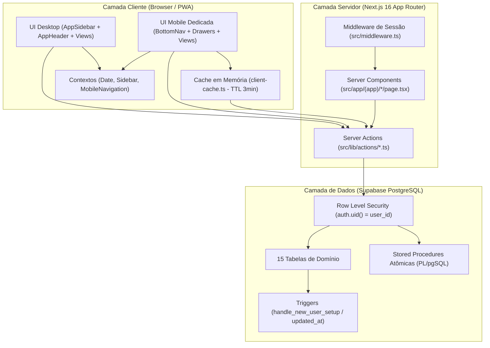

# Fase 1 — Diagnóstico Completo do Sistema (BarberFin → Plataforma SaaS Multi-Segmento)

> [!IMPORTANT]
> **Modo de Inspeção (Somente Leitura):** Este diagnóstico foi elaborado exclusivamente a partir da leitura e inspeção estática do código-fonte, migrações SQL, configurações e testes automatizados do repositório. Nenhum arquivo do projeto, banco de dados ou configuração foi modificado.

---

## 1. Visão Geral da Arquitetura

### 1.1. Stack Tecnológica e Configurações (Fatos Verificados)
* **Framework Web & Fullstack:** `Next.js 16.4.2` (App Router) com `React 19.3.0`, compilador `Turbopack`, `cacheComponents: true` e `partialPrefetching: true` habilitados em [`next.config.ts`](file:///home/alexandrerangel/Projetos/financeiro-app/next.config.ts).
* **Linguagem & Tipagem:** `TypeScript 5` (`strict: true`), com definições de domínio centralizadas em [`src/types/database.ts`](file:///home/alexandrerangel/Projetos/financeiro-app/src/types/database.ts) e [`src/types/notifications.ts`](file:///home/alexandrerangel/Projetos/financeiro-app/src/types/notifications.ts).
* **Estilização & UI:** `Tailwind CSS v4` (`@tailwindcss/turbopack`), tema escuro nativo (`zinc-950`), ícones `lucide-react` (`^1.59.0`) e notificações toast via `sonner` (`^2.0.8`).
* **Banco de Dados & Backend-as-a-Service:** `Supabase` (`@supabase/supabase-js ^2.118.0` e `@supabase/ssr ^0.12.7`) sobre PostgreSQL, com 17 migrações SQL versionadas em `supabase/migrations/`.
* **Exportação de Relatórios Client-Side:** `jspdf` (`^4.2.1`), `jspdf-autotable` (`^5.0.9`) e `xlsx` (`^0.18.5`) em [`src/lib/export-utils.ts`](file:///home/alexandrerangel/Projetos/financeiro-app/src/lib/export-utils.ts).
* **Suporte PWA:** Manifesto em [`src/app/manifest.ts`](file:///home/alexandrerangel/Projetos/financeiro-app/src/app/manifest.ts) e registro de Service Worker em [`src/components/pwa/RegisterServiceWorker.tsx`](file:///home/alexandrerangel/Projetos/financeiro-app/src/components/pwa/RegisterServiceWorker.tsx).
* **Testes Automatizados:** `Vitest 5.0.5` com **16 arquivos de teste** e **101 asserções unitárias** cobrindo utilitários críticos de negócio.

### 1.2. Padrão Arquitetural

* **Renderização Híbrida (SSR + CSR):** As rotas autenticadas vivem no Route Group [`src/app/(app)/`](file:///home/alexandrerangel/Projetos/financeiro-app/src/app/(app)/layout.tsx). O layout compartilhado valida a sessão via [`getAuthenticatedUser()`](file:///home/alexandrerangel/Projetos/financeiro-app/src/lib/supabase/server.ts#L40-L53) (memoizado por request com `React.cache`) e mantém [`AppShell`](file:///home/alexandrerangel/Projetos/financeiro-app/src/components/layout/AppShell.tsx) persistente.
* **Comunicação Cliente-Servidor:** Não há rotas REST manuais (exceto `/auth/callback`). Toda leitura dinâmica e mutação ocorre via **Next.js Server Actions** (`'use server'`) em `src/lib/actions/*.ts`, seguidas de `revalidatePath()` e/ou atualização otimista via [`MobileNavigationContext`](file:///home/alexandrerangel/Projetos/financeiro-app/src/context/MobileNavigationContext.tsx) + [`client-cache.ts`](file:///home/alexandrerangel/Projetos/financeiro-app/src/lib/client-cache.ts).
* **Desacoplamento Desktop vs. Mobile:** Na rota `/dashboard`, o servidor detecta o `user-agent` para evitar *layout shift* inicial, e o cliente sincroniza com `window.matchMedia` via [`useIsMobile`](file:///home/alexandrerangel/Projetos/financeiro-app/src/hooks/useIsMobile.ts), entregando árvores de componentes distintas para Desktop (`GeneralDashboardDesktop` / `BusinessDashboardDesktop`) e Mobile (`GeneralDashboardMobile` / `BusinessDashboardMobile` / `MobileStatementView` / `MobileSummaryView` / `MobileMoreView`).

---

## 2. Inventário de Módulos, Rotas, Banco de Dados e Funcionalidades

### 2.1. Mapa de Rotas (`src/app/`)

| Rota | Arquivo | Tipo | Responsabilidade Principal |
| :--- | :--- | :--- | :--- |
| `/` | [`src/app/page.tsx`](file:///home/alexandrerangel/Projetos/financeiro-app/src/app/page.tsx) | Server Redirect | Redireciona imediatamente para `/dashboard`. |
| `/login` | [`src/app/login/page.tsx`](file:///home/alexandrerangel/Projetos/financeiro-app/src/app/login/page.tsx) | Client Page | Login via Google OAuth (`signInWithOAuth`), limpando sessão local prévia. |
| `/auth/callback` | [`src/app/auth/callback/route.ts`](file:///home/alexandrerangel/Projetos/financeiro-app/src/app/auth/callback/route.ts) | Route Handler | Troca `code` OAuth por sessão (`exchangeCodeForSession`) e redireciona para `/dashboard`. |
| `/dashboard` | [`src/app/(app)/dashboard/page.tsx`](file:///home/alexandrerangel/Projetos/financeiro-app/src/app/(app)/dashboard/page.tsx) | Server Page | Carrega em paralelo contas, cartões, categorias, métricas gerais/negócio, alertas e transações; sincroniza recorrências do mês atual e seguinte. |
| `/transacoes` | [`src/app/(app)/transacoes/page.tsx`](file:///home/alexandrerangel/Projetos/financeiro-app/src/app/(app)/transacoes/page.tsx) | Server Page | Extrato completo de receitas e despesas, filtros por escopo/status/categoria/busca, criação em parcelas e exportação (PDF/Excel/CSV). |
| `/contas` | [`src/app/(app)/contas/page.tsx`](file:///home/alexandrerangel/Projetos/financeiro-app/src/app/(app)/contas/page.tsx) | Server Page | Gestão de contas bancárias/carteiras, configuração de rendimento (% CDI ou % mensal), ajuste de saldo e conciliação de rendimentos. |
| `/cartoes` | [`src/app/(app)/cartoes/page.tsx`](file:///home/alexandrerangel/Projetos/financeiro-app/src/app/(app)/cartoes/page.tsx) | Server Page | Gestão de cartões de crédito, limites, dias de fechamento/vencimento, faturas mensais e pagamento integral/parcial de fatura. |
| `/recorrencias` | [`src/app/(app)/recorrencias/page.tsx`](file:///home/alexandrerangel/Projetos/financeiro-app/src/app/(app)/recorrencias/page.tsx) | Server Page | Contas fixas mensais/anuais (pessoais ou do negócio) com geração automática de lançamentos no extrato. |
| `/categorias` | [`src/app/(app)/categorias/page.tsx`](file:///home/alexandrerangel/Projetos/financeiro-app/src/app/(app)/categorias/page.tsx) | Server Page | CRUD de categorias de receita/despesa/ambos, com ícone, cor e escopo (`personal` / `business`). |
| `/vendas` | [`src/app/(app)/vendas/page.tsx`](file:///home/alexandrerangel/Projetos/financeiro-app/src/app/(app)/vendas/page.tsx) | Server Page | PDV / Registro de atendimentos e vendas de serviços/produtos, suporte a venda à vista ou a prazo (`on_credit`), amortizações e recibos. |
| `/fiados` | [`src/app/(app)/fiados/page.tsx`](file:///home/alexandrerangel/Projetos/financeiro-app/src/app/(app)/fiados/page.tsx) | Server Page | Central de contas a receber (fiados), agrupamento por cliente devedor, quitação/amortização FIFO, cobrança via WhatsApp e exportação de devedores. |
| `/clientes` | [`src/app/(app)/clientes/page.tsx`](file:///home/alexandrerangel/Projetos/financeiro-app/src/app/(app)/clientes/page.tsx) | Server Page | CRM de clientes (histórico, ciclo de retorno, VIPs, aniversariantes, radar WhatsApp) + aba de Clube & Mensalidades (`?tab=subscriptions`). |
| `/mensalidades` | [`src/app/(app)/mensalidades/page.tsx`](file:///home/alexandrerangel/Projetos/financeiro-app/src/app/(app)/mensalidades/page.tsx) | Server Redirect | Redireciona para `/clientes?tab=subscriptions`. |
| `/produtos` | [`src/app/(app)/produtos/page.tsx`](file:///home/alexandrerangel/Projetos/financeiro-app/src/app/(app)/produtos/page.tsx) | Server Page | Catálogo de serviços (`service`) e produtos (`product`) com preço padrão, cor, ícone e status ativo/inativo. |

### 2.2. Modelo de Dados Completo (15 Tabelas + 5 Funções/RPCs)

| Tabela | Colunas Chave e Relacionamentos | Propósito no Domínio |
| :--- | :--- | :--- |
| `accounts` | `id`, `user_id`, `name`, `type` (`checking`, `wallet`, `savings`, `investment`), `initial_balance`, `yield_type` (`none`, `cdi_percent`, `monthly_percent`), `yield_rate`, `color` | Contas bancárias, carteiras físicas e caixinhas de investimento. |
| `credit_cards` | `id`, `user_id`, `name`, `credit_limit`, `closing_day` (1-31), `due_day` (1-31), `color` | Cartões de crédito e parâmetros de corte de fatura. |
| `categories` | `id`, `user_id`, `name`, `type` (`income`, `expense`, `both`), `icon`, `color`, `is_default`, `scope` (`personal`, `business`) | Classificação contábil e separação de centros de custo. |
| `recurrences` | `id`, `user_id`, `description`, `amount`, `type`, `category_id`, `account_id`, `credit_card_id`, `due_day`, `frequency` (`monthly`, `yearly`), `active`, `scope` | Modelos de despesas/receitas fixas que geram transações mensais. |
| `transactions` | `id`, `user_id`, `description`, `amount`, `type` (`income`, `expense`, `transfer`), `payment_method`, `transaction_date`, `due_date`, `category_id`, `account_id`, `credit_card_id`, `recurrence_id`, `installment_group_id`, `current_installment`, `total_installments`, `is_paid`, `paid_at`, `notes`, `scope` | Livro-razão (extrato) central de todas as movimentações financeiras. |
| `products` | `id`, `user_id`, `name`, `type` (`service`, `product`), `default_price`, `icon`, `color`, `active` | Catálogo de serviços prestados e produtos vendidos (não possui coluna de quantidade em estoque). |
| `clients` | `id`, `user_id`, `name`, `phone`, `cpf`, `birth_date`, `last_contacted_at`, `notes` | Base de clientes para vínculo em vendas, fiados, CRM e assinaturas. |
| `sales` | `id`, `user_id`, `client_id`, `client_name`, `total_amount`, `paid_amount`, `remaining_amount`, `status` (`paid`, `pending`, `partially_paid`), `payment_method` (`pix`, `cash`, `debit`, `credit`, `on_credit`), `due_date`, `account_id`, `transaction_id`, `sale_date`, `notes` | Cabeçalho de comandas/atendimentos realizados. |
| `sale_items` | `id`, `sale_id` (FK `sales` CASCADE), `product_id` (FK `products` SET NULL), `product_name`, `quantity`, `unit_price`, `total_price` | Itens individuais que compõem uma venda/atendimento. |
| `sale_amortizations` | `id`, `user_id`, `sale_id` (FK `sales` CASCADE), `client_id`, `amount`, `payment_method`, `account_id`, `transaction_id` (FK `transactions` SET NULL), `amortized_at`, `notes` | Histórico de pagamentos parciais ou totais de vendas a prazo (fiados). |
| `business_message_settings` | `user_id` (PK), `pix_key_type`, `pix_key`, `pix_holder_name`, `template_friendly`, `template_default`, `template_firm`, `template_sale_credit_receipt`, `template_return_window`, `template_inactive_recovery`, `template_birthday`, `include_pix_default` | Configurações de chave Pix e templates customizáveis de WhatsApp por usuário. |
| `notifications` | `id`, `user_id`, `category`, `title`, `message`, `action_url`, `action_label`, `idempotency_key`, `metadata` (JSONB), `is_read`, `read_at` | Caixa de entrada de alertas do sistema (contas, fiados, aniversários, mensalidades). |
| `user_notification_preferences` | `user_id` (PK), `notify_bills`, `notify_Statement`/`notify_cards`, `notify_credits`, `notify_returns`, `notify_birthdays`, `bill_days_ahead` | Preferências de ativação de alertas por categoria de notificação. |
| `subscription_plans` | `id`, `user_id`, `name`, `description`, `price`, `interval` (`monthly`), `active` | Planos de assinatura/mensalidade oferecidos pelo profissional aos seus clientes. |
| `client_subscriptions` | `id`, `user_id`, `client_id`, `plan_id`, `custom_plan_name`, `price`, `due_day`, `start_date`, `status` (`active`, `paused`, `canceled`), `notes` | Contratos de assinatura recorrente de clientes. |
| `subscription_invoices` | `id`, `user_id`, `subscription_id`, `client_id`, `amount`, `due_date`, `period_start`, `period_end`, `status` (`pending`, `paid`, `canceled`), `paid_at`, `payment_method`, `account_id`, `transaction_id` | Faturas mensais geradas para cada assinatura de cliente. |

#### Stored Procedures (RPCs) e Triggers no PostgreSQL:
1. `handle_new_user_setup()` (`SECURITY DEFINER`, trigger `AFTER INSERT ON auth.users`): Cria automaticamente a `"Conta Principal"` e 12 categorias padrão (10 pessoais + 2 de negócio: `"Barbearia"` e `"Insumos & Barbearia"`).
2. `create_sale_atomic(...)` (`SECURITY INVOKER`): Insere em transação única a receita em `transactions` (se à vista ou se houver entrada no fiado), a venda em `sales`, os itens em `sale_items` e a amortização inicial em `sale_amortizations`.
3. `amortize_sale_atomic(...)` (`SECURITY INVOKER`): Registra pagamento parcial/total de uma venda a prazo com lock pessimista (`FOR UPDATE`), cria a receita em `transactions`, insere em `sale_amortizations` e atualiza `paid_amount`, `remaining_amount` e `status` da venda.
4. `amortize_client_debt_atomic(...)` (`SECURITY INVOKER`): Liquida múltiplas comandas em aberto de um mesmo cliente em ordem cronológica (**FIFO** — mais antigas primeiro) invocando `amortize_sale_atomic` para cada venda até esgotar o valor pago.
5. `get_account_aggregates(p_month_prefix)` e `get_account_prior_balance(p_before)` (`SECURITY INVOKER`): Agregam saldos pagos e rendimentos diretamente no PostgreSQL para evitar tráfego de todas as transações históricas para o Node.js.

---

## 3. Mapeamento das Principais Dependências entre Componentes

* **Casca de Layout (`AppShell.tsx`):**
  * Envolve todas as rotas de `src/app/(app)/layout.tsx`.
  * Provedores globais aninhados: `DateProvider` $\rightarrow$ `MobileNavigationProvider` $\rightarrow$ `SidebarProvider`.
  * Renderiza no Desktop: `AppSidebar` + `AppHeader` (que inclui `NotificationBell`).
  * Renderiza no Mobile: `BottomNav` + `MobileBackButton` + 4 modais/drawers carregados dinamicamente (`ssr: false`): `QuickActionDrawer`, `MobileQuickTransactionModal`, `MobileNewSaleDrawer` e `MobileYieldCorrectionModal`.
* **Acoplamento entre Módulos de Negócio e o Extrato Financeiro (`transactions`):**
  * **`sales.ts` $\rightarrow$ `transactions` + `categories.ts`:** Toda venda paga (ou amortização de fiado) chama `getOrCreateBarbeariaCategory()` e gera um lançamento do tipo `income` na tabela `transactions`, com `scope = 'business'` e descrição prefixada por `"Atendimento: ..."`, `"Entrada Atendimento: ..."` ou `"Recebimento Fiado: ..."`.
  * **`subscriptions.ts` $\rightarrow$ `transactions` + `categories.ts`:** Ao quitar uma mensalidade em `paySubscriptionInvoice()`, chama `getOrCreateBarbeariaCategory()` e insere uma receita em `transactions` com descrição `"Mensalidade: {cliente} ({plano})"`.
  * **`accounts.ts` $\rightarrow$ `transactions` + `categories.ts`:** Ao conciliar rendimento (`recordAccountYield`) ou ajustar saldo manualmente (`updateAccountBalance`), cria transações em `transactions` (usando `getOrCreateInvestimentosCategory()` e a tag `[Rendimento]` para rendimentos).
  * **`credit-cards.ts` $\rightarrow$ `transactions`:** O pagamento de fatura (`payCreditCardInvoiceAmount`) cria uma despesa paga na conta bancária escolhida e marca as transações de cartão do período como `is_paid = true`.
* **Acoplamento de Analytics e Classificação (`business-scope-utils.ts`):**
  * `dashboard.ts`, `TransactionsView.tsx`, `MobileStatementView.tsx`, `MobileSummaryView.tsx`, `RecurrencesList.tsx` e `CategoriesList.tsx` dependem diretamente de `isBusinessTransaction()`, `isBusinessCategory()` e `isBarbeariaServiceIncome()` para separar o que é "Pessoal" do que é "Negócio/Barbearia".

---

## 4. Identificação das Regras de Negócio Já Implementadas (Fatos no Código)

1. **Fuso Horário Canônico (`America/Sao_Paulo`):**
   * Definido em [`src/lib/date-utils.ts`](file:///home/alexandrerangel/Projetos/financeiro-app/src/lib/date-utils.ts). Todas as decisões de "hoje", limites de mês e conversão de timestamps no servidor usam `Intl.DateTimeFormat` fixado em `America/Sao_Paulo`, evitando bugs de virada de dia em servidores UTC (Vercel).
2. **Isolamento Pessoal vs. Negócio (`FinancialScope`):**
   * Categorias, transações e recorrências possuem `scope: 'personal' | 'business'`.
   * Como fallback de retrocompatibilidade (para bancos sem a migration ou dados antigos), [`src/lib/business-scope-utils.ts`](file:///home/alexandrerangel/Projetos/financeiro-app/src/lib/business-scope-utils.ts) também identifica transações de negócio pela tag `[Barbearia]` em `notes`, pelo prefixo `"Atendimento:"` em `description`, ou por palavras-chave no nome da categoria (`barbearia`, `insumos`, `descartáveis`, `lâminas`).
3. **Cálculo de Faturas de Cartão de Crédito ([`src/lib/credit-card-utils.ts`](file:///home/alexandrerangel/Projetos/financeiro-app/src/lib/credit-card-utils.ts)):**
   * A competência da fatura é determinada por `due_date`.
   * Quando uma compra é feita no cartão (`payment_method === 'credit'`), se o dia da compra for **maior ou igual** ao `closing_day`, o vencimento (`due_date`) é empurrado para o mês seguinte (ou subsequente, caso `due_day < closing_day`).
   * Compras parceladas geram $N$ registros independentes em `transactions` compartilhando o mesmo `installment_group_id`, com ajuste de centavos na 1ª parcela para soma exata.
   * Despesas de cartão de crédito **não** reduzem o saldo de contas bancárias em `getAccounts()` até que a fatura seja paga via conta bancária (`account_id IS NOT NULL` e `is_paid = true`).
4. **Vendas, Fiados (`on_credit`) e Amortização FIFO ([`src/lib/actions/sales.ts`](file:///home/alexandrerangel/Projetos/financeiro-app/src/lib/actions/sales.ts) e [`src/lib/sales-amortization-utils.ts`](file:///home/alexandrerangel/Projetos/financeiro-app/src/lib/sales-amortization-utils.ts)):**
   * Vendas à vista geram `status = 'paid'`, `paid_amount = total_amount`, `remaining_amount = 0` e criam imediatamente uma transação paga na conta selecionada.
   * Vendas a prazo (`on_credit`) exigem obrigatoriamente um cliente cadastrado (`client_id`). Permitem pagamento de entrada opcional (`initial_payment`). O saldo devedor fica em `remaining_amount` e só entra no fluxo de caixa realizado (`transactions`) conforme amortizações são registradas.
   * A amortização em lote por cliente (`amortize_client_debt_atomic`) distribui o valor pago entre as comandas abertas da mais antiga para a mais recente (`ORDER BY sale_date ASC`).
   * A exclusão de uma venda (`deleteSale`) remove em cascata as transações de receita vinculadas (tanto a principal quanto as de amortizações) antes de remover o registro em `sales`.
5. **Inteligência de Retenção e Ciclo de Retorno de Clientes ([`src/lib/client-analytics.ts`](file:///home/alexandrerangel/Projetos/financeiro-app/src/lib/client-analytics.ts)):**
   * Agrupa atendimentos do cliente por dia único de visita.
   * Calcula o ciclo médio ponderado dando maior peso aos intervalos mais recentes (`computeWeightedCycleDays`), limitado entre `MIN_CYCLE_DAYS = 5` e `MAX_CYCLE_DAYS = 90` (filtrando *outliers* $> 120$ dias).
   * Se o cliente tiver apenas 1 visita, assume um ciclo estimado padrão de **21 dias** (`isEstimatedCycle = true`).
   * Classifica cada cliente em 5 status:
     * `new` (sem visitas),
     * `on_track` (Em Dia — antes da janela de retorno),
     * `in_window` (Na Janela — dentro da margem de $\pm 15\%$ do ciclo ou mín. 3 dias),
     * `overdue` (Atrasado — passou da janela, até $2\times$ o ciclo ou mín. 40 dias),
     * `missing` (Sumido — passou de $\max(\text{ciclo} \times 2, 40)$ dias).
   * Identifica os 2 dias da semana preferidos do cliente e os Top 3 itens mais consumidos.
   * **Clientes VIP (`computeVipClientIds`):** Top 20% dos clientes (mín. 1, máx. 10) com pelo menos 2 visitas, ordenados por `totalSpent` e desempatados por `totalSalesCount`.
6. **Rendimentos de Contas ([`src/lib/account-yield-utils.ts`](file:///home/alexandrerangel/Projetos/financeiro-app/src/lib/account-yield-utils.ts)):**
   * Taxa base do CDI configurada em constante (`DEFAULT_ANNUAL_CDI_RATE = 10.65`% a.a., equivalente a $\approx 0,8467\%$ a.m.).
   * Possui heurística por nome de instituição (`Nubank`, `Mercado Pago`, `PicPay`, `Iti`, `99Pay`, `PagBank`, `Inter`, `C6`, ` Caixinha`) que sugere `100% do CDI` automaticamente caso `yield_type` não esteja definido.
   * A conciliação calcula `diferença = novoSaldoBanco - saldoAtualApp` e lança uma transação de receita paga com a tag `[Rendimento]` na categoria `"Investimentos"`.
7. **Sincronização de Recorrências ([`src/lib/actions/recurrences.ts`](file:///home/alexandrerangel/Projetos/financeiro-app/src/lib/actions/recurrences.ts)):**
   * Executada automaticamente ao abrir `/dashboard` ou `/transacoes`.
   * É idempotente: verifica tanto pela chave `(recurrence_id, due_date)` (protegida no banco pelo índice único parcial `uq_transactions_recurrence_due`) quanto por correspondência de `(description, amount, type)` no mesmo mês.
8. **Assinaturas / Clube de Mensalidades ([`src/lib/actions/subscriptions.ts`](file:///home/alexandrerangel/Projetos/financeiro-app/src/lib/actions/subscriptions.ts)):**
   * Planos mensais ou valores customizados vinculados a um cliente com `due_day` (1 a 31).
   * Geração automática da fatura do mês corrente (`ensureCurrentMonthInvoicesInternal`) garantida pelo índice único `(subscription_id, period_start)`.
   * Métricas dedicadas (`getClubMonthlyOverview`): MRR (Receita Recorrente Mensal), total recebido no mês, pendente no mês, em atraso e contagem de inadimplentes.
9. **Motor de Mensagens WhatsApp ([`src/lib/whatsapp-templates.ts`](file:///home/alexandrerangel/Projetos/financeiro-app/src/lib/whatsapp-templates.ts)):**
   * Não utiliza API paga externa; gera links `https://wa.me/55{DDD}{NUMERO}?text=...` abertos diretamente no app do WhatsApp do usuário.
   * Substitui variáveis dinâmicas (`{nome}`, `{primeiro_nome}`, `{valor}`, `{vencimento}`, `{dias_atraso}`, `{dias_ultima_visita}`, `{itens}`, `{plano}`, `{metodo_pagamento}`, `{bloco_pix}`, `{assinatura}`).
   * Anexa automaticamente assinatura `_Mensagem enviada via BarberFin_`.

---

## 5. Oportunidades de Reaproveitamento

O código existente possui uma base altamente madura e reaproveitável para qualquer profissional autônomo ou pequeno negócio:

1. **Núcleo Financeiro Pessoal + Profissional (100% Reaproveitável):**
   * Gestão de contas bancárias, rendimentos CDI, cartões de crédito com cálculo de fechamento/vencimento, parcelamentos, contas fixas recorrentes, extrato unificado e separação `personal` vs `business`.
2. **Motor de Vendas, Comandas, Fiados e Amortização FIFO (95% Reaproveitável):**
   * Toda a modelagem `products` (`service` vs `product`), `sales`, `sale_items` e `sale_amortizations`, incluindo as RPCs atômicas no PostgreSQL (`create_sale_atomic`, `amortize_sale_atomic`, `amortize_client_debt_atomic`), aplica-se integralmente a salões de beleza, clínicas de estética, pet shops, oficinas, consultórios, personal trainers, fotógrafos e prestadores de serviço em geral.
3. **CRM, Retenção por Ciclo de Retorno e Assinaturas de Clientes (90% Reaproveitável):**
   * O algoritmo de cálculo de ciclo de retorno ponderado (`client-analytics.ts`), identificação de VIPs, aniversariantes do dia e o módulo de Clube/Mensalidades (`subscription_plans`, `client_subscriptions`, `subscription_invoices`) servem diretamente para qualquer negócio com recorrência de atendimento ou pacotes mensais.
4. **Infraestrutura Mobile-First & Cache Otimista (95% Reaproveitável):**
   * A arquitetura de navegação mobile (`BottomNav`, `QuickActionDrawer`, `MobileQuickTransactionModal`, `MobileNewSaleDrawer`) e o cache em memória de 0ms (`client-cache.ts`) oferecem um diferencial competitivo pronto para uso em campo/balcão.
5. **Segurança Multi-Tenant via RLS (100% Reaproveitável):**
   * O isolamento por `user_id = auth.uid()` com `FORCE ROW LEVEL SECURITY` já garante que múltiplos profissionais autônomos utilizem a mesma instância do banco sem vazamento de dados entre contas.

---

## 6. Pontos que Talvez Precisem de Generalização

> [!NOTE]
> A lista abaixo registra exclusivamente **fatos encontrados no código** onde o domínio de "Barbearia" está fixado (*hardcoded*). As decisões sobre o que e como generalizar serão tomadas por você nas Fases 2 e 3.

1. **Identidade Visual e Textos Fixos de Marca (`BarberFin` / `💈`):**
   * Presentes em [`AppSidebar.tsx`](file:///home/alexandrerangel/Projetos/financeiro-app/src/components/layout/AppSidebar.tsx#L120-L126), [`MobileHeader.tsx`](file:///home/alexandrerangel/Projetos/financeiro-app/src/components/dashboard/mobile/MobileHeader.tsx), [`Navbar.tsx`](file:///home/alexandrerangel/Projetos/financeiro-app/src/components/layout/Navbar.tsx) e na assinatura obrigatória do WhatsApp (`_Mensagem enviada via BarberFin_` em [`src/lib/whatsapp-templates.ts`](file:///home/alexandrerangel/Projetos/financeiro-app/src/lib/whatsapp-templates.ts#L16-L162)).
2. **Trigger de Onboarding de Novos Usuários no Banco (`handle_new_user_setup`):**
   * Na migração [`20261019213000_business_expenses_scope.sql`](file:///home/alexandrerangel/Projetos/financeiro-app/supabase/migrations/20261019213000_business_expenses_scope.sql#L48-L75), todo novo usuário criado em `auth.users` recebe automaticamente as categorias fixas `"Barbearia"` (ícone `scissors`) e `"Insumos & Barbearia"` (ícone `scissors`).
3. **Funções e Constantes de Escopo de Negócio ([`src/lib/business-scope-utils.ts`](file:///home/alexandrerangel/Projetos/financeiro-app/src/lib/business-scope-utils.ts) e [`src/lib/actions/categories.ts`](file:///home/alexandrerangel/Projetos/financeiro-app/src/lib/actions/categories.ts#L237-L287)):**
   * A tag de fallback em `notes` é `BUSINESS_TAG = '[Barbearia]'`.
   * As palavras-chave de detecção automática são `['barbearia', 'insumos', 'descartáveis', 'lâminas']`.
   * A função `getOrCreateBarbeariaCategory(userId)` busca ou cria especificamente uma categoria chamada `"Barbearia"` com ícone `scissors` sempre que uma venda ou mensalidade é registrada.
   * A função `resolveIncomeCategoryMeta` agrupa receitas de atendimento sob o rótulo fixo `'Barbearia (Serviços)'`.
4. **Templates Padrão de WhatsApp ([`src/lib/whatsapp-templates.ts`](file:///home/alexandrerangel/Projetos/financeiro-app/src/lib/whatsapp-templates.ts)):**
   * Os textos padrão usam gírias e referências específicas de barbearia (*"aqui é da barbearia"*, *"dar aquele talento no corte e na barba"*, *"renovar o corte e tomar uma gelada"*, emojis `💈` e `✂️`).
5. **Rótulos de Interface, Placeholders e Relatórios PDF (57 arquivos com ocorrências):**
   * Placeholders de modais (ex.: `"Ex: Corte Degradê, Barba, Pomada..."` em `ProductModal.tsx`, `"Ex: Aluguel da Barbearia..."` em `RecurrenceModal.tsx`, `"Ex: Corte toda sexta, usa navalha zero..."` em `ClientModal.tsx`).
   * Títulos de relatórios PDF em [`src/lib/export-utils.ts`](file:///home/alexandrerangel/Projetos/financeiro-app/src/lib/export-utils.ts) (`"BARBEARIA • EXTRATO FINANCEIRO"` e `"BARBEARIA • CENTRAL DE FIADOS A RECEBER"`).
   * Seletores de contexto na UI (`[ Barbearia ]` vs `[ Pessoal ]`) e grupos de navegação (`AppSidebar.tsx`, `AppHeader.tsx`).
6. **Parâmetro de Ciclo Estimado na 1ª Visita (`client-analytics.ts`):**
   * Clientes com apenas 1 visita recebem um ciclo estimado fixo de `21 dias` (típico de corte de cabelo masculino), que pode variar conforme o ramo de atividade.
7. **Ausência de Tabela de Perfil do Negócio / Tenant Settings:**
   * Atualmente não existe uma tabela ou configuração de perfil do negócio (ex.: nome do estabelecimento, segmento/ramo de atuação, nomenclatura preferida para "Atendimento/Venda", ciclo padrão de retorno).

---

## 7. Riscos, Gargalos de Desempenho e Limitações Identificados

### 7.1. Riscos de Segurança e Isolamento
1. **Cache em Memória Global no Cliente ([`src/lib/client-cache.ts`](file:///home/alexandrerangel/Projetos/financeiro-app/src/lib/client-cache.ts)):**
   * As variáveis `cachedAccounts`, `cachedCards`, `cachedCategories`, `cachedProducts` e `cachedClients` são variáveis de escopo de módulo no browser.
   * No logout (`AppHeader.tsx`), o sistema faz `window.location.replace('/login')` (recarregamento completo de página, o que limpa a memória JS do browser) e limpa `localStorage`/`sessionStorage` via `clearAppClientStorage()`. Porém, `clearAppClientStorage()` **não chama** `invalidateClientCache()`, e a chave `barberfin:sidebar_collapsed` usa prefixo `barberfin:` enquanto `clearAppClientStorage()` filtra apenas `financeiro_*` e `sb-*`.
2. **Políticas RLS das Tabelas Recentes sem `FORCE ROW LEVEL SECURITY` e sem `REVOKE ALL FROM anon` explícito:**
   * Na migração `20261019210000_enforce_rls_isolation.sql`, as 9 tabelas iniciais receberam `FORCE ROW LEVEL SECURITY` e `REVOKE ALL ... FROM anon`.
   * As 6 tabelas criadas posteriormente (`sale_amortizations`, `business_message_settings`, `notifications`, `user_notification_preferences`, `subscription_plans`, `client_subscriptions`, `subscription_invoices`) possuem `ENABLE ROW LEVEL SECURITY` e políticas `TO authenticated USING (auth.uid() = user_id)`, o que já protege contra acesso não autorizado via PostgREST, mas não aplicaram a mesma padronização de `FORCE ROW LEVEL SECURITY` e `REVOKE ALL FROM anon` da migração de endurecimento.

### 7.2. Riscos de Integridade Transacional (Não-Atômicos)
1. **Pagamento de Mensalidade (`paySubscriptionInvoice` em [`src/lib/actions/subscriptions.ts`](file:///home/alexandrerangel/Projetos/financeiro-app/src/lib/actions/subscriptions.ts#L336-L429)):**
   * Diferente de `createSale` e `amortizeSale` (que usam RPCs atômicas em PL/pgSQL), `paySubscriptionInvoice` faz **duas operações separadas** via cliente JS: primeiro insere em `transactions` e depois faz `UPDATE` em `subscription_invoices`. Se a segunda chamada falhar por oscilação de rede, a receita é criada duplicada no extrato enquanto a fatura permanece como `'pending'`.
2. **Pagamento de Fatura de Cartão (`payCreditCardInvoiceAmount` em [`src/lib/actions/credit-cards.ts`](file:///home/alexandrerangel/Projetos/financeiro-app/src/lib/actions/credit-cards.ts#L295-L415)):**
   * Executa múltiplas queries sequenciais via JS (cria transação de despesa na conta bancária e depois atualiza/divide transações do cartão) sem transação atômica de banco (RPC).
3. **Conciliação e Ajuste de Saldo de Contas (`recordAccountYield` / `updateAccountBalance` em [`src/lib/actions/accounts.ts`](file:///home/alexandrerangel/Projetos/financeiro-app/src/lib/actions/accounts.ts#L261-L370)):**
   * Calculam a diferença lendo o saldo via `getAccounts()` no Node.js e inserindo uma transação de ajuste em seguida, sem lock de linha no banco.

### 7.3. Gargalos de Desempenho e Escalabilidade (Performance)
1. **Carregamento Completo do Histórico em `getClients()` ([`src/lib/actions/clients.ts`](file:///home/alexandrerangel/Projetos/financeiro-app/src/lib/actions/clients.ts#L32-L132)):**
   * A query de listagem de clientes faz um `SELECT` aninhado trazendo **todos os clientes + todas as vendas históricas de cada cliente + todos os `sale_items` + todas as `sale_amortizations`** para processar `analyzeClientSales()` em memória no Node.js. Para um autônomo com centenas de clientes e milhares de atendimentos acumulados ao longo de anos, o payload e o tempo de CPU crescerão linearmente ($O(N_{\text{clientes}} \times M_{\text{vendas}})$).
2. **Sincronizações Síncronas no Caminho Crítico de Leitura:**
   * `getClientSubscriptions()` chama `await ensureCurrentMonthInvoicesInternal()` em **toda leitura**.
   * `NotificationBell` chama `syncAndGenerateNotifications()` na montagem, que executa 5 consultas + `upsert` no banco.
3. **Listagem de Vendas sem Paginação em `/vendas`:**
   * Na página [`src/app/(app)/vendas/page.tsx`](file:///home/alexandrerangel/Projetos/financeiro-app/src/app/(app)/vendas/page.tsx#L30), `getSales()` é chamado **sem filtro de mês/ano** (`getSales()`), carregando todas as vendas da história do usuário (com itens, contas, clientes e amortizações).

### 7.4. Duplicações e Manutenção de Código
1. **Código Morto Identificado:**
   * [`src/components/layout/Navbar.tsx`](file:///home/alexandrerangel/Projetos/financeiro-app/src/components/layout/Navbar.tsx) não é mais importado em nenhum lugar após a introdução de `AppSidebar.tsx` e `AppHeader.tsx`.
2. **Inconsistência na Obtenção do Usuário Autenticado nas Actions:**
   * Algumas actions usam o helper memoizado `getAuthenticatedUser()` (`dashboard.ts`, `notifications.ts`, `subscriptions.ts`), enquanto outras chamam `supabase.auth.getUser()` diretamente (`sales.ts`, `clients.ts`, `products.ts`, `message-settings.ts`), gerando chamadas extras de verificação de sessão quando invocadas em paralelo.
3. **README Desatualizado em Pontos Específicos:**
   * O `README.md` menciona "estoque" para produtos (mas a tabela `products` não possui controle de quantidade em estoque), menciona 56 testes (hoje são 101 testes) e ainda lista a estrutura de diretórios pré-Route Group `(app)`.

---

## 8. Questões que Não Puderam Ser Respondidas pela Análise Estática

1. **Estado Real do Banco de Dados em Produção (Supabase Cloud):**
   * Não é possível saber apenas pelo código se todas as 17 migrações de `supabase/migrations/` (especialmente as RPCs `create_sale_atomic`, `get_account_aggregates` e as últimas migrações de `20261024*`) já estão aplicadas no ambiente de produção ou se o sistema em produção está caindo nos blocos de *fallback legacy* presentes no código.
2. **Configurações do Painel do Supabase (Auth & OAuth):**
   * Não é visível no repositório se o provedor Google OAuth no Supabase está em modo público ou restrito a e-mails específicos, nem quais URLs de redirecionamento estão cadastradas no painel.
3. **Volume Atual de Dados e Usuários Ativos em Produção:**
   * Quantos usuários (`user_id` distintos) já possuem dados reais em produção e se algum deles já depende dos nomes fixos de categorias (`"Barbearia"`, `"Insumos & Barbearia"`) ou da tag `[Barbearia]`.
4. **Visão de Produto para Multi-Segmento (que será investigada nas Fases 2 e 3):**
   * Quais segmentos de autônomos e pequenos negócios serão priorizados, se o sistema adotará um *onboarding* com escolha de ramo de atividade, e quais terminologias devem ser adaptáveis por perfil de negócio versus unificadas.
