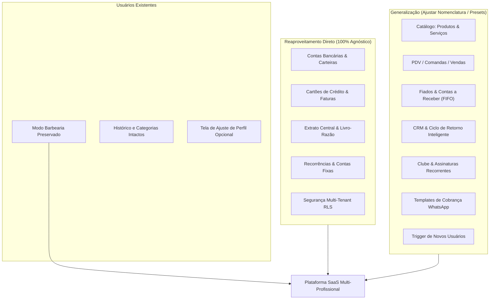

# Fase 2 — Mapeamento de Reaproveitamento do Sistema

> [!IMPORTANT]
> **Premissa Fundamental Confirmada pelo Usuário:**
> 1. Todas as 17 migrações SQL já estão aplicadas em produção.
> 2. O login OAuth é público.
> 3. Existem usuários ativos em produção que dependem do ecossistema de Barbearia.
> 4. **Objetivo Estratégico:** Generalizar a plataforma para atender outros profissionais autônomos e pequenos negócios **sem que nenhum usuário atual perca seus dados, histórico, categorias ou configurações**, prevendo transição suave (assistente/tela de migração ou perfil).

---

## 1. Matriz de Classificação das Funcionalidades

Classificação adotada:
* **[A] Reaproveitamento Direto:** A funcionalidade é 100% agnóstica a segmento e já funciona perfeitamente para qualquer autônomo sem nenhuma alteração no código.
* **[B] Generalização:** A lógica de negócio é excelente e útil para qualquer segmento, mas possui textos, ícones, categorias padrão ou parâmetros fixados na barbearia que precisam se tornar configuráveis ou dinâmicos.
* **[C] Manutenção como Recurso Específico:** Funcionalidade ou preset que deve ser mantido como especialidade para quem é do ramo de barbearia/beleza (ou ativado via perfil do negócio).
* **[D] Refatoração Técnica:** Oportunidade de robustez, atomicidade de banco ou performance que trará estabilidade à escala multi-usuário.
* **[E] Investigação Adicional:** Pontos com alternativas de produto a serem definidos com você na Fase 3.

---

## 2. Análise Detalhada por Módulo e Recurso

---

### Módulo 1: Contas Bancárias, Carteiras e Rendimentos CDI
* **Classificação:** **[A] Reaproveitamento Direto** (com refatoração técnica leve).
* **O que existe atualmente:**
  * Cadastro de contas (corrente, carteira física, poupança, investimento).
  * Rendimento automático estimado (% CDI ou % mensal) com detecção inteligente por banco (Nubank, Inter, PicPay, etc.).
  * Ajuste rápido de saldo e conciliação de rendimento gerando receita com tag `[Rendimento]`.
  * Cálculo em alta performance via RPC PostgreSQL `get_account_aggregates`.
* **O que precisa mudar:**
  * **Nada na regra de negócio.** Qualquer profissional autônomo precisa controlar contas bancárias, caixinhas e dinheiro em espécie.
* **Implicações Técnicas:**
  * Zero alteração de banco ou tela. Manutenção 100% direta.
  * Oportunidade futura pontual: transformar a conciliação manual em transação atômica.

---

### Módulo 2: Cartões de Crédito, Faturas e Parcelamentos
* **Classificação:** **[A] Reaproveitamento Direto**.
* **O que existe atualmente:**
  * Gestão de limites, dia de fechamento e dia de vencimento.
  * Cálculo de faturas mensais abertas/fechadas por competência (`due_date`).
  * Parcelamento automático ($N$ parcelas) com ajuste de centavos e agrupamento via `installment_group_id`.
  * Pagamento de faturas (integral ou parcial) com baixa em conta bancária.
* **O que precisa mudar:**
  * **Nada.** O fluxo é universal para controle de finanças pessoais e de negócios de qualquer natureza.
* **Implicações Técnicas:**
  * Zero risco de regressão. 100% reaproveitado.

---

### Módulo 3: Contas Fixas / Recorrências Mensais e Anuais
* **Classificação:** **[A] Reaproveitamento Direto** (com generalização leve de placeholders).
* **O que existe atualmente:**
  * Sincronização mensal automática e idempotente via índice único `uq_transactions_recurrence_due`.
  * Suporte a despesas e receitas com escopo `personal` ou `business`.
* **O que precisa mudar:**
  * Apenas placeholders nos formulários de cadastro (ex.: substituir *"Ex: Aluguel da Barbearia"* por *"Ex: Aluguel do espaço, internet, energia, software..."*).
* **Implicações Técnicas:**
  * Alteração puramente cosmética de UI. Regras de sincronização no backend permanecem intactas.

---

### Módulo 4: Categorias e Escopo Financeiro (`personal` vs `business`)
* **Classificação:** **[B] Generalização** + **[C] Manutenção como Recurso Específico**.
* **O que existe atualmente:**
  * Cada categoria tem `scope: 'personal' | 'business'`, ícone e cor.
  * O trigger do banco cria fixamente `"Barbearia"` (receita) e `"Insumos & Barbearia"` (despesa).
  * `getOrCreateBarbeariaCategory()` cria ou busca especificamente a categoria chamada `"Barbearia"`.
  * Utilitário `isBusinessCategory` busca palavras-chave de barbearia (`barbearia`, `lâminas`, etc.).
* **O que precisa mudar:**
  * **Para usuários existentes:** Manter a categoria `"Barbearia"` e `"Insumos & Barbearia"` funcionando normalmente, sem renomear ou deletar nada compulsoriamente.
  * **Para a arquitetura generalizada:**
    * O conceito canônico deve ser a categoria de **"Serviços Prestados"** (ou a categoria padrão de faturamento do negócio do usuário) e **"Custos Operacionais / Insumos"**.
    * A busca do sistema não deve depender do nome fixo string `"Barbearia"`, mas sim de uma flag ou metadado (ex: categoria primária de negócio do usuário, ou `scope = 'business'` com uma categoria padrão).
    * `getOrCreateBarbeariaCategory` passa a ser `getOrCreateBusinessCategory(userId, fallbackName)`: se o usuário já tem uma categoria de negócio (seja `"Barbearia"`, `"Atendimentos"`, `"Consultas"`, `"Honorários"`, `"Serviços"`), o sistema a reutiliza.
* **Implicações Técnicas:**
  * Migração 100% não-destrutiva: usuários atuais continuam com suas categorias `"Barbearia"`. Novos usuários podem receber categorias compatíveis com seu segmento ou um nome genérico profissional.

---

### Módulo 5: Catálogo de Produtos e Serviços
* **Classificação:** **[B] Generalização** (com reaproveitamento de 95% do código).
* **O que existe atualmente:**
  * Tabela `products` com diferenciação `type: 'service' | 'product'`.
  * Preço padrão (`default_price`), ícone, cor e status ativo/inativo.
  * Usado na montagem de comandas e no cálculo de split de receita (Serviços vs Produtos).
* **O que precisa mudar:**
  * A estrutura de dados já é agnóstica! (`service` e `product` atendem tatuadores, esteticistas, mecânicos, psicólogos, veterinários, consultores, etc.).
  * O que muda são apenas os placeholders e ícones sugeridos na interface (ex.: permitir ícones além de tesoura e navalha, placeholders que exemplifiquem outros segmentos).
* **Implicações Técnicas:**
  * Nenhuma mudança no schema de banco. Apenas enriquecimento do catálogo de ícones do seletor e placeholders na UI.

---

### Módulo 6: PDV, Checkout e Comandas de Atendimento
* **Classificação:** **[B] Generalização**.
* **O que existe atualmente:**
  * PDV Desktop e Gaveta Mobile de Atendimento (`MobileNewSaleDrawer`).
  * Seleção de cliente cadastrado ou venda avulsa.
  * Adição de múltiplos serviços e produtos com cálculo dinâmico de total.
  * Suporte a itens rápidos e cadastro de itens avulsos.
  * Execução atômica no banco via RPC `create_sale_atomic`.
* **O que precisa mudar:**
  * A mecânica é universal. O que precisa de generalização são as terminologias na tela:
    * Em vez de fixar *"Novo Atendimento Barbearia"*, o sistema pode usar *"Novo Atendimento / Venda"* (ou adotar a nomenclatura configurada no perfil do negócio: "Atendimento", "Consulta", "Comanda", "Venda", "Serviço").
    * O prefixo de transação gerado no extrato: em vez de fixar `"Atendimento: {cliente}"`, usar a nomenclatura preferida ou `"Atendimento: ..."` que já é ampla.
* **Implicações Técnicas:**
  * A RPC `create_sale_atomic` já aceita qualquer descrição (`p_description`) e qualquer item (`p_items`). Nenhum ajuste de banco é necessário na lógica principal.

---

### Módulo 7: Central de Fiados (Vendas a Prazo) e Amortização FIFO
* **Classificação:** **[A] Reaproveitamento Direto** (com terminologia flexível).
* **O que existe atualmente:**
  * Registro de venda com `payment_method = 'on_credit'` vinculada obrigatoriamente a um cliente.
  * Pagamento de entrada opcional (`initial_payment`).
  * Liquidação parcial ou total de comanda individual (`amortize_sale_atomic`).
  * Liquidação de saldo acumulado do cliente com abatimento automático FIFO (`amortize_client_debt_atomic`).
  * Central `/fiados` com devedores, dias de atraso, comanda mais urgente e exportação de relatório.
* **O que precisa mudar:**
  * Essa funcionalidade é uma das maiores dores de qualquer autônomo brasileiro (manicures, mecânicos, marceneiros, esteticistas, consultores, pequenos prestadores).
  * A única adaptação é semântica: permitir chamar tanto de *"Fiados"* quanto de *"Contas a Receber / Vendas a Prazo"*, para atender profissionais que preferem um tom mais formal.
* **Implicações Técnicas:**
  * O motor financeiro e as RPCs atômicas são 100% reaproveitáveis sem qualquer alteração lógica.

---

### Módulo 8: CRM, Histórico e Inteligência de Retenção de Clientes
* **Classificação:** **[B] Generalização** + **[E] Investigação Adicional**.
* **O que existe atualmente:**
  * Cadastro de clientes com telefone, CPF, data de nascimento e notas.
  * Histórico cronológico de todos os atendimentos, comandas e pagamentos.
  * Identificação de clientes VIP (Top 20%).
  * Algoritmo de Ciclo de Retorno Ponderado (`client-analytics.ts`): estima o ciclo habitual do cliente, prevê a data de retorno e classifica em `Na Janela`, `Em Dia`, `Atrasado`, `Sumido`.
  * Ciclo estimado para 1ª visita fixado em **21 dias**.
* **O que precisa mudar:**
  * O ciclo de retorno de 21 dias é perfeito para barbearia, mas para uma oficina mecânica pode ser de 180 dias, para uma clínica de estética pode ser de 30 ou 45 dias, para um personal trainer é semanal.
  * **Generalização necessária:** Tornar o *ciclo base padrão* (e a margem da janela) parametrizável no perfil do negócio (com preset padrão de 21 ou 30 dias caso não configurado).
  * Manter intacto todo o cálculo ponderado (`computeWeightedCycleDays`) e detecção de VIPs, que são agnósticos.
* **Implicações Técnicas:**
  * Parametrizar a constante `DEFAULT_ESTIMATED_CYCLE_DAYS = 21` para ler da preferência do usuário ou receber como argumento.

---

### Módulo 9: Mensalidades e Clube de Assinaturas
* **Classificação:** **[A] Reaproveitamento Direto** (com ajuste de rótulos).
* **O que existe atualmente:**
  * Planos de assinatura recorrente (`subscription_plans`).
  * Vínculo de cliente à assinatura com dia de vencimento fixo (`client_subscriptions`).
  * Geração mensal automática de faturas (`subscription_invoices`).
  * Quitação com registro de receita no caixa e métricas de MRR / inadimplência.
* **O que precisa mudar:**
  * O conceito de clube de assinatura / mensalidade é extremamente valorizado hoje em múltiplos nichos (lavajatos com planos mensais, estúdios de pilates/personal, consultorias contínuas, pet shops com banho semanal).
  * **Ajuste:** Substituir referências estáticas como *"clube da barbearia"* nos textos e templates por termos customizáveis como *"Clube de Assinaturas"*, *"Mensalistas"* ou *"Planos Recorrentes"*.
* **Implicações Técnicas:**
  * **[D] Refatoração Técnica recomendada:** Migrar `paySubscriptionInvoice` para uma RPC atômica (como fizemos nas vendas), eliminando o risco de inconsistência caso a conexão caia entre o INSERT da transação e o UPDATE da fatura.

---

### Módulo 10: Mensagens WhatsApp e Cobrança Pix
* **Classificação:** **[B] Generalização**.
* **O que existe atualmente:**
  * Tabela `business_message_settings` por usuário (chave Pix, titular, templates de cobrança, recibo, retorno, inativos e aniversários).
  * Geração de links `wa.me` diretos (sem custos de gateway de WhatsApp).
  * Templates com placeholders dinâmicos e assinatura fixa `_Mensagem enviada via BarberFin_`.
* **O que precisa mudar:**
  * Os templates padrão atuais usam jargões de barbearia (*"corte e barba"*, *"tomar uma gelada"*, *"equipe da barbearia"*).
  * Generalizar os templates padrão para uma linguagem profissional flexível, ou permitir selecionar um conjunto de templates por segmento no onboarding.
  * A assinatura do WhatsApp: permitir exibir o nome do negócio do usuário (ex: `_{nome_negocio}_` ou nome do profissional) em vez de fixar `BarberFin`.
* **Implicações Técnicas:**
  * Na tabela `business_message_settings`, usuários legados continuam com os templates que já salvaram no banco. Apenas os fallbacks padrões em `whatsapp-templates.ts` passam a ser flexíveis e dependentes do perfil.

---

### Módulo 11: Dashboard, Gráficos e Visão Geral
* **Classificação:** **[B] Generalização**.
* **O que existe atualmente:**
  * Alternador de visualização: **Visão Pessoal** vs. **Visão do Negócio** (Barbearia).
  * Faturamento bruto, despesas operacionais pagas/pendentes, lucro líquido realizado e projetado, margem de lucro, ticket médio e taxa de retorno de clientes.
  * Evolução anual por categoria, evolução semanal e mensal, maiores clientes e produtos mais vendidos.
* **O que precisa mudar:**
  * As métricas matemáticas são 100% aplicáveis a qualquer autônomo.
  * Generalização visual: o botão de alternância pode exibir `[ Pessoal ]` e `[ Meu Negócio ]` (ou o nome fantasia do negócio cadastrado pelo usuário).
  * No código, desacoplar os nomes de componentes internos que levam `BusinessDashboard...` e textos que usam a palavra "Barbearia".
* **Implicações Técnicas:**
  * Nenhuma alteração nas fórmulas financeiras de `dashboard.ts`.

---

### Módulo 12: Onboarding e Transição para Usuários Legados
* **Classificação:** **[B] Generalização** + **[E] Investigação Adicional**.
* **O que existe atualmente:**
  * Novos usuários caem direto no Dashboard com categorias criadas pelo trigger de banco.
  * Não há etapa de configuração inicial (nome do negócio, ramo de atuação, chave Pix inicial).
* **O que precisaria mudar:**
  * **Para novos usuários:** Possibilidade de escolher seu segmento de atuação (ex.: Barbearia / Beleza / Estética, Saúde / Bem-estar, Serviços Gerais / Freelancer, Outro) para que o sistema crie as categorias e templates mais adequados logo no primeiro acesso.
  * **Para usuários existentes (Transição Segura):**
    * Usuários que já possuem transações ou categorias `"Barbearia"` mantêm **100% de tudo como está**. O sistema detecta automaticamente que já é um perfil de Barbearia.
    * Uma tela/modal opcional de *"Dados do Meu Negócio"* nas Configurações permite que ele personalize o nome do seu negócio, sua chave Pix e confirme suas preferências sem que nada seja quebrado.
* **Implicações Técnicas:**
  * Criar tabela ou extensão de perfil (ex.: `business_profiles` ou colunas em `business_message_settings`) sem quebrar chaves estrangeiras existentes.

---

## 3. Síntese do Diagnóstico de Reaproveitamento

| Módulo / Recurso | Classificação | Impacto em Código | Impacto no Banco de Dados |
| :--- | :--- | :--- | :--- |
| **Contas e Carteiras** | [A] Reaproveitamento Direto | Zero | Zero |
| **Cartões de Crédito** | [A] Reaproveitamento Direto | Zero | Zero |
| **Recorrências Fixas** | [A] Reaproveitamento Direto | Baixo (Placeholders) | Zero |
| **Categorias & Escopos** | [B] Generalização | Médio (desacoplar strings fixas) | Baixo (Novos defaults) |
| **Catálogo de Serviços/Produtos** | [B] Generalização | Baixo (Ícones e textos) | Zero |
| **PDV & Comandas** | [B] Generalização | Baixo (Rótulos) | Zero (RPCs mantidas) |
| **Fiados & Contas a Receber** | [A] Reaproveitamento Direto | Baixo (Terminologia) | Zero (RPCs mantidas) |
| **CRM & Ciclo de Retorno** | [B] Generalização | Médio (Ciclo configurável) | Baixo (Parametrização) |
| **Assinaturas & Mensalidades**| [A] Reaproveitamento Direto | Baixo (Rótulos) + [D] RPC | Opcional (RPC atômica) |
| **WhatsApp & Chave Pix** | [B] Generalização | Médio (Templates agnósticos) | Baixo (Defaults) |
| **Dashboard & Métricas** | [B] Generalização | Médio (Rótulos de tela) | Zero |
| **Onboarding & Migração** | [B] Generalização | Médio (Nova tela/configuração)| Baixo (Tabela de perfil) |

---

## 4. Próximo Passo: Fase 3 (Engenharia de Requisitos Interativa)

Com este mapeamento documentado e comprovado, estamos prontos para conduzir a **Fase 3**, na qual faremos rodadas de perguntas progressivas (3 a 5 perguntas objetivas por rodada) para que você defina como quer conduzir a experiência, a nomenclatura e as prioridades do produto.
