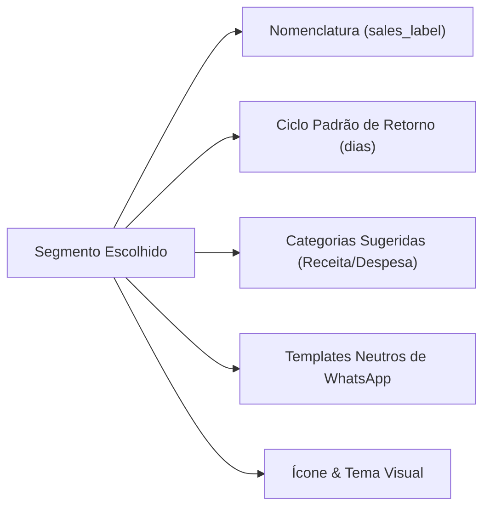
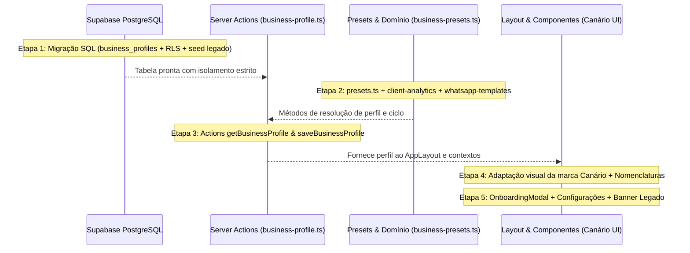

# Fase 4 — Planejamento Técnico e Arquitetura da Solução

> [!IMPORTANT]
> **Diretriz de Arquitetura:** Máximo reaproveitamento do código existente, zero reescritas desnecessárias, preservação estrita da retrocompatibilidade para usuários atuais da barbearia e garantia de segurança multi-tenant no PostgreSQL (Supabase RLS).

---

## 1. Arquitetura de Dados: Modelo de Perfil do Negócio

### 1.1. Nova Tabela: `public.business_profiles`
Para desacoplar a identidade do negócio sem alterar as 15 tabelas existentes de movimentações, vendas ou extrato, criaremos a tabela `business_profiles`:

```sql
CREATE TABLE IF NOT EXISTS public.business_profiles (
  user_id UUID PRIMARY KEY REFERENCES auth.users(id) ON DELETE CASCADE,
  business_name VARCHAR(150),
  segment VARCHAR(50) NOT NULL DEFAULT 'barbearia', 
  -- Segmentos suportados: 'barbearia', 'beleza_estetica', 'servicos_manutencao', 'saude_consultorio', 'aulas_treinamento', 'comercio_geral', 'outro'
  has_business BOOLEAN NOT NULL DEFAULT TRUE,
  sales_label VARCHAR(50) DEFAULT 'Atendimentos', -- 'Atendimentos', 'Ordens de Serviço', 'Consultas', 'Aulas', 'Vendas'
  default_cycle_days INTEGER NOT NULL DEFAULT 21,
  onboarding_completed BOOLEAN NOT NULL DEFAULT FALSE,
  legacy_migrated BOOLEAN NOT NULL DEFAULT FALSE,
  created_at TIMESTAMPTZ NOT NULL DEFAULT NOW(),
  updated_at TIMESTAMPTZ NOT NULL DEFAULT NOW()
);

-- Ativação rigorosa de RLS
ALTER TABLE public.business_profiles ENABLE ROW LEVEL SECURITY;
ALTER TABLE public.business_profiles FORCE ROW LEVEL SECURITY;

CREATE POLICY "strict_isolation_business_profiles"
  ON public.business_profiles
  FOR ALL
  TO authenticated
  USING (auth.uid() = user_id)
  WITH CHECK (auth.uid() = user_id);

GRANT SELECT, INSERT, UPDATE, DELETE ON public.business_profiles TO authenticated;
REVOKE ALL ON public.business_profiles FROM anon;
```

### 1.2. Estratégia de Migração para Usuários Existentes (Zero Quebras)
Na própria migração SQL, executaremos uma inserção não-destrutiva para inicializar os usuários atuais:

```sql
-- Inicializa automaticamente todos os usuários existentes como 'barbearia', garantindo que nenhum dado ou rotina quebre
INSERT INTO public.business_profiles (user_id, business_name, segment, has_business, sales_label, default_cycle_days, onboarding_completed, legacy_migrated)
SELECT 
  u.id, 
  COALESCE(
    (SELECT pix_holder_name FROM public.business_message_settings WHERE user_id = u.id AND pix_holder_name IS NOT NULL),
    'Minha Barbearia'
  ),
  'barbearia',
  TRUE,
  'Atendimentos',
  21,
  TRUE, -- Não bloqueia usuários antigos com assistente compulsório
  FALSE -- Marca para exibir o banner discreto de boas-vindas ao Canário
FROM auth.users u
ON CONFLICT (user_id) DO NOTHING;
```

### 1.3. Fallback no Código (Proteção Dupla)
Caso por qualquer motivo a query no servidor não encontre registro em `business_profiles` (ex: banco em transição), uma função utilitária `resolveBusinessProfile(user)` retornará um objeto padrão compatível:
```typescript
{
  business_name: 'Minha Barbearia',
  segment: 'barbearia',
  has_business: true,
  sales_label: 'Atendimentos',
  default_cycle_days: 21,
  onboarding_completed: true,
  legacy_migrated: true,
}
```
Isso garante **100% de tolerância a falhas**.

---

## 2. Catálogo de Presets por Segmento (`src/lib/business-presets.ts`)

Centralizaremos em um arquivo de domínio limpo as configurações de cada segmento:



* **Beleza, Estética & Barbearia:**
  * Label: *"Atendimentos & Vendas"* | Botão: *"Novo Atendimento"* | Ciclo padrão: 21 a 30 dias.
  * Categorias: `"Serviços de Beleza"`, `"Venda de Cosméticos"`, `"Insumos & Descartáveis"`.
* **Serviços Gerais & Manutenção:**
  * Label: *"Ordens de Serviço & Vendas"* | Botão: *"Nova O.S."* | Ciclo padrão: 90 dias.
  * Categorias: `"Mão de Obra / Serviços"`, `"Venda de Peças"`, `"Peças & Componentes"`, `"Equipamentos & Ferramentas"`.
* **Saúde & Consultórios:**
  * Label: *"Consultas & Sessões"* | Botão: *"Nova Consulta"* | Ciclo padrão: 30 dias.
  * Categorias: `"Honorários / Consultas"`, `"Procedimentos"`, `"Materiais Clínicos"`, `"Cursos & Atualização"`.
* **Aulas & Treinamento:**
  * Label: *"Aulas & Sessões"* | Botão: *"Nova Aula"* | Ciclo padrão: 7 dias.
  * Categorias: `"Mensalidades / Aulas"`, `"Planos / Assinaturas"`, `"Acessórios & Suplementos"`, `"Aluguel de Espaço"`.
* **Comércio Rápido & Autônomos Gerais:**
  * Label: *"Vendas & Pedidos"* | Botão: *"Nova Venda"* | Ciclo padrão: 30 dias.
  * Categorias: `"Venda de Mercadorias"`, `"Mercadorias para Revenda"`, `"Embalagens & Entrega"`.

---

## 3. Mapeamento de Componentes: Mantidos vs. Generalizados

### 3.1. Componentes que Permanecem 100% Mantidos
* **Financeiro Geral:** [`AccountsList.tsx`](file:///home/alexandrerangel/Projetos/financeiro-app/src/components/accounts/AccountsList.tsx), [`CreditCardsList.tsx`](file:///home/alexandrerangel/Projetos/financeiro-app/src/components/cards/CreditCardsList.tsx), [`TransactionsView.tsx`](file:///home/alexandrerangel/Projetos/financeiro-app/src/components/transactions/TransactionsView.tsx), [`RecurrencesList.tsx`](file:///home/alexandrerangel/Projetos/financeiro-app/src/components/recurrences/RecurrencesList.tsx), [`CategoriesList.tsx`](file:///home/alexandrerangel/Projetos/financeiro-app/src/components/categories/CategoriesList.tsx).
* **Fiados e Amortizações:** [`FiadosView.tsx`](file:///home/alexandrerangel/Projetos/financeiro-app/src/components/fiados/FiadosView.tsx), [`AmortizeModal.tsx`](file:///home/alexandrerangel/Projetos/financeiro-app/src/components/sales/AmortizeModal.tsx), [`DebtClientCard.tsx`](file:///home/alexandrerangel/Projetos/financeiro-app/src/components/fiados/DebtClientCard.tsx).
* **Clube e Mensalidades:** [`SubscriptionsList.tsx`](file:///home/alexandrerangel/Projetos/financeiro-app/src/components/subscriptions/SubscriptionsList.tsx), [`SubscriptionModal.tsx`](file:///home/alexandrerangel/Projetos/financeiro-app/src/components/subscriptions/SubscriptionModal.tsx), [`SubscriptionPlanModal.tsx`](file:///home/alexandrerangel/Projetos/financeiro-app/src/components/subscriptions/SubscriptionPlanModal.tsx).
* **CRM Básico:** [`ClientsList.tsx`](file:///home/alexandrerangel/Projetos/financeiro-app/src/components/clients/ClientsList.tsx), [`ClientModal.tsx`](file:///home/alexandrerangel/Projetos/financeiro-app/src/components/clients/ClientModal.tsx), [`ClientHistoryModal.tsx`](file:///home/alexandrerangel/Projetos/financeiro-app/src/components/clients/ClientHistoryModal.tsx).
* **Gráficos e Alertas:** [`CategoryDonutChart.tsx`](file:///home/alexandrerangel/Projetos/financeiro-app/src/components/dashboard/CategoryDonutChart.tsx), [`MonthlyBarChart.tsx`](file:///home/alexandrerangel/Projetos/financeiro-app/src/components/dashboard/MonthlyBarChart.tsx), [`SmoothLineChart.tsx`](file:///home/alexandrerangel/Projetos/financeiro-app/src/components/dashboard/SmoothLineChart.tsx), [`UpcomingBillsAlert.tsx`](file:///home/alexandrerangel/Projetos/financeiro-app/src/components/dashboard/UpcomingBillsAlert.tsx), [`PendingReceiptsAlert.tsx`](file:///home/alexandrerangel/Projetos/financeiro-app/src/components/dashboard/PendingReceiptsAlert.tsx).

### 3.2. Componentes que Serão Generalizados (Ajustes de Nomenclatura e Props)
* [`AppSidebar.tsx`](file:///home/alexandrerangel/Projetos/financeiro-app/src/components/layout/AppSidebar.tsx) e [`AppHeader.tsx`](file:///home/alexandrerangel/Projetos/financeiro-app/src/components/layout/AppHeader.tsx):
  * Substituir o logotipo `💈 BarberFin PRO` por `Canário` acompanhado do `Nome Fantasia` (ex: `Canário` com subtítulo `Barbearia VIP` ou `Studio Bella`).
  * Se `has_business === false`, oculta o grupo "Barbearia" da sidebar e exibe botão "Ativar Meu Negócio".
  * Trocar rótulo do item de balcão de "Atendimentos" para o `sales_label` configurado.
* [`MobileHeader.tsx`](file:///home/alexandrerangel/Projetos/financeiro-app/src/components/dashboard/mobile/MobileHeader.tsx) e [`BottomNav.tsx`](file:///home/alexandrerangel/Projetos/financeiro-app/src/components/layout/BottomNav.tsx):
  * Atualizar marca para Canário e ocultar atalhos de negócio se `has_business === false`.
* [`SalesView.tsx`](file:///home/alexandrerangel/Projetos/financeiro-app/src/components/sales/SalesView.tsx), [`NewSaleModal.tsx`](file:///home/alexandrerangel/Projetos/financeiro-app/src/components/sales/NewSaleModal.tsx), [`MobileNewSaleDrawer.tsx`](file:///home/alexandrerangel/Projetos/financeiro-app/src/components/layout/MobileNewSaleDrawer.tsx):
  * Usar `sales_label` nos títulos, botões e descrições.
* [`client-analytics.ts`](file:///home/alexandrerangel/Projetos/financeiro-app/src/lib/client-analytics.ts):
  * Modificar a lógica para: **somente calcular ciclo previsto se o cliente tiver pelo menos 2 visitas em datas distintas**. Para clientes com 1 visita, marcar status como `new` ou `on_track` com base no `default_cycle_days` do negócio, sem gerar ciclo forçado.
* [`whatsapp-templates.ts`](file:///home/alexandrerangel/Projetos/financeiro-app/src/lib/whatsapp-templates.ts):
  * Assinatura configurável: `— {business_name}` com menção discreta `• via Canário`.
  * Fallbacks neutros sem gírias específicas de barbearia.

### 3.3. Novos Componentes a Desenvolver
1. **`OnboardingModal.tsx`:** Modal fluido e elegante de boas-vindas para novos usuários (escolha de modo pessoal vs negócio, nome fantasia, segmento e chave Pix).
2. **`BusinessSettingsModal.tsx`:** Painel completo de configurações do negócio (Nome Fantasia, Segmento, Chave Pix, Nomenclaturas, Ciclo de Retorno, Templates de WhatsApp e botão de ativar/desativar módulo de negócio).
3. **`LegacyWelcomeBanner.tsx`:** Banner discreto exibido no topo do dashboard apenas para usuários legados informando da evolução para o Canário e dando um atalho para personalizar o Nome Fantasia quando quiser.

---

## 4. Dependências entre Mudanças e Riscos de Regressão



### Mitigação de Riscos Técnicos:
1. **Zero Bloqueio de Login:** Se o usuário fechar o modal de onboarding sem responder, o sistema salva automaticamente `has_business = true` com fallback neutro ou `has_business = false` (modo pessoal) sem travar a navegação.
2. **Preservação dos 101 Testes:** A assinatura de `analyzeClientSales(sales, now, defaultCycleDays?)` manterá valor padrão opcional `defaultCycleDays = 21`, garantindo que toda a suíte de testes existente continue 100% verde sem quebrar contratos.
3. **Cache de Sessão:** A Server Action `getBusinessProfile()` utilizará `React.cache()` para não onerar o banco com consultas repetidas durante a renderização paralela da página.

---

## 5. Roteiro de Implementação Incremental (Fase 5 Prevista)

Dividiremos a implementação nas seguintes etapas pequenas e verificáveis:

* **Etapa 1 — Banco de Dados & Infraestrutura de Domínio:**
  * Criar migração SQL `20261024030000_business_profiles.sql` (tabela, RLS e migração automática de usuários existentes).
  * Criar tipos TypeScript em `database.ts` e biblioteca de presets `src/lib/business-presets.ts`.
  * Criar Server Actions em `src/lib/actions/business-profile.ts`.
  * Validação: TypeScript e Vitest.

* **Etapa 2 — Generalização da Inteligência de CRM & WhatsApp:**
  * Ajustar `client-analytics.ts` para respeitar o ciclo padrão do negócio e não forçar previsão com 1 única visita.
  * Ajustar `whatsapp-templates.ts` para assinatura com Nome Fantasia e templates neutros.
  * Validação: Executar os testes unitários (`npm test`).

* **Etapa 3 — Marca Canário & Adaptação do Layout:**
  * Atualizar `AppSidebar.tsx`, `AppHeader.tsx`, `MobileHeader.tsx` e `login/page.tsx` para a identidade **Canário • {Nome Fantasia}**.
  * Aplicar o controle de visibilidade (ocultar abas de negócio se `has_business === false`).
  * Atualizar `SalesView.tsx` e `NewSaleModal.tsx` com `sales_label` dinâmico.

* **Etapa 4 — Painel "Meu Negócio" (Configurações) & Banner de Transição:**
  * Implementar modal de configurações do negócio (Nome Fantasia, Pix, Segmento, Ciclo e Templates).
  * Implementar o `LegacyWelcomeBanner` para usuários antigos da barbearia.

* **Etapa 5 — Assistente de Primeiro Acesso (Onboarding):**
  * Implementar `OnboardingModal` para novos usuários após o login (com botão de pular para modo pessoal).
  * Validação final: Build de produção (`npm run build`), linting (`npm run lint`), testes (`npm test`) e verificação completa.

---

## 6. Próximo Passo

Apresento este planejamento técnico detalhado para sua avaliação. **Parei aqui e aguardo sua aprovação** antes de iniciar qualquer alteração no código.
