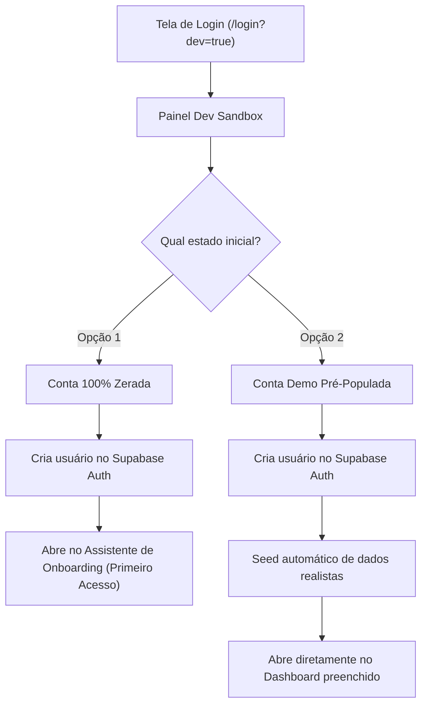

# Especificação de Requisitos: Conta Simulada de Testes (Dev Sandbox)

Este documento especifica a criação de um ambiente de simulação e criação de contas de teste no **Canário**, restrito ao ambiente de desenvolvimento local (`localhost`), permitindo testar fluxos em contas zeradas ou pré-populadas com 1 clique.

---

## 1. Regras de Negócio e Acesso

1. **Restrição Estrita de Ambiente:**
   - Funcionalidade ativa **exclusivamente** em ambiente local (`process.env.NODE_ENV === 'development'`).
   - Em produção (`NODE_ENV === 'production'`), todo o código do sandbox, botões e Server Actions retornam `403 Forbidden` e não são renderizados.

2. **Acesso Secreto / Discreto:**
   - Acessível na tela de login por URL parametrizada: `http://localhost:3000/login?dev=true`
   - Em `localhost`, exibe um rodapé discreto: `🧪 Modo Desenvolvedor (Sandbox)` que abre o painel de criação rápida de conta de teste.

3. **Ciclo de Vida das Contas de Teste:**
   - Cada conta gerada é efêmera e descartável (`dev_<timestamp>@canario.test`).
   - O desenvolvedor desloga a qualquer momento clicando no botão existente "Sair da conta" no header/menu, voltando à tela de login limpa.

---

## 2. Modos de Simulação Disponíveis



### Opção A: Conta 100% Zerada
- **Objetivo:** Testar a experiência exata de um novo usuário do Canário.
- **Comportamento:**
  - Cria o usuário de teste e estabelece a sessão de login.
  - Não cria contas, cartões, despesas nem clientes.
  - `onboarding_completed` permanece `false`.
  - O desenvolvedor é recebido pelo modal de **Onboarding** para testar a escolha de segmento, nome fantasia e primeiro acesso.

### Opção B: Conta Demo Pré-Populada
- **Objetivo:** Testar relatórios, gráficos, CRM e fluxos avançados sem precisar cadastrar tudo manualmente.
- **Seed Automático Inclui:**
  - **Perfil do Negócio:** Configurado com segmento personalizável (ex: Barbearia/Estética), nome fantasia "Studio & Barbearia Demo", `sales_label: "Atendimentos"`, ciclo de 21 dias e onboarding concluído.
  - **Contas Bancárias:** 
    - Nubank (R$ 3.250,00 com 100% CDI ativo)
    - Caixa Econômica / Itaú (R$ 6.100,00)
    - Dinheiro em Caixa (R$ 450,00)
  - **Cartão de Crédito:** 
    - Cartão Black (Limite R$ 10.000, fatura atual com compras parceladas e à vista)
  - **Categorias:** Categorias padrão organizadas em Pessoais e Negócio.
  - **Catálogo de Serviços & Produtos:** 4 serviços (Corte, Barba, Hidratação, Combo) e 2 produtos com controle de estoque.
  - **Clientes & CRM Preditivo:**
    - 5 clientes com históricos reais para testar todos os status do CRM:
      - 🟢 *Cliente Na Janela* (pronto para convite de retorno no WhatsApp)
      - 🟡 *Cliente Em Dia* (atendimento recente)
      - 🟠 *Cliente Atrasado* (passou da janela)
      - 🔴 *Cliente Sumido* (inativo há 60 dias para resgate promocional)
      - ⭐ *Cliente VIP* com selo de destaque
  - **Vendas a Prazo (Fiados):** 2 clientes com saldo devedor em aberto para testar cobrança e recibo de amortização.
  - **Assinatura Recorrente:** 1 cliente com plano mensal ativo.
  - **Transações do Mês:** Receitas e despesas lançadas para preencher o gráfico de faturamento, DRE, custos operacionais e margem de lucro líquido.

---

## 3. Arquitetura Técnica & Banco de Dados

### 1. Migração SQL (`20261024040000_dev_sandbox_auth.sql`)
Função com `SECURITY DEFINER` para confirmar o e-mail do usuário de teste no Supabase Auth imediatamente, contornando a exigência de confirmação manual por link de e-mail:

```sql
CREATE OR REPLACE FUNCTION public.confirm_dev_user(p_email text)
RETURNS boolean
LANGUAGE plpgsql
SECURITY DEFINER
AS $$
BEGIN
  UPDATE auth.users
  SET email_confirmed_at = COALESCE(email_confirmed_at, now())
  WHERE email = p_email;
  RETURN true;
END;
$$;

GRANT EXECUTE ON FUNCTION public.confirm_dev_user(text) TO anon, authenticated;
```

### 2. Server Action (`src/lib/actions/dev-sandbox.ts`)
- `createSandboxAccount({ mode: 'clean' | 'demo', segment?: BusinessSegment })`:
  1. Valida se `process.env.NODE_ENV === 'development'`.
  2. Gera credenciais únicas: `dev_<timestamp>@canario.test` + senha aleatória.
  3. Executa `supabase.auth.signUp(...)`.
  4. Executa `supabase.rpc('confirm_dev_user', { p_email })`.
  5. Executa `supabase.auth.signInWithPassword(...)` e grava os cookies de sessão no navegador.
  6. Se `mode === 'demo'`, executa a função de seed `seedSandboxDemoData(userId, segment)`.
  7. Retorna `{ success: true, redirectUrl: '/dashboard' }`.

---

## 4. Plano de Implementação

1. **Passo 1:** Criar a migração SQL `supabase/migrations/20261024040000_dev_sandbox_auth.sql`.
2. **Passo 2:** Criar utilitário de seed e Server Actions em `src/lib/actions/dev-sandbox.ts`.
3. **Passo 3:** Criar o componente `DevSandboxModal.tsx` e integrá-lo em `src/app/login/page.tsx` (visível em `dev=true` ou em rodapé de desenvolvimento).
4. **Passo 4:** Criar testes unitários para a geração e isolamento do sandbox.
5. **Passo 5:** Validação completa (`npm test`, `npx tsc --noEmit`, `npm run lint`, `npm run build`) e commit em pt-BR.
