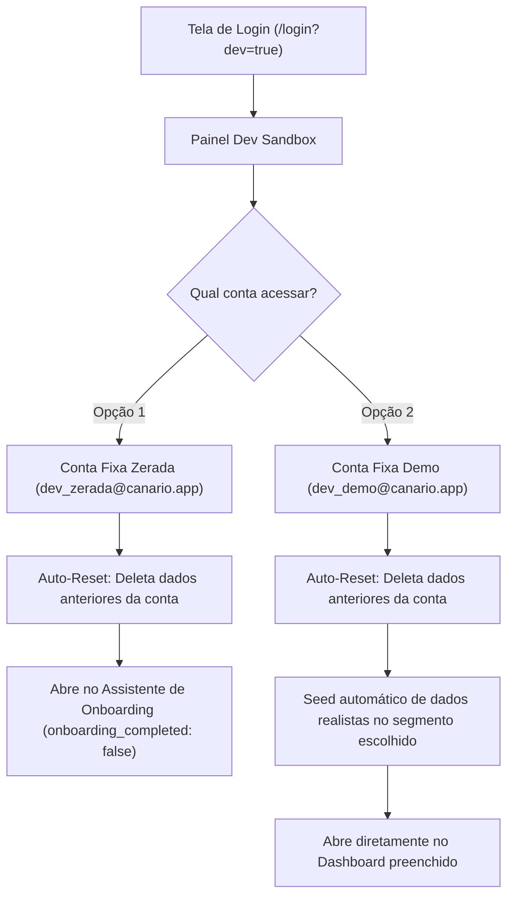

# Especificação de Requisitos: Conta Simulada de Testes (Dev Sandbox)

Este documento especifica a criação de um ambiente de simulação e gerenciamento de contas de teste no **Canário**, restrito ao ambiente de desenvolvimento local (`localhost`), permitindo testar fluxos em contas zeradas ou pré-populadas com 1 clique, com estratégia de **Contas Fixas com Auto-Reset**.

---

## 1. Regras de Negócio e Acesso

1. **Restrição Estrita de Ambiente:**
   - Funcionalidade ativa **exclusivamente** em ambiente local (`process.env.NODE_ENV === 'development'`).
   - Em produção (`NODE_ENV === 'production'`), todo o código do sandbox, botões e Server Actions retornam erro/bloqueio imediato e não são expostos.

2. **Acesso Secreto / Discreto:**
   - Acessível na tela de login por URL parametrizada: `http://localhost:3000/login?dev=true`
   - Em `localhost`, exibe um rodapé discreto: `🧪 Modo Desenvolvedor (Sandbox)` que abre o painel modal de simulação.

3. **Estratégia de Contas Fixas com Auto-Reset (Zero Poluição de Banco):**
   - Para não acumular dezenas de usuários temporários no Supabase Auth nem no banco de dados, o sandbox utiliza **duas contas fixas dedicadas**:
     - Conta Zerada: `dev_zerada@canario.app`
     - Conta Demo: `dev_demo@canario.app`
   - Toda vez que o botão é acionado, a Server Action:
     1. Autentica ou cria a conta fixa no Supabase Auth caso ainda não exista.
     2. Executa um **auto-reset completo** apagando todos os registros anteriores criados naquela conta (transações, vendas, clientes, contas, etc.).
     3. Prepara o estado limpo ou popula uma massa de dados fresca.
     4. Conecta o navegador na sessão correspondente.
   - O desenvolvedor desloga a qualquer momento pelo botão usual "Sair da conta" no app.

---

## 2. Modos de Simulação Disponíveis



### Opção A: Conta Fixa Zerada (`dev_zerada@canario.app`)
- **Objetivo:** Testar a experiência exata de um novo usuário do Canário (onboarding, primeiro acesso, primeiras configurações).
- **Comportamento no Auto-Reset:**
  - Limpa dados anteriores criados na conta de testes zerada.
  - Recria a `Conta Principal` zerada e as categorias pessoais essenciais.
  - `onboarding_completed` é definido como `false`.
  - Redireciona para `/dashboard`, abrindo automaticamente o modal/assistente de Onboarding.

### Opção B: Conta Fixa Demo (`dev_demo@canario.app`)
- **Objetivo:** Testar relatórios, gráficos, CRM e fluxos avançados sem precisar cadastrar tudo manualmente.
- **Comportamento no Auto-Reset:**
  - Limpa todos os dados anteriores da conta demo.
  - Popula uma massa de dados rica e atualizada referente à data atual:
    - **Perfil do Negócio:** Segmento selecionado no modal (Barbearia, Estética, Serviços, etc.), nome fantasia "Studio & Negócio Demo", ciclo de 21 dias e onboarding concluído.
    - **Contas Bancárias:** 
      - Nubank PJ (R$ 3.250,00 com rendimento CDI ativo)
      - Itaú Pessoal (R$ 6.100,00)
      - Dinheiro em Caixa (R$ 450,00)
    - **Cartão de Crédito:** 
      - Nubank Ultravioleta (Limite R$ 10.000,00, compras à vista e parceladas)
    - **Categorias:** Separadas em escopo pessoal e negócio.
    - **Catálogo de Serviços & Produtos:** Serviços e produtos com preços e ícones.
    - **Clientes & CRM Preditivo:**
      - 5 clientes simulando os principais status:
        - 🟢 *Cliente Na Janela* (pronto para convite no WhatsApp)
        - 🟡 *Cliente Em Dia* (atendimento recente)
        - 🟠 *Cliente Atrasado* (passou da janela)
        - 🔴 *Cliente Sumido* (inativo para resgate promocional)
    - **Venda a Prazo (Fiado):** Cliente com saldo devedor em aberto para testar amortização e recibo.
    - **Assinatura Recorrente:** Cliente mensalista ativo.
    - **Movimentações Financeiras:** Receitas e despesas pagas e pendentes para preencher DRE, gráficos e indicadores.

---

## 3. Arquitetura Técnica & Banco de Dados

### 1. Migração SQL (`20261024040000_dev_sandbox_auth.sql`)
Função com `SECURITY DEFINER` para confirmar o e-mail do usuário de teste no Supabase Auth imediatamente:

```sql
CREATE OR REPLACE FUNCTION public.confirm_dev_user(p_email text)
RETURNS boolean
LANGUAGE plpgsql
SECURITY DEFINER
AS $$
BEGIN
  UPDATE auth.users
  SET email_confirmed_at = COALESCE(email_confirmed_at, now())
  WHERE email = p_email;
  RETURN true;
END;
$$;

GRANT EXECUTE ON FUNCTION public.confirm_dev_user(text) TO anon, authenticated;
```

### 2. Server Action (`src/lib/actions/dev-sandbox.ts`)
- `ensureDevUser(supabase, email)`: Verifica se o usuário de teste já existe. Se não existir, executa `signUp` + `confirm_dev_user`. Autentica e inicia a sessão no Next.js.
- `clearUserData(supabase, userId)`: Exclui registros anteriores de forma transacional e respeitando restrições de integridade referencial.
- `resetCleanAccount(supabase, userId, segment)`: Restaura estado em branco com `onboarding_completed: false`.
- `seedDemoData(supabase, userId, segment)`: Insere massa realista atualizada.

---

## 4. Arquivos e Componentes

1. `supabase/migrations/20261024040000_dev_sandbox_auth.sql` (RPC de confirmação de e-mail de desenvolvimento)
2. `src/lib/actions/dev-sandbox.ts` (Lógica de autenticação fixa, auto-reset e seed)
3. `src/components/auth/DevSandboxModal.tsx` (Interface do modal de desenvolvimento)
4. `src/app/login/page.tsx` (Integração discreta na tela de login)
5. `src/lib/actions/dev-sandbox.test.ts` (Testes unitários de isolamento e bloqueio em produção)
