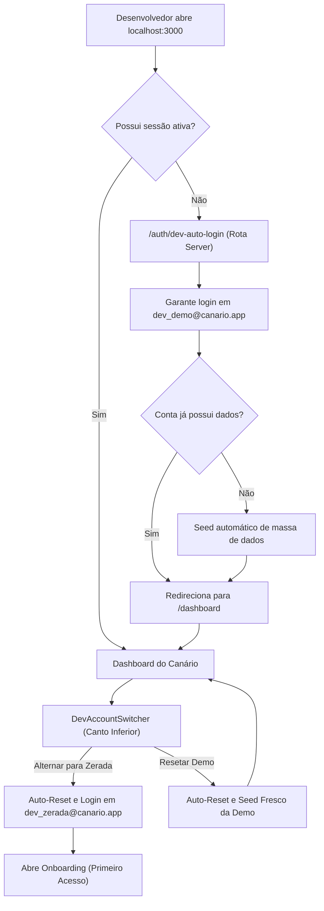

# Especificação de Requisitos: Conta Simulada de Testes (Dev Sandbox)

Este documento especifica a criação de um ambiente de simulação e gerenciamento de contas de teste no **Canário**, restrito ao ambiente de desenvolvimento local (`localhost`), permitindo testar fluxos em contas zeradas ou pré-populadas com 1 clique, com estratégia de **Contas Fixas com Auto-Reset** e **Acesso Direto Sem Exigência de Login**.

---

## 1. Regras de Negócio e Acesso

1. **Restrição Estrita de Ambiente:**
   - Funcionalidade ativa **exclusivamente** em ambiente local (`process.env.NODE_ENV === 'development'`).
   - Em produção (`NODE_ENV === 'production'`), todo o código do sandbox, botões, switcher flutuante e rotas de auto-login retornam erro/bloqueio 403 e são eliminados no bundle via Dead Code Elimination.

2. **Acesso Direto Sem Login em Desenvolvimento Local:**
   - **Auto-Login Automático ao Iniciar:** Ao abrir `localhost:3000` (ou qualquer rota protegida) sem sessão ativa, o middleware redireciona transparentemente para `/auth/dev-auto-login`, autenticando diretamente na **Conta Demo** e abrindo o Dashboard sem qualquer exigência de digitar credenciais ou passar pelo Google OAuth.
   - **Botões Diretos na Tela de Login:** Caso o usuário acesse `/login?manual=true` (ex: após clicar em "Sair da conta"), a página exibe no topo botões diretos de 1 clique:
     - `⭐ Entrar como Conta Demo` (com dados realistas)
     - `✨ Entrar como Conta Zerada` (para testar Onboarding)
     - `Entrar com Google` (fluxo tradicional)
   - **Switcher Flutuante em Todo o App (`DevAccountSwitcher`):** Fixo no canto inferior em ambiente de desenvolvimento, permitindo com 1 clique:
     - Alternar entre Conta Demo e Conta Zerada
     - Resetar os dados da Conta Demo
     - Ir para a tela de login manual

3. **Estratégia de Contas Fixas com Auto-Reset (Zero Poluição de Banco):**
   - Utiliza **duas contas fixas dedicadas**:
     - Conta Zerada: `dev_zerada@canario.app`
     - Conta Demo: `dev_demo@canario.app`
   - O banco de dados nunca acumula usuários temporários.

---

## 2. Fluxo de Navegação e Arquitetura

---

## 3. Modos de Simulação Disponíveis

### Opção A: Conta Fixa Zerada (`dev_zerada@canario.app`)
- **Objetivo:** Testar a experiência exata de um novo usuário do Canário (onboarding, primeiro acesso, primeiras configurações).
- **Comportamento:**
  - Limpa dados anteriores criados na conta de testes zerada.
  - Recria a `Conta Principal` zerada e as categorias pessoais essenciais.
  - `onboarding_completed` é definido como `false`.
  - Redireciona para `/dashboard`, abrindo automaticamente o modal/assistente de Onboarding.

### Opção B: Conta Fixa Demo (`dev_demo@canario.app`)
- **Objetivo:** Testar relatórios, gráficos, CRM e fluxos avançados sem precisar cadastrar tudo manualmente.
- **Comportamento:**
  - Ao entrar via auto-login, preserva os dados existentes sem apagar caso já esteja configurada.
  - Ao acionar o botão de reset, limpa todos os dados anteriores e popula uma massa rica e atualizada referente à data atual:
    - **Perfil do Negócio:** Barbearia ou segmento selecionado, nome "Studio & Negócio Demo", ciclo de 21 dias e onboarding concluído.
    - **Contas Bancárias:** Nubank PJ (R$ 3.250,00 com CDI), Itaú Pessoal (R$ 6.100,00), Dinheiro em Caixa (R$ 450,00).
    - **Cartão de Crédito:** Nubank Ultravioleta (Limite R$ 10.000,00).
    - **Categorias & Serviços:** Pessoal e Negócio; serviços de corte, barba e produtos.
    - **Clientes & CRM Preditivo:** 5 clientes em diferentes estágios (Na Janela, Em Dia, Atrasado, Sumido).
    - **Venda a Prazo (Fiado):** Cliente com saldo devedor em aberto para testar cobrança e amortização.
    - **Assinatura Recorrente:** Cliente mensalista ativo.
    - **Movimentações Financeiras:** Receitas e despesas pagas e pendentes.

---

## 4. Arquivos e Componentes

1. `supabase/migrations/20261024040000_dev_sandbox_auth.sql` (RPC de confirmação de e-mail de desenvolvimento)
2. `src/lib/dev-sandbox-constants.ts` (Constantes de credenciais fixas de sandbox)
3. `src/lib/actions/dev-sandbox.ts` (`createSandboxAccount`, `loginOrCreateSandboxUser`)
4. `src/app/auth/dev-auto-login/route.ts` (Route handler de auto-login para localhost)
5. `src/middleware.ts` (Interceptação inteligente em dev: direciona sessões anônimas para auto-login)
6. `src/components/auth/DevAccountSwitcher.tsx` (Menu flutuante global em dev para troca instantânea de contas)
7. `src/components/auth/DevSandboxModal.tsx` (Modal de opções avançadas e seleção de segmentos)
8. `src/app/login/page.tsx` (Tela de login com botões diretos de 1 clique em desenvolvimento)
9. `src/lib/actions/dev-sandbox.test.ts` (Testes unitários de isolamento e bloqueio em produção)
