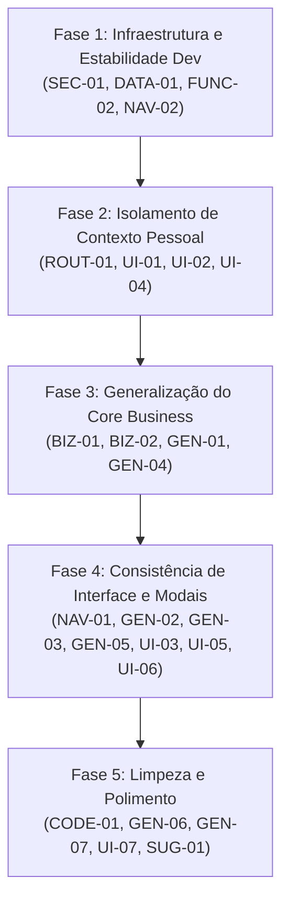

# AUDITORIA PÓS-REFATORAÇÃO — SISTEMA CANÁRIO PRO
**Status:** Concluído (Modo Somente Leitura)  
**Data:** 24 de Outubro de 2026  
**Ambiente:** Next.js 16.4.2 (Turbopack) • Supabase PostgreSQL (RLS) • TypeScript 5 • Tailwind CSS 4  

---

## 1. Resumo Executivo

O sistema Canário PRO passou por uma refatoração arquitetural estratégica para evoluir de um aplicativo de nicho (finanças pessoais + barbearias) para uma plataforma SaaS completa voltada a profissionais autônomos e microempreendedores de múltiplos segmentos (barbearias, clínicas/estética, consultorias, serviços gerais, aulas/treinamento e comércio), além de suportar usuários com perfil puramente de finanças pessoais (`has_business = false`).

A presente auditoria foi executada em **estrito modo somente de leitura**, sem qualquer modificação em código-fonte, banco de dados ou arquivos de configuração.

### Métricas de Integridade Técnica do Código:
- **TypeScript (`npx tsc --noEmit`):** ✅ 0 erros (Tipagem estrita validada).
- **ESLint (`npm run lint`):** ✅ 0 erros e 0 warnings.
- **Testes Automatizados (`npm test` / Vitest):** ✅ 18 suítes, 114 testes unitários e de integração passando (100% de sucesso).
- **Compilação de Produção (`npm run build` Turbopack):** ✅ 19 rotas compiladas com sucesso.
- **Políticas RLS:** ✅ 17 tabelas públicas com `ENABLE ROW LEVEL SECURITY` e `FORCE ROW LEVEL SECURITY`.

Apesar da alta higienização técnica e estabilidade de compilação, foram identificadas **inconsistências funcionais, vazamentos de contexto e artefatos de generalização incompleta** que comprometem a experiência de usuários de outros segmentos e de usuários puramente pessoais.

---

## 2. Matriz Consolidada de Problemas

| Prioridade | Interface / Visual | Generalização & Nomenclatura | Funcional & Rotas | Dados & Schemas | Segurança & Dev Sandbox | Total |
| :--- | :---: | :---: | :---: | :---: | :---: | :---: |
| **P0 — Crítico** | 0 | 0 | 0 | 0 | 0 | **0** |
| **P1 — Alto** | 1 | 2 | 2 | 1 | 1 | **7** |
| **P2 — Médio** | 3 | 4 | 3 | 1 | 1 | **12** |
| **P3 — Baixo** | 2 | 3 | 1 | 0 | 0 | **6** |
| **P4 — Sugestão** | 1 | 1 | 1 | 1 | 0 | **4** |
| **Total** | **7** | **10** | **7** | **3** | **2** | **29** |

---

## 3. Relatório Detalhado de Ocorrências (Por Prioridade e Área)

---

### PRIORIDADE P1 — ALTO (Impacto Funcional Relevante ou Falha Operacional)

#### `[SEC-01]` Provisionamento de Sandbox via SQL corrompe Auth GoTrue
- **Prioridade:** P1 — Alto
- **Categoria:** Segurança & Dev Sandbox
- **Funcionalidade Afetada:** Auto-login local e provisionamento da Conta Demo (`/auth/dev-auto-login`)
- **Descrição Objetiva:** A migração SQL `20261024050000_dev_sandbox_direct_provisioning.sql` tenta criar usuários diretamente na tabela `auth.users` usando PL/pgSQL com `extensions.crypt` e `gen_salt`. A inserção manual sem todos os gatilhos e metadados internos do GoTrue gera `ERROR: 42883: function gen_salt does not exist` ou `Database error querying schema`, travando o login de desenvolvimento.
- **Evidência Observada:**
  - `supabase/migrations/20261024050000_dev_sandbox_direct_provisioning.sql` (Linhas 9-112).
  - Log de erro do servidor: `Database error querying schema at ensureDevUser (src/lib/actions/dev-sandbox.ts:221:9)`.
- **Como Reproduzir:** Executar a migração no Supabase e tentar acessar `/auth/dev-auto-login`.
- **Impacto:** Bloqueia a entrada na Conta Demo e força o desenvolvedor a cair na tela de login com erro.
- **Correção Sugerida:** Descontinuar a função SQL `provision_dev_user` e utilizar exclusivamente o provisionamento via `adminClient.auth.admin.createUser` suportado pelo SDK oficial com a chave `SUPABASE_SERVICE_ROLE_KEY`.
- **Grau de Confiança:** Comprovado (100%).

---

#### `[DATA-01]` Falha silenciosa no Seed de Transações da Conta Demo
- **Prioridade:** P1 — Alto
- **Categoria:** Dados & Schemas
- **Funcionalidade Afetada:** Conta Demo do Sandbox (`src/lib/actions/dev-sandbox.ts`)
- **Descrição Objetiva:** O seed da Conta Demo tenta inserir registros na tabela `transactions` enviando a propriedade `date: today`. Porém, a tabela `transactions` possui as colunas `transaction_date` e `due_date`, não possui a coluna `date`, e exige obrigatoriamente a coluna `payment_method` (`NOT NULL CHECK`). Como a chamada `supabase.from('transactions').insert(...)` não valida o retorno de erro, a inserção falha silenciosamente.
- **Evidência Observada:**
  - `src/lib/actions/dev-sandbox.ts` (Linhas 569-633):
    ```ts
    interface SandboxTransactionInsert {
      date: string; // Coluna inexistente no schema
      // Falta payment_method NOT NULL
    }
    ```
  - `supabase/migrations/20261018000000_initial_schema.sql` (Linhas 82-84):
    `payment_method TEXT NOT NULL`, `transaction_date DATE NOT NULL`, `due_date DATE NOT NULL`.
- **Como Reproduzir:** Resetar a Conta Demo no Sandbox e verificar a tabela `transactions` ou o Extrato Financeiro (aparece vazio).
- **Impacto:** A Conta Demo nasce sem transações bancárias e sem histórico de despesas/receitas preenchido.
- **Correção Sugerida:** Corrigir os campos do objeto em `dev-sandbox.ts` para `transaction_date: today`, `due_date: today`, `payment_method: 'pix'` e `scope: 'business' | 'personal'`.
- **Grau de Confiança:** Comprovado (100%).

---

#### `[BIZ-01]` Categoria "Barbearia" imposta obrigatoriamente para todos os segmentos
- **Prioridade:** P1 — Alto
- **Categoria:** Generalização & Nomenclatura
- **Funcionalidade Afetada:** Módulo de Vendas (`/vendas`) e Assinaturas (`/mensalidades`)
- **Descrição Objetiva:** Toda vez que um atendimento ou venda é registrado (independente se o negócio é uma clínica médica, oficina mecânica, consultoria ou personal trainer), o backend invoca `getOrCreateBarbeariaCategory`, que cria e vincula a categoria fixa com nome `'Barbearia'` e ícone `'scissors'`.
- **Evidência Observada:**
  - `src/lib/actions/sales.ts` (Linhas 220, 458, 573): `await getOrCreateBarbeariaCategory(user.id);`.
  - `src/lib/actions/subscriptions.ts` (Linha 380): `await getOrCreateBarbeariaCategory(user.id);`.
  - `src/lib/actions/categories.ts` (Linhas 237-286): função busca estritamente por `'Barbearia'`.
- **Como Reproduzir:** Cadastrar um negócio no segmento "Serviços Gerais & Manutenção", registrar uma O.S. de R$ 500,00 e abrir o Extrato de Transações. A receita aparecerá categorizada como "Barbearia" com tesoura.
- **Impacto:** Quebra conceitual grave da generalização multi-segmento na contabilidade do usuário.
- **Correção Sugerida:** Tornar a função genérica `getOrCreateBusinessIncomeCategory(userId, segment, businessName)` respeitando os presets de `SEGMENTS_CONFIG[segment].suggestedCategories[0]`.
- **Grau de Confiança:** Comprovado (100%).

---

#### `[BIZ-02]` Templates padrão de WhatsApp forçam textos de barbearia para todos os negócios
- **Prioridade:** P1 — Alto
- **Categoria:** Generalização & Nomenclatura
- **Funcionalidade Afetada:** Cobrança de Fiados, Retorno de Clientes, Aniversários e Recibos via WhatsApp
- **Descrição Objetiva:** Quando o usuário não personalizou mensagens nas configurações, o backend e os modais utilizam `DEFAULT_TEMPLATES` que contêm expressões e emojis exclusivos de barbearia ("Fala irmão", "aqui na barbearia 💈✂️", "último corte", "tomar uma gelada", "clube da barbearia"). Embora `DEFAULT_NEUTRAL_TEMPLATES` tenha sido criado, o sistema continua importando `DEFAULT_TEMPLATES` como fallback padrão.
- **Evidência Observada:**
  - `src/lib/actions/message-settings.ts` (Linhas 19-25, 47-57, 88-98).
  - `src/components/fiados/WhatsAppChargeModal.tsx` (Linhas 60-63, 84-88).
  - `src/components/clients/ClientEngagementWhatsAppModal.tsx` (Linhas 65-67).
  - `src/components/subscriptions/SubscriptionChargeWhatsAppModal.tsx` (Linha 55).
- **Como Reproduzir:** Criar conta com segmento "Saúde & Consultórios", registrar um cliente e clicar em "Cobrar no WhatsApp" ou "Parabenizar". A mensagem gerada terá ícones de tesoura e texto de barbearia.
- **Impacto:** Constrangimento profissional e inviabilidade de uso dos recursos de CRM para não-barbeiros.
- **Correção Sugerida:** Em `message-settings.ts` e modais, utilizar `resolveSegmentTemplates(segment)` ou fazer fallback para `DEFAULT_NEUTRAL_TEMPLATES` caso o segmento não seja barbearia.
- **Grau de Confiança:** Comprovado (100%).

---

#### `[ROUT-01]` Ausência de Proteção nas Rotas de Negócio para Contas Pessoais
- **Prioridade:** P1 — Alto
- **Categoria:** Funcional & Rotas
- **Funcionalidade Afetada:** Rotas `/vendas`, `/fiados`, `/clientes`, `/mensalidades`, `/produtos`
- **Descrição Objetiva:** Um usuário que selecionou no Onboarding "Apenas Finanças Pessoais" (`has_business = false`) não possui menus na Sidebar para essas rotas, mas se digitar a URL diretamente na barra do navegador (ex.: `localhost:3000/vendas`), a página carrega normalmente com todas as tabelas vazias e cabeçalhos de negócio ativos, sem redirecionamento.
- **Evidência Observada:**
  - `src/app/(app)/vendas/page.tsx` (Linhas 18-35): checa apenas `if (!user) redirect('/login')`. Não valida `has_business`.
  - `src/app/(app)/fiados/page.tsx`, `/clientes/page.tsx`, `/mensalidades/page.tsx`, `/produtos/page.tsx` com o mesmo comportamento.
- **Como Reproduzir:** Logar com conta pessoal e acessar `/vendas` ou `/fiados`.
- **Impacto:** Inconsistência de fluxo, expondo funcionalidades desativadas para o perfil pessoal.
- **Correção Sugerida:** Criar helper `ensureBusinessProfile()` nas páginas de negócio ou no proxy: se `!hasBusiness`, redirecionar para `/dashboard`.
- **Grau de Confiança:** Comprovado (100%).

---

#### `[NAV-01]` Mapeamento de abas incorreto na barra inferior mobile (`BottomNav.tsx`)
- **Prioridade:** P1 — Alto
- **Categoria:** Funcional & Rotas / Interface
- **Funcionalidade Afetada:** Navegação Mobile (`src/components/layout/BottomNav.tsx`)
- **Descrição Objetiva:** A lista `MORE_ROUTES` em `BottomNav.tsx` contém apenas rotas financeiras (`/clientes`, `/produtos`, `/contas`, `/cartoes`, `/recorrencias`, `/categorias`). As rotas principais de negócio (`/vendas`, `/fiados`, `/mensalidades`) foram omitidas da constante. Ao navegar para qualquer uma delas no smartphone, o `effectiveTab` recai no fallback `'home'`, iluminando a aba **"Início"** como ativa em vez da aba **"Mais"**.
- **Evidência Observada:**
  - `src/components/layout/BottomNav.tsx` (Linhas 14-21 e 43-49):
    ```ts
    const MORE_ROUTES = ['/clientes', '/produtos', '/contas', '/cartoes', '/recorrencias', '/categorias'];
    ```
- **Como Reproduzir:** Acessar a aplicação em resolução mobile, abrir o menu "Mais" e clicar em "Vendas & Atendimentos" ou "Fiados". A aba "Início" no rodapé ficará verde/ativa.
- **Impacto:** Desorientação espacial do usuário durante a navegação mobile.
- **Correção Sugerida:** Adicionar `'/vendas'`, `'/fiados'`, `'/mensalidades'` ao array `MORE_ROUTES`.
- **Grau de Confiança:** Comprovado (100%).

---

#### `[UI-01]` Vazamento do Card "Inteligência da Barbearia" no Resumo Mobile Pessoal
- **Prioridade:** P1 — Alto
- **Categoria:** Interface / Visual
- **Funcionalidade Afetada:** Aba "Resumo" Mobile (`src/components/dashboard/mobile/MobileSummaryView.tsx`)
- **Descrição Objetiva:** Na aba Resumo do aplicativo mobile, o bloco "4. INTELIGÊNCIA OPERACIONAL DA BARBEARIA" (contendo divisão de serviços vs produtos, ticket médio e dias mais fortes) é renderizado de forma incondicional, mesmo quando o usuário escolheu `has_business: false`.
- **Evidência Observada:**
  - `src/components/dashboard/mobile/MobileSummaryView.tsx` (Linhas 640-730): renderiza o card sem condicional `{hasBusiness && ...}`.
- **Como Reproduzir:** Acessar com a Conta Zerada (modo pessoal), clicar na aba inferior "Resumo" e rolar a página. O card "Inteligência da Barbearia" é exibido com R$ 0,00 e ícones de tesoura.
- **Impacto:** Quebra visual crítica para usuários que contrataram o aplicativo apenas para gestão pessoal.
- **Correção Sugerida:** Envolver o bloco 4 em `{hasBusiness && (...)}` e generalizar o título para `Inteligência de ${businessName}` quando ativo.
- **Grau de Confiança:** Comprovado (100%).

---

### PRIORIDADE P2 — MÉDIO (Inconsistência Relevante ou Experiência Comprometida)

#### `[GEN-01]` Divergência de Nomes de Segmento na Sidebar e QuickActions
- **Prioridade:** P2 — Médio
- **Categoria:** Generalização & Nomenclatura
- **Funcionalidade Afetada:** Ícone da barra lateral (`AppSidebar.tsx`) e Ações Rápidas (`QuickActionDrawer.tsx`)
- **Descrição Objetiva:** `AppSidebar` e `QuickActionDrawer` utilizam uma função local `getSalesIcon(segment)` baseada em strings legadas (`'saude_estetica'`, `'consultoria_servicos'`, `'comercio_produtos'`, `'alimentacao'`) que não correspondem aos tipos reais de `BusinessSegment` definidos no banco (`'beleza_estetica'`, `'servicos_manutencao'`, `'saude_consultorio'`, `'aulas_treinamento'`, `'comercio_geral'`).
- **Evidência Observada:**
  - `src/components/layout/AppSidebar.tsx` (Linhas 40-55).
  - `src/components/layout/QuickActionDrawer.tsx` (Linhas 17-32).
  - `src/types/database.ts` (Linhas 240-248).
- **Como Reproduzir:** Selecionar o segmento "Beleza, Estética & Bem-Estar" (`beleza_estetica`). O ícone do menu cai no `default` (Briefcase) em vez de Sparkles.
- **Impacto:** Ícones incorretos e desconexos com o segmento do usuário.
- **Correção Sugerida:** Centralizar o mapeamento de ícones utilizando o enum tipado `BusinessSegment` e `SEGMENTS_CONFIG`.
- **Grau de Confiança:** Comprovado (100%).

---

#### `[GEN-02]` Seletor de Escopo com "Barbearia (Negócio)" fixo em Modais
- **Prioridade:** P2 — Médio
- **Categoria:** Generalização & Nomenclatura / Interface
- **Funcionalidade Afetada:** `TransactionModal.tsx`, `RecurrenceModal.tsx`, `CategoryModal.tsx`
- **Descrição Objetiva:** Nos formulários de Nova Transação, Nova Recorrência e Nova Categoria, o seletor de escopo exibe sempre os botões: "Pessoal" e "Barbearia (Negócio)" acompanhado do ícone `<Scissors />`. Além de ignorar o nome real do negócio, o seletor é exibido mesmo se `has_business === false`.
- **Evidência Observada:**
  - `src/components/transactions/TransactionModal.tsx` (Linhas 233-264).
  - `src/components/recurrences/RecurrenceModal.tsx` (Linhas 157-184).
  - `src/components/categories/CategoryModal.tsx` (Linhas 138-168).
- **Como Reproduzir:** Abrir o modal de Nova Transação com qualquer usuário. O botão de negócio diz "Barbearia (Negócio)".
- **Impacto:** Poluição visual para contas pessoais e inadequação semântica para profissionais de outras áreas.
- **Correção Sugerida:** Se `!hasBusiness`, ocultar o seletor e fixar `scope = 'personal'`. Se `hasBusiness`, exibir o nome configurado (`businessName`) com ícone contextual.
- **Grau de Confiança:** Comprovado (100%).

---

#### `[GEN-03]` Nomenclatura "Barbearia" em Gráficos e Cards do Dashboard Desktop
- **Prioridade:** P2 — Médio
- **Categoria:** Generalização & Nomenclatura / Interface
- **Funcionalidade Afetada:** Painel Desktop de Negócios (`BusinessDashboardDesktop.tsx`)
- **Descrição Objetiva:** Vários componentes do painel desktop mantêm textos estáticos referenciando barbearia:
  1. Série do gráfico: `'Gastos Barbearia'`.
  2. Título do gráfico: `'Faturamento, Gastos e Lucro da Barbearia'`.
  3. Card de meios de pagamento: `'Consumo da Barbearia por Cartão / Conta'`.
  4. Card de despesas: `'Últimos Gastos da Barbearia'`.
  5. KPI de atendimentos: exibe `'atendimentos'` fixo ao invés de usar `salesLabel` (que pode ser 'Consultas', 'Vendas', 'O.S.').
- **Evidência Observada:** `src/components/dashboard/desktop/BusinessDashboardDesktop.tsx` (Linhas 91, 162, 175, 374, 475, 545).
- **Como Reproduzir:** Acessar o Dashboard em modo negócio no desktop em tela ampla.
- **Impacto:** Compromete a identidade visual para empresas de outros segmentos.
- **Correção Sugerida:** Substituir as strings literais por variáveis dinâmicas: `Gastos de ${businessName}`, `salesLabel`, etc.
- **Grau de Confiança:** Comprovado (100%).

---

#### `[GEN-04]` Tag técnica `[Barbearia]` e helpers de escopo acoplados
- **Prioridade:** P2 — Médio
- **Categoria:** Generalização & Nomenclatura
- **Funcionalidade Afetada:** Detecção de escopo em transações (`src/lib/business-scope-utils.ts`)
- **Descrição Objetiva:** O módulo define `export const BUSINESS_TAG = '[Barbearia]'` e concatena essa tag nas notas de transações. Além disso, a função `isBarbeariaServiceIncome` procura por palavras-chave exclusivas de salão ("lâminas", "gola higiênica", "descartáveis").
- **Evidência Observada:** `src/lib/business-scope-utils.ts` (Linhas 3, 44-70, 92-111).
- **Como Reproduzir:** Inspecionar notas de transações sincronizadas de vendas de qualquer segmento.
- **Impacto:** Poluição técnica nos dados e fragilidade na inferência de escopo para outros ramos.
- **Correção Sugerida:** Utilizar a coluna nativa `scope = 'business'` existente no banco de dados e renomear o helper para `isBusinessServiceIncome`.
- **Grau de Confiança:** Comprovado (100%).

---

#### `[GEN-05]` Exportações de Relatórios (PDF, Excel, CSV) com rodapé fixo de Barbearia
- **Prioridade:** P2 — Médio
- **Categoria:** Generalização & Nomenclatura
- **Funcionalidade Afetada:** Exportação de Extrato (`src/lib/export-utils.ts`)
- **Descrição Objetiva:** O rodapé do relatório em PDF gerado traz: `"Relatório gerado pelo Financeiro App • Gestão da Barbearia"`. Nas planilhas Excel e CSV, a coluna de escopo exporta o texto `'Barbearia'` ao invés de `'Negócio'` ou do nome da empresa.
- **Evidência Observada:** `src/lib/export-utils.ts` (Linhas 118, 254 e 513).
- **Como Reproduzir:** Na tela de Transações, clicar em "Exportar Relatório" ➔ "Baixar PDF". O rodapé do documento exibe "Gestão da Barbearia".
- **Impacto:** Entrega de documentos formais com nomenclatura incorreta para contadores ou clientes.
- **Correção Sugerida:** Injetar `businessName` no gerador de exportação e exibir no rodapé `"Relatório gerado pelo Canário PRO • Gestão Financeira"`.
- **Grau de Confiança:** Comprovado (100%).

---

#### `[UI-02]` Vazamento de "Barbearia" no Card de Receitas do Dashboard Geral
- **Prioridade:** P2 — Médio
- **Categoria:** Interface / Visual
- **Funcionalidade Afetada:** Dashboard Geral Desktop (`GeneralDashboardDesktop.tsx`)
- **Descrição Objetiva:** No card de Receitas do Mês da visão geral, é renderizada incondicionalmente a linha `<Scissors /> Barbearia: R$ 0,00`, mesmo para usuários sem negócio (`has_business: false`).
- **Evidência Observada:** `src/components/dashboard/desktop/GeneralDashboardDesktop.tsx` (Linhas 266-275).
- **Como Reproduzir:** Acessar o dashboard de um usuário com perfil apenas pessoal. No card de receitas haverá a menção à barbearia com tesoura.
- **Impacto:** Vazamento de contexto comercial para usuários de finanças pessoais.
- **Correção Sugerida:** Renderizar a discriminação de negócio apenas se `hasBusiness === true` e com o nome configurado.
- **Grau de Confiança:** Comprovado (100%).

---

#### `[UI-03]` Filtro de Extrato Mobile exibe "✂️ Só Barbearia" indevidamente
- **Prioridade:** P2 — Médio
- **Categoria:** Interface / Visual
- **Funcionalidade Afetada:** Extrato Mobile (`MobileStatementView.tsx`)
- **Descrição Objetiva:** O botão de alternância de escopo cicla entre: `'✂️ Só Barbearia'`, `'👤 Só Pessoal'` e `'Escopo: Todos'`. Para contas pessoais, ciclar inclui a opção de barbearia. Para outros negócios, mantém o emoji e nome de barbearia.
- **Evidência Observada:** `src/components/dashboard/mobile/MobileStatementView.tsx` (Linhas 275-279).
- **Como Reproduzir:** Clicar no filtro de escopo na aba "Extrato" no celular.
- **Impacto:** Inconsistência visual em dispositivos móveis.
- **Correção Sugerida:** Se `!hasBusiness`, omitir o filtro. Se `hasBusiness`, exibir `💼 ${businessName}`.
- **Grau de Confiança:** Comprovado (100%).

---

#### `[UI-04]` Opções de CRM e Fiados visíveis nas Preferências de Usuário Pessoal
- **Prioridade:** P2 — Médio
- **Categoria:** Interface / Visual
- **Funcionalidade Afetada:** Modal de Preferências de Notificação (`NotificationPreferencesModal.tsx`)
- **Descrição Objetiva:** O modal exibe toggles de "Alertas de fiados vencidos", "Radar de Retorno de Corte (CRM)" com ícone de tesoura e "Aniversariantes do Dia" para contas que não possuem negócio ativado.
- **Evidência Observada:** `src/components/notifications/NotificationPreferencesModal.tsx` (Linhas 303-348).
- **Como Reproduzir:** Abrir o modal de preferências de notificação em uma conta pessoal.
- **Impacto:** Usuário pessoal é exposto a configurações irrelevantes para sua rotina.
- **Correção Sugerida:** Condicionar a exibição dos alertas de clientes e vendas ao booleano `hasBusiness`.
- **Grau de Confiança:** Comprovado (100%).

---

#### `[NAV-02]` Botão "Ir para Tela de Login" no DevAccountSwitcher causa loop de redirecionamento
- **Prioridade:** P2 — Médio
- **Categoria:** Funcional & Rotas
- **Funcionalidade Afetada:** Alternador Dev Sandbox (`src/components/auth/DevAccountSwitcher.tsx`)
- **Descrição Objetiva:** O botão "Ir para Tela de Login" faz um link direto `<a href="/login?manual=true">`. Como o usuário já possui um cookie de sessão ativo, o middleware (`src/middleware.ts` linha 118) intercepta a requisição e redireciona de volta para `/dashboard`.
- **Evidência Observada:**
  - `src/components/auth/DevAccountSwitcher.tsx` (Linhas 96-100).
  - `src/middleware.ts` (Linhas 118-120): `if (user && isAuthPage) return NextResponse.redirect('/dashboard')`.
- **Como Reproduzir:** Estando autenticado em ambiente local, clicar em "Dev Sandbox" ➔ "Ir para Tela de Login". A página recarrega no próprio dashboard.
- **Impacto:** Impede o desenvolvedor de deslogar rapidamente para testar fluxos a partir da tela de login.
- **Correção Sugerida:** Alterar o botão para invocar `supabase.auth.signOut()` antes de redirecionar para `/login?manual=true`.
- **Grau de Confiança:** Comprovado (100%).

---

#### `[FUNC-01]` Vendas de Teste inseridas sem Itens de Venda (`sale_items`)
- **Prioridade:** P2 — Médio
- **Categoria:** Funcional & Dados
- **Funcionalidade Afetada:** Módulo de Vendas e Fiados na Conta Demo
- **Descrição Objetiva:** No seed da Conta Demo, os registros de venda (ex.: `cliLucas`) são inseridos diretamente na tabela `sales`, porém nenhum registro correspondente é inserido na tabela `sale_items`.
- **Evidência Observada:** `src/lib/actions/dev-sandbox.ts` (Linhas 530-553).
- **Como Reproduzir:** Entrar na Conta Demo, acessar `/vendas` ou `/fiados` e abrir os detalhes da comanda do cliente Lucas. A lista de serviços/produtos aparece em branco.
- **Impacto:** Demonstração incompleta das capacidades do sistema de PDV/Vendas.
- **Correção Sugerida:** Inserir os registros filhos em `sale_items` com `sale_id`, `product_name`, `quantity` e `unit_price`.
- **Grau de Confiança:** Comprovado (100%).

---

#### `[FUNC-02]` Fallback da chave `SUPABASE_SERVICE_ROLE_KEY` aciona `signUp` e gera rate limit
- **Prioridade:** P2 — Médio
- **Categoria:** Funcional & Dev Sandbox
- **Funcionalidade Afetada:** Tela de Login em Desenvolvimento (`src/lib/actions/dev-sandbox.ts`)
- **Descrição Objetiva:** Na função `ensureDevUser`, quando o `adminClient.auth.admin.createUser` falha porque o usuário de teste já existe em `auth.users`, a execução cai para o passo 4 (`supabase.auth.signUp`). Se a confirmação de e-mail estiver ativa no Supabase, isso dispara e-mails até atingir o erro `email rate limit exceeded`.
- **Evidência Observada:**
  - `src/lib/actions/dev-sandbox.ts` (Linhas 136-180).
  - Imagem anexada pelo usuário demonstrando a mensagem na UI.
- **Como Reproduzir:** Clicar repetidamente em "Entrar como Conta Demo" com o provedor de e-mail do Supabase configurado com confirmação obrigatória.
- **Impacto:** Bloqueio temporário do auto-login em ambiente de desenvolvimento.
- **Correção Sugerida:** No `adminClient`, se o usuário já existir, executar `adminClient.auth.admin.updateUserById(userId, { password: DEV_PASSWORD, email_confirm: true })` em vez de chamar `signUp()`.
- **Grau de Confiança:** Comprovado (100%).

---

### PRIORIDADE P3 — BAIXO (Inconsistência Visual Menor ou Código Legado)

#### `[CODE-01]` Componente Legado Inutilizado (`Navbar.tsx`)
- **Prioridade:** P3 — Baixo
- **Categoria:** Generalização & Manutenibilidade
- **Funcionalidade Afetada:** Código morto em `src/components/layout/Navbar.tsx`
- **Descrição Objetiva:** O arquivo `Navbar.tsx` (135 linhas) representa a barra de navegação superior da versão 1.0. Ele não é importado nem referenciado por nenhum outro componente do repositório desde a introdução da `AppSidebar` e do `Header`.
- **Evidência Observada:** Busca global por `Navbar` aponta apenas para o próprio arquivo de declaração.
- **Como Reproduzir:** `grep -rn "Navbar" src/`
- **Impacto:** Código morto que aumenta o custo de manutenção sem valor para o produto.
- **Correção Sugerida:** Excluir o arquivo `src/components/layout/Navbar.tsx`.
- **Grau de Confiança:** Comprovado (100%).

---

#### `[UI-05]` Pílula de Filtro e Botão em Transações com Tesoura e "Barbearia"
- **Prioridade:** P3 — Baixo
- **Categoria:** Interface / Visual
- **Funcionalidade Afetada:** Lista de Transações Desktop (`TransactionsView.tsx`)
- **Descrição Objetiva:** Na listagem de transações, o botão superior diz `"+ Gasto Barbearia"` com ícone de tesoura, e o filtro horizontal possui a pílula `'✂️ Barbearia'`. Ambos aparecem inclusive quando o usuário tem outro segmento ou não tem negócio ativo.
- **Evidência Observada:** `src/components/transactions/TransactionsView.tsx` (Linhas 661-671 e 693).
- **Como Reproduzir:** Acessar `/transacoes` no desktop.
- **Impacto:** Inadequação estética.
- **Correção Sugerida:** Renderizar os botões condicionados a `hasBusiness` e com o nome dinâmico do negócio.
- **Grau de Confiança:** Comprovado (100%).

---

#### `[UI-06]` Emblema "Barbearia" em Transações do Cartão de Crédito
- **Prioridade:** P3 — Baixo
- **Categoria:** Interface / Visual
- **Funcionalidade Afetada:** Painel de Faturas de Cartão (`CreditCardInvoicesPanel.tsx`)
- **Descrição Objetiva:** O painel exibe o card `'Gasto Barbearia'` e tags `'Barbearia'` nos itens da fatura com ícone `<Scissors />`, independente do ramo da empresa.
- **Evidência Observada:** `src/components/cards/CreditCardInvoicesPanel.tsx` (Linhas 445 e 539).
- **Como Reproduzir:** Cadastrar compras no cartão com escopo comercial e visualizar a fatura.
- **Impacto:** Inconsistência de rotulagem.
- **Correção Sugerida:** Trocar por `Gasto ${businessName}` ou `'Gasto Comercial'`.
- **Grau de Confiança:** Comprovado (100%).

---

#### `[GEN-06]` Widget de Mensalidades intitulado "Clube da Barbearia"
- **Prioridade:** P3 — Baixo
- **Categoria:** Generalização & Nomenclatura
- **Funcionalidade Afetada:** Dashboard de Negócios (`ClubMetricsWidget.tsx`)
- **Descrição Objetiva:** O cabeçalho do card de assinaturas está fixo como `"Clube da Barbearia"`. Para outros negócios (ex: consultorias com retenção mensal, estúdios de pilates ou aulas particulares), o termo barbearia é incorreto.
- **Evidência Observada:** `src/components/dashboard/ClubMetricsWidget.tsx` (Linha 55).
- **Como Reproduzir:** Ativar planos de recorrência e visualizar o dashboard de negócios.
- **Impacto:** Terminologia rígida.
- **Correção Sugerida:** Exibir `"Clube de Assinaturas"` ou `"Mensalidades • ${businessName}"`.
- **Grau de Confiança:** Comprovado (100%).

---

#### `[GEN-07]` Modais de WhatsApp de Assinatura com Fallback "Clube da Barbearia"
- **Prioridade:** P3 — Baixo
- **Categoria:** Generalização & Nomenclatura
- **Funcionalidade Afetada:** Cobrança e Recibo de Mensalidade (`SubscriptionChargeWhatsAppModal.tsx` e `SubscriptionReceiptWhatsAppModal.tsx`)
- **Descrição Objetiva:** Quando a assinatura não possui nome de plano customizado, os modais atribuem como fallback a string `'Clube da Barbearia'`.
- **Evidência Observada:**
  - `SubscriptionChargeWhatsAppModal.tsx` (Linha 47).
  - `SubscriptionReceiptWhatsAppModal.tsx` (Linha 42).
- **Como Reproduzir:** Enviar mensagem de cobrança de uma assinatura sem plano nomeado em um negócio de outro segmento.
- **Impacto:** Mensagem gerada com o termo da versão antiga.
- **Correção Sugerida:** Utilizar como fallback `"Plano Mensal"` ou `"Assinatura"`.
- **Grau de Confiança:** Comprovado (100%).

---

#### `[UI-07]` Texto de Versão "Finanças & Barbearia • V2.0" na Aba Mais Mobile
- **Prioridade:** P3 — Baixo
- **Categoria:** Interface / Visual
- **Funcionalidade Afetada:** Aba "Mais" Mobile (`MobileMoreView.tsx`)
- **Descrição Objetiva:** No rodapé do menu mobile, o texto estático exibe `"Finanças & Barbearia • V2.0"`.
- **Evidência Observada:** `src/components/dashboard/mobile/MobileMoreView.tsx` (Linha 384).
- **Como Reproduzir:** Clicar na aba "Mais" no celular e rolar até o rodapé.
- **Impacto:** Inconsistência textual cosmética.
- **Correção Sugerida:** Atualizar para `"Canário PRO • Gestão Financeira"`.
- **Grau de Confiança:** Comprovado (100%).

---

### PRIORIDADE P4 — SUGESTÕES E OPORTUNIDADES DE MELHORIA

- **`[SUG-01]` Migração do padrão `middleware` para `proxy` (Next.js 16.4):** O build do Next.js emitiu o aviso oficial: `The "middleware" file convention is deprecated. Please use "proxy" instead.` Sugere-se migrar o arquivo `src/middleware.ts` para a convenção recomendada da versão 16.4.
- **`[SUG-02]` Unificação de Presets de Segmento:** Criar um hook único `useSegmentConfig()` que centralize ícones, labels e categorias para eliminar duplicidades entre Sidebar, QuickActions e Modais.
- **`[SUG-03]` Isolamento de Rota por Layout de Negócio:** Agrupar rotas de negócios (`/vendas`, `/fiados`, etc.) sob um layout compartilhado `(app)/(business)/layout.tsx` que centralize a verificação de `has_business`, evitando checagens repetidas em cada página.
- **`[SUG-04]` Carregamento Otimizado de Bibliotecas Pesadas:** Os pacotes `jspdf` e `xlsx` representam parcela significativa do bundle. Garantir que as funções de exportação permaneçam em importação dinâmica (`import(...)`) apenas quando o usuário clicar no botão de exportação.

---

## 4. Classificação das Ocorrências de Generalização

Conforme as 5 categorias do protocolo de auditoria:

| ID | Classificação da Auditoria | Justificativa |
| :--- | :--- | :--- |
| `[BIZ-01]` | **4. Defeito funcional** | Associa categoria errada ("Barbearia") a receitas de outros segmentos. |
| `[BIZ-02]` | **3. Inconsistência que afeta a experiência** | Envia mensagens de WhatsApp com gírias e ícones de barbearia para clientes de clínicas/serviços. |
| `[GEN-01]` | **3. Inconsistência que afeta a experiência** | Faz com que ícones da sidebar recaiam no default por divergência de enums. |
| `[GEN-02]` | **3. Inconsistência que afeta a experiência** | Exibe botão fixo "Barbearia (Negócio)" mesmo para quem não tem barbearia. |
| `[GEN-03]` | **3. Inconsistência que afeta a experiência** | Títulos e séries de gráficos com texto de barbearia no desktop. |
| `[GEN-04]` | **5. Dependência técnica que exige investigação** | Tag `[Barbearia]` em notas legadas e busca de palavras-chave restritas a insumos de barbearia. |
| `[GEN-05]` | **3. Inconsistência que afeta a experiência** | Gera PDFs oficiais com rodapé "Gestão da Barbearia". |
| `[GEN-06]` | **2. Artefato antigo sem impacto funcional aparente** | Título do card de planos exibe barbearia, mas lógica de MRR funciona normalmente. |
| `[GEN-07]` | **2. Artefato antigo sem impacto funcional aparente** | Fallback de nome de plano só ocorre se o usuário não preencher o plano. |
| `[CODE-01]` | **2. Artefato antigo sem impacto funcional aparente** | Arquivo `Navbar.tsx` não afeta a execução porque não é importado por ninguém. |

---

## 5. Ordem Recomendada de Correção

A implementação futura das correções deve seguir uma sequência técnica coordenada para mitigar riscos de regressão:



1. **Fase 1 — Infraestrutura Dev & Seed:** Corrigir os campos do seed de transações (`DATA-01`) e blindar o `adminClient` no auto-login (`FUNC-02` e `SEC-01`). Permite testes rápidos e limpos.
2. **Fase 2 — Blindagem do Modo Pessoal:** Proteger rotas de negócios para quem tem `has_business: false` (`ROUT-01`) e ocultar cards vazios de barbearia no mobile e desktop (`UI-01`, `UI-02`, `UI-04`).
3. **Fase 3 — Generalização do Backend & WhatsApp:** Trocar `getOrCreateBarbeariaCategory` por categoria contextual ao segmento (`BIZ-01`) e plugar `DEFAULT_NEUTRAL_TEMPLATES` (`BIZ-02`).
4. **Fase 4 — Interface, Modais e Navegação:** Corrigir `MORE_ROUTES` em `BottomNav.tsx` (`NAV-01`), sincronizar enums de segmento (`GEN-01`) e parametrizar títulos de modais e gráficos (`GEN-02`, `GEN-03`, `GEN-05`).
5. **Fase 5 — Limpeza Final:** Remover `Navbar.tsx` (`CODE-01`) e atualizar rodapés secundários.

---

## 6. Riscos de Correção em Conjunto e Plano de Validação

### Riscos Identificados:
- **Risco de Quebra em Usuários Legados:** Usuários existentes que de fato possuem barbearia e categorias chamadas `'Barbearia'` não podem ter seus lançamentos históricos desvinculados.
- **Risco em Relatórios Agrupados:** A função `isBusinessTransaction` não pode quebrar a soma de meses anteriores ao migrar de `[Barbearia]` para a coluna nativa `scope`.

### Plano de Validação Pós-Correções:
1. Executar a suíte completa de testes (`npm test`), garantindo que os 114 testes continuem verdes.
2. Adicionar testes unitários para os novos helpers genéricos de categorias e templates de WhatsApp.
3. Executar o fluxo end-to-end com duas contas distintas:
   - **Conta A (Apenas Pessoal):** Confirmar que nenhuma menção a negócios, barbearia ou vendas aparece no Extrato, Resumo, Notificações ou Modais.
   - **Conta B (Oficina / Saúde / Consultoria):** Registrar um atendimento e uma cobrança, confirmando que a categoria gerada é compatível e as mensagens de WhatsApp não contêm referências a barbearia.
4. Validar o build de produção (`npm run build`) sem erros de Turbopack.
