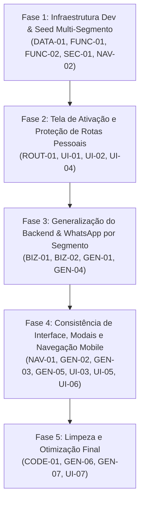

# ENGENHARIA DE REQUISITOS — PLANO DE CORREÇÕES PÓS-AUDITORIA
**Status:** Aprovado para Implementação  
**Data:** 24 de Outubro de 2026  
**Projeto:** Canário PRO (Gestão Financeira & Negócios Autônomos)  

---

## 1. Decisões de Negócio e Diretrizes Alinhadas

Com base na entrevista de alinhamento com o usuário, foram definidas as seguintes regras de negócio e comportamentos do sistema:

### 1.1. Proteção de Rotas Comerciais para Usuários Pessoais (`has_business: false`)
- **Comportamento Aprovado:** Em vez de redirect silencioso ou erro 404, as rotas `/vendas`, `/fiados`, `/mensalidades`, `/clientes` e `/produtos` exibirão uma **tela de ativação amigável e educativa**.
- **Elementos da Tela de Ativação:**
  - Ícone ilustrativo (`Briefcase` ou `Store`).
  - Título: *"Módulo de Negócio Desativado"*.
  - Mensagem: *"Você está utilizando o Canário PRO no modo Finanças Pessoais. Deseja gerenciar atendimentos, clientes, cobranças de fiados e catálogo de serviços?"*
  - Botão de Ação Primária: *"Ativar Gestão de Negócio"*, que abre instantaneamente o modal de configurações de negócio (`BusinessSettingsModal`) permitindo ao usuário escolher nome e segmento em 1 clique.
  - Botão Secundário: *"Voltar ao Dashboard Pessoal"* (`/dashboard`).

---

### 1.2. Categorização Financeira Inteligente por Segmento
- **Comportamento Aprovado:** Eliminar o acoplamento com a categoria fixa `'Barbearia'`.
- **Implementação:**
  - Criar `getOrCreateBusinessIncomeCategory(userId, segment, businessName)`.
  - Respeitar a primeira categoria de receita definida em `SEGMENTS_CONFIG[segment].suggestedCategories`:
    - **Barbearia:** `Atendimentos & Barbearia` (ícone `scissors`, cor `#10b981`).
    - **Beleza & Estética:** `Serviços de Beleza & Estética` (ícone `sparkles`, cor `#10b981`).
    - **Serviços & Manutenção:** `Mão de Obra & Serviços` (ícone `wrench`, cor `#10b981`).
    - **Saúde & Consultórios:** `Consultas & Procedimentos` (ícone `activity`, cor `#10b981`).
    - **Aulas & Treinamento:** `Aulas & Treinamentos` (ícone `graduation-cap`, cor `#10b981`).
    - **Comércio Geral & Outros:** `Vendas & Serviços` (ícone `shopping-bag`, cor `#10b981`).
  - Atualizar os pontos de criação de vendas (`sales.ts`) e mensalidades (`subscriptions.ts`) para utilizar essa resolução dinâmica.

---

### 1.3. Mensagens de WhatsApp Adaptadas ao Segmento
- **Comportamento Aprovado:** O sistema resolverá os templates padrão de acordo com o segmento da empresa:
  - **Barbearia:** Mantém o estilo descontraído (`DEFAULT_TEMPLATES` com expressões como "Fala irmão", "corte", emojis 💈✂️).
  - **Saúde & Consultórios / Aulas:** Tom profissional e cortês (ex: *"Olá {primeiro_nome}, tudo bem? Passando para lembrar do seu acerto de {valor} referente à sua consulta/sessão..."*).
  - **Serviços Gerais / Manutenção / Comércio / Beleza:** Tom direto, comercial e educado (`DEFAULT_NEUTRAL_TEMPLATES`).
- Se o usuário editar suas mensagens em `/fiados` (Configurar Mensagens), os textos personalizados continuam tendo prioridade absoluta sobre os padrões.

---

### 1.4. Dev Sandbox Multi-Segmento
- **Comportamento Aprovado:** No ambiente de desenvolvimento local, o Dev Sandbox permitirá popular dados de teste para **qualquer segmento selecionado**:
  - Modal do Sandbox e Switcher permitirão escolher:
    - **Demo Barbearia** (cortes, degradê, pomadas, clube vip).
    - **Demo Serviços / Oficina** (troca de óleo, mão de obra, peças).
    - **Demo Saúde / Consultório** (consultas, sessões, planos de tratamento).
    - **Demo Conta Zerada** (para testar Onboarding).
  - **Correção Técnica do Seed:** Garantir que transações usem `transaction_date`, `due_date`, `payment_method`, `scope`, e que vendas criem seus respectivos `sale_items`.
  - **Blindagem do Auth:** Priorizar `adminClient.auth.admin.createUser` e `updateUserById`, eliminando chamadas a `signUp()` e prevenindo `email rate limit exceeded`.

---

## 2. Ordem de Execução das Fases

---

## 3. Critérios de Aceitação por Fase

### Fase 1:
- [ ] O seed da Conta Demo popula a tabela `transactions` com sucesso (sem falhas silenciosas).
- [ ] Vendas na Conta Demo criam registros filhos na tabela `sale_items`.
- [ ] O auto-login via `adminClient` nunca aciona `signUp` para contas de teste existentes, eliminando 100% dos erros de rate limit de email.
- [ ] O botão "Ir para Tela de Login" no DevAccountSwitcher faz logout real antes de redirecionar.

### Fase 2:
- [ ] Rotas `/vendas`, `/fiados`, `/mensalidades`, `/clientes`, `/produtos` exibem a nova tela amigável de ativação quando `has_business = false`.
- [ ] Card "Inteligência da Barbearia" no Mobile e menção a barbearia no Desktop ficam ocultos para contas pessoais.
- [ ] Preferências de notificação ocultam opções comerciais para contas pessoais.

### Fase 3:
- [ ] Criação de venda gera categoria apropriada para o segmento (ex: "Mão de Obra" para oficinas).
- [ ] Templates de WhatsApp carregam textos compatíveis com o segmento da conta.
- [ ] Helper `isBusinessTransaction` opera com base em `scope = 'business'` ao invés da string `[Barbearia]`.

### Fase 4:
- [ ] `BottomNav` mantém a aba "Mais" ativa ao visitar `/vendas`, `/fiados` e `/mensalidades`.
- [ ] Modais de Transação, Recorrência e Categoria exibem o nome do negócio e ícone correto.
- [ ] Gráficos e cards do Desktop usam o nome dinâmico da empresa.
- [ ] Exportações em PDF geram rodapé profissional sem citar barbearia.

### Fase 5:
- [ ] Arquivo morto `Navbar.tsx` removido.
- [ ] 100% dos testes passando (`npm test`), 0 erros no lint e build limpo.
